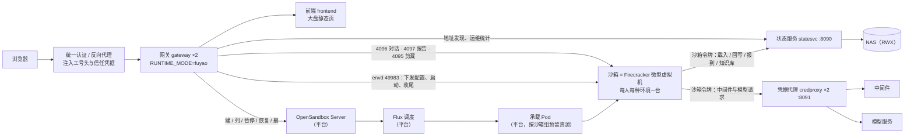

# Fuyao 沙箱部署手册：从零到上线（预览）

> 本文随本仓库标签 `agent-v1.5.2` 发布。文中提到的 `k8s/`、`docker/`、`scripts/`、`gateway/`、`e2b/` 等路径，指本仓库或离线交付包里的同名目录。

> **预览**：Fuyao 沙箱模式随 `agent-v1.5.0` 发布，属于**预览**功能。平台的三项安全前提（envd 认证、沙箱出网限制、OpenSandbox 认证）落实之前，**只用于测试环境**：只用测试账号、测试库与模拟中间件，不接生产数据库与真实的中间件令牌。按需、固定池化两种模式不受影响。

> **第一次安装、只想尽快搭一套测试环境**：先看简易版《[快速搭建-Fuyao沙箱](快速搭建-Fuyao沙箱.md)》，一条路径照抄命令即可；本篇是完整说明。
>
> 面向：负责实施的运维工程师，以及配合的平台管理员。
> 用法：**按章节顺序照做**。每一步写明在哪台机器上做、由谁做、命令、预期结果、失败时看哪里。
> 适用：网关运行模式 `RUNTIME_MODE=fuyao`（每位用户一台 openFuyao 沙箱，即 E2B 微型虚拟机）。
> 与《部署手册-从零到上线》相同的部分（取包、Secret 的生成、`agent-config`、统一认证）本篇给出命令并指明出处，
> 设计原理、生命周期与数据规则见《Fuyao沙箱手册》，参数的完整说明见《参数手册》。
>
> 文中的实测数据来自鲲鹏 920（ARM64、64K 页内核）+ openFuyao 实验环境，2026-11-17 至 11-18。

---

## 0. 这套东西是什么形态

### 0.1 一句话

用户登录后，网关调平台的 OpenSandbox 接口为他建一台**沙箱**（独立内核的微型虚拟机），诊断环境、知识库导入环境各一台；
用户的会话、工作区、报告存在沙箱本地盘，由集群里的**状态服务**每 60 秒回写 NAS；中间件令牌、模型密钥留在集群里的**凭据代理服务**，
不进沙箱。闲置后先回写再**暂停**（内存快照，回来约 3–4 秒恢复），暂停超过保留期删除，下次登录从 NAS 重建。

### 0.2 架构



### 0.3 组件清单

**K8s 侧（我方，命名空间默认 `gaussdb-agent`）**

| 组件 | 类型 | 镜像 | 端口 | 作用 |
|---|---|---|---|---|
| `gateway` | Deployment ×2 | `gaussdb-agent-gateway` | 8080（Service 80） | 认人、按工号找 / 建 / 恢复沙箱、反向代理、清扫器、运维接口、资源大盘数据 |
| `frontend` | Deployment ×1 | `gaussdb-agent-frontend` | 8080（Service 80） | 大盘静态页面（含资源大盘） |
| `statesvc` | Deployment ×1（Recreate） | `gaussdb-agent-runtime`（入口 `serve-statesvc`） | 8090 | 唯一读写 NAS 的一方：载入、回写、独占、知识库发布与拉取、沙箱地址记录、运维统计 |
| `credproxy` | Deployment ×2 | `gaussdb-agent-runtime`（入口 `serve-credproxy-net`） | 8091 | 按沙箱令牌认人，给中间件请求加本人令牌与签名、给模型请求加密钥 |
| `kbstd-install-<版本>` | Job（一次性） | `gaussdb-agent-kbstd` + `gaussdb-agent-kb-import` | — | 把官方文档集装进 NAS 的 `kb/docsets/` |
| `gaussdb-agent-sandbox-read` | ClusterRole + Binding | — | — | 资源大盘只读平台的 sandboxgroups / subsandboxgroups / sandboxes |

**平台侧（平台管理员负责，命名空间 `flux-system`、`e2b`）**

| 对象 | 由谁建 | 作用 |
|---|---|---|
| OpenSandbox Server、Flux、E2B 服务、模板构建服务 | 平台已部署 | 沙箱的建删调度与模板 |
| 诊断沙箱组、导入沙箱组（SandboxGroup） | 平台管理员按我方样例 apply | 容量与每台沙箱的资源预留 |
| 两个模板（诊断 `gsdb-runtime-<版本>`、导入 `gsdb-import-<版本>`） | 我方运维在模板构建主机上用脚本注册 | 沙箱的根文件系统与虚拟机规格 |

**沙箱里（启动器 `podctl fuyao-start` 以 systemd 起）**

| 单元 | 身份 | 端口 | 作用 |
|---|---|---|---|
| `gsdb-agent` | `agent`（uid 1000，无 sudo） | 4096 对话、4097 报告；导入环境另有 4095 剪藏 | opencode 与诊断技能 |
| `gsdb-credrelay` | root | 4099、`/run/credproxy/credproxy.sock` | 把技能的中间件 / 模型请求加上沙箱令牌转给凭据代理 |
| `gsdb-statesync` | root | — | 每 5 秒报到、30 秒续独占、60 秒增量回写、60 秒刷新或发布知识库 |
| envd | 平台自带 | 49983 | 网关经它下发配置、启动、收尾 |

### 0.4 与另外两种模式的区别

按需模式由网关为每人建 K8s Pod，固定池化在预建的 Pod 里按槽位分配，两者的用户进程都是容器、直接挂 NAS。
Fuyao 模式下用户进程跑在平台的微型虚拟机里，**我方不建、不管用户 Pod，也没有池子管家**；沙箱挂不了 NAS，数据经状态服务进出；
密钥不进沙箱，经凭据代理。镜像、技能、提示词三种模式相同，模式靠 `gateway-config` 的 `RUNTIME_MODE` 切换。
Fuyao 模式里出现的「承载 Pod」是**平台的**对象（每个承载 Pod 固定容纳若干台沙箱，平台据此记账与预热），与固定池化的池子无关。

---

## 1. 部署前检查清单

### 1.1 平台与安全前提（平台管理员确认）

| 项 | 怎么查（平台集群上） | 要求 / 实测参考 |
|---|---|---|
| OpenSandbox、Flux、E2B 已部署 | `helm list -A \| grep -Ei 'opensandbox\|flux\|e2b'`；`kubectl -n flux-system get pods`；`kubectl -n e2b get pods` | 实测版本：`opensandbox-server` chart `0.0.0-of-dev-v0.2.1`、`flux-sandbox` `26.9.0`、`e2b` chart `0.1.0` |
| 沙箱 CRD | `kubectl api-resources \| grep sandbox.flux.io` | 有 `sandboxes`（sb）、`sandboxgroups`（sg）、`subsandboxgroups`（ssg） |
| OpenSandbox 地址 | `kubectl -n flux-system get svc opensandbox-server` | 填 `FUYAO_API`，形如 `http://opensandbox-server.flux-system.svc:80` |
| E2B 团队 API Key | 模板构建主机上的 `/root/.e2b/config.json`（键 `teamApiKey`） | **只确认文件存在，不打印内容** |

**三项安全前提**——不落实时只能用于测试（只用测试账号、测试库、模拟中间件）：

| # | 前提 | 不落实的后果 |
|---|---|---|
| S1 | envd（49983）开启认证，或阻断沙箱之间、普通 Pod 到沙箱 envd 的访问 | 实测 envd 无认证：任何能连到沙箱地址的程序都能以 root 在里面执行命令，一台沙箱可以进到另一台 |
| S2 | 宿主机侧限制沙箱出网，只放行状态服务（8090）、凭据代理（8091）与平台自身需要的地址 | 实测出网不受限：模型生成的命令可以把数据发到任意地址；K8s 网络策略管不到虚拟机 |
| S3 | OpenSandbox 开启认证 | 集群里任何 Pod 都能建删沙箱、读到全部沙箱的 metadata（含工号）。开了之后 Key 放 Secret `fuyao-api`（§6），不用改代码 |

### 1.2 集群与节点（我方运维确认）

| 项 | 怎么查 | 要求 / 说明 |
|---|---|---|
| CPU 架构 | `kubectl get nodes -o wide`；节点上 `uname -m` | 选同架构的离线包与模板包（`arm64` / `amd64`） |
| 内存页大小 | 节点上 `getconf PAGESIZE` | `65536` 即 64K 页内核。1.5.0 起产品已适配（§7.3），只作记录 |
| 节点 CPU 数 | `kubectl get nodes -o jsonpath='{.items[*].status.capacity.cpu}'` | 用于资源测算（§1.4）。前端 nginx 的进程数 1.5.0 起固定为 2，与核数无关 |
| CNI 是否执行网络策略 | `kubectl -n kube-flannel get ds`（有即为 Flannel） | **Flannel 不执行 NetworkPolicy**（实测），清单里的策略对象只是摆设，隔离要靠平台在宿主机侧做 |
| Pod 网段 | `kubectl get nodes -o jsonpath='{range .items[*]}{.spec.podCIDR}{"\n"}{end}'` | 实测沙箱地址落在 Pod 网段里，§7.2 的 `SANDBOX_CIDR` 填这个 |
| 节点时钟同步 | 节点上 `timedatectl \| grep synchronized`；`chronyc tracking` | 必须为 `yes`。网关与状态服务之间的运维统计签名有 **120 秒**时间窗，组件分在时钟相差超过 120 秒的节点上时资源大盘统计读不到；中间件的时间戳签名同样受影响 |
| NAS | 见《部署手册-从零到上线》§2.1–2.2 | RWX；`users/`、`admins/`、`kb/` 三个目录与**导出根目录本身**属主都是 uid/gid 1000（状态服务要在根下建 `.ops/` 存运维统计） |
| 镜像仓库 | — | 推荐内网仓库；只靠节点本地导入的风险见《部署手册-从零到上线》§1.5 |
| 部署人员权限 | `kubectl auth can-i create clusterrole` | 本篇要建一个 ClusterRole 与 ClusterRoleBinding（§7.6）。没有集群级权限时，这两个对象交平台管理员 apply |

### 1.3 网络连通矩阵

| 源 | 目的 | 端口 | 用途 |
|---|---|---|---|
| 统一认证 / 反向代理 | 网关 Service | 80 | 用户的全部请求 |
| 网关 Pod | OpenSandbox Service（`flux-system`） | 80 | 建、列、暂停、恢复、删沙箱 |
| 网关 Pod | 沙箱地址（Pod 网段） | 49983、4096、4097、4095 | envd、对话、报告、剪藏 |
| 网关 Pod | 状态服务 | 8090 | 恢复后找沙箱的新地址；运维统计上报与读取 |
| 网关 Pod | K8s API Server | 443 / 6443 | 读写本命名空间的 Secret、ConfigMap；读平台的沙箱对象 |
| 沙箱 | 状态服务 **ClusterIP** | 8090 | 载入、回写、报到、知识库。沙箱解析不了集群域名，网关下发的是 ClusterIP |
| 沙箱 | 凭据代理 **ClusterIP** | 8091 | 中间件、模型请求 |
| 凭据代理 Pod | 中间件、模型服务、K8s API Server | 现场端口、443 / 80、443 / 6443 | 转发请求；按工号读 Secret `grmp-token-<工号>` |
| 模板构建脚本（构建主机） | E2B API Service（`e2b` 命名空间） | 3000 | 注册模板 |
| 模板构建服务 | 构建主机 `127.0.0.1:5050` | 5050 | 从脚本起的只读临时仓库拉模板镜像 |

### 1.4 资源测算

**容量规则（实测）**

- 同时运行的沙箱上限 = 承载 Pod 数 × 每个承载 Pod 的台数（`maxSandboxesPerPod`）。
- **暂停的沙箱不占名额**，宿主机上也没有它的进程（内存快照在磁盘上）。容量按**同时在用的人数**规划，不按注册人数。
- **平台只按 `agentPodMin` 起承载 Pod**，不会按需扩到 `agentPodMax`，所以最小值与最大值设成同一个数。
- 实际容量以子组 `SubSandboxGroup` 的状态为准（沙箱组 `SandboxGroup` 状态里的承载 Pod 数、容量跟着最大值走，不准）。

**K8s 预留公式**

```
每个承载 Pod 的预留 = 每 Pod 台数 × 每台预留（sandboxResources.requests） + 平台代理 100m / 128Mi
每个承载 Pod 的上限 = 每 Pod 台数 × 每台上限（sandboxResources.limits）   + 平台代理 100m / 128Mi
沙箱组的预留       = 承载 Pod 数 × 每个承载 Pod 的预留
```

每台的「上限」应等于模板的虚拟机规格；「预留」可以低于上限（CPU 超分，实测平台接受预留 0.5 核、上限 2 核）。
**内存不要超分**：预留等于上限，避免宿主机内存不足时虚拟机被杀。

**例：同时运行 64 台诊断沙箱**（虚拟机 2 vCPU / 4 GiB，每台预留 0.5 核 / 4Gi，每 Pod 8 台）

| 项 | 计算 | 结果 |
|---|---|---|
| 承载 Pod 数 | 64 ÷ 8 | 8 |
| 每个承载 Pod 预留 | 8 × 0.5 核 + 0.1 核；8 × 4Gi + 128Mi | 4.1 核 / 32.1 GiB |
| 诊断组预留 | 8 × 每 Pod | **32.8 核 / 257 GiB** |
| 诊断组上限 | 8 × (8 × 2 核 + 0.1 核) | 128.8 核（CPU 超分 4 倍） |
| 导入组（1 个承载 Pod × 4 台，每台 2 核 / 4Gi） | 4 × 2 + 0.1；4 × 4Gi + 128Mi | 8.1 核 / 16.1 GiB |
| 我方 K8s 组件预留 | 网关 2 × 100m/128Mi、前端 50m/64Mi、状态服务 500m/512Mi、凭据代理 2 × 200m/256Mi | 1.15 核 / 1.3 GiB |
| **合计** | | **约 42 核 / 275 GiB** |

**实际用量参考（实测）**：空闲的诊断沙箱虚拟机内已用约 600 MiB，宿主机上该虚拟机进程约 550 MiB、CPU 约 1.4%；
暂停的沙箱不占宿主机内存与 CPU。重任务（健康检查、WDR 解读）时的峰值尚未测量，上线前建议用 §11.2 的方法实测后再定规格。

**磁盘**：每台沙箱本地盘约 8.9 GB（可用约 7.7 GB，见 §4.3）；暂停沙箱的内存快照占宿主机磁盘，单台大小**尚未测量**，
按保留期（默认 7 天）内暂停的台数预留宿主机磁盘余量。

---

## 2. 准备材料

### 2.1 离线包内容

镜像有三种取法：用我方发布的离线包（本节）；能连外网时从 `ghcr.io/sqlrush` 直接拉，K8s 镜像与两个沙箱模板镜像都有，见 **§2.3**；或现场从源码自己制作，见 **§16**。
三种做法得到的镜像内容相同，后续步骤也相同。
离线包的全部文件（含沙箱模板 OCI 包、`release.yaml`、`MANIFEST.txt` 与各 `.sha256`）也挂在联合仓库对应版本的发布页上，可以直接下载，例如 v1.5.2：<https://github.com/sqlrush/gh_gs_k8s_agent/releases/tag/agent-v1.5.2>。下载到同一目录后 `shasum -a 256 -c *.sha256` 核对；`e2b/` 目录取联合仓库同一标签下的 `e2b/`（与离线包相同）。

我方用 `scripts/package-images.sh <TAG> --e2b` 打包（`--e2b` 不能与 `--without-kbstd` 同用）。包目录 `gaussdb-agent-v<版本>-oc1.18.27/` 下：

| 文件 | 内容 | 用在哪一步 |
|---|---|---|
| `<包名>-<架构>.tar.gz` | 五个 K8s 镜像：runtime、kb-import、gateway、frontend、kbstd | §3 |
| `<包名>-e2b-<架构>.oci.tar` | 两个模板镜像：`gaussdb-agent-runtime-e2b`、`gaussdb-agent-kb-import-e2b`（OCI 格式，已压成一层，不再 gzip） | §4 |
| `e2b/` | 模板注册脚本 `e2b/scripts/build-e2b-template.py`、临时仓库 `e2b/scripts/oci-serve.py`、`e2b/docker/Dockerfile.e2b` | §4 |
| `<包名>-k8s.tar.gz` | `k8s/` 清单与 `docs/` 交付文档 | §6–§7 |
| `gaussdb-agent-release-…-<架构>.tar.gz`、`release.yaml`、`release-console.sh` | 发版台（升级用） | §10 |
| `rootspec-overlay.sh` | 换根规范；包里有模板 OCI 包时一并重建模板 | 按需 |
| `*.sha256`、`MANIFEST.txt` | 校验和、实际镜像标签 | 全程 |

`<包名>`：标签以 `agent-` 开头时为 `gaussdb-<标签>`，例如标签 `agent-v1.5.2-oc1.18.27` 的包名是 `gaussdb-agent-v1.5.2-oc1.18.27`。

### 2.2 校验（跳板机上）

```bash
cd gaussdb-agent-v1.5.2-oc1.18.27
shasum -a 256 -c *.sha256          # Linux 也可 sha256sum -c *.sha256
cat MANIFEST.txt
```

**预期**：每个文件 `OK`。`MANIFEST.txt` 列出的就是导入后的实际镜像标签：在哪种架构的机器上打的包，那份没有后缀，另一份带 `-<架构>` 后缀。
**任何一个校验失败就停下**，重新传输。

### 2.3 不用离线包：从 GHCR 直接拉

能连外网的机器可以直接从 GHCR 拉，不用传离线包。镜像公开，**不用登录**。版本 `agent-v1.5.2` 的地址：

| 镜像 | 地址 | 架构 | 用在 |
|---|---|---|---|
| runtime | `ghcr.io/sqlrush/gaussdb-agent-runtime:agent-v1.5.2-oc1.18.27` | amd64、arm64 | 状态服务、凭据代理（§3） |
| kb-import | `ghcr.io/sqlrush/gaussdb-agent-kb-import:agent-v1.5.2-oc1.18.27` | amd64、arm64 | 标准知识库安装 Job（§3） |
| gateway | `ghcr.io/sqlrush/gaussdb-agent-gateway:agent-v1.5.2-oc1.18.27` | amd64、arm64 | 网关（§3） |
| frontend | `ghcr.io/sqlrush/gaussdb-agent-frontend:agent-v1.5.2-oc1.18.27` | amd64、arm64 | 前端（§3） |
| kbstd | `ghcr.io/sqlrush/gaussdb-agent-kbstd:agent-v1.5.2-oc1.18.27` | amd64、arm64 | 标准知识库安装 Job（§3） |
| runtime-e2b | `ghcr.io/sqlrush/gaussdb-agent-runtime-e2b:agent-v1.5.2-oc1.18.27` | 只有 arm64 | 诊断沙箱模板（§4） |
| kb-import-e2b | `ghcr.io/sqlrush/gaussdb-agent-kb-import-e2b:agent-v1.5.2-oc1.18.27` | 只有 arm64 | 导入沙箱模板（§4） |
| release（可选） | `ghcr.io/sqlrush/gaussdb-agent-release:agent-v1.5.2-oc1.18.27` | amd64、arm64 | 发版台，升级用（§10） |

前五个是多架构镜像，`docker pull` 会按本机架构自动取；也有带后缀的单架构标签（`…-oc1.18.27-arm64`、`…-oc1.18.27-amd64`），在 x86 跳板机上要拉 arm64 时用。
两个沙箱模板镜像只出 arm64，另有同内容的 `…-oc1.18.27-arm64` 标签。

**K8s 镜像**：拉下来推进内网仓库，再按 §3 往后做（`docker load` 那一行换成 `docker pull`）：

```bash
TAG=agent-v1.5.2-oc1.18.27
REG=registry.example/gaussdb-agent         # 内网仓库前缀,按现场填
ARCH=arm64                                 # 集群节点的架构(鲲鹏为 arm64)
for img in runtime kb-import gateway frontend kbstd; do
  docker pull --platform linux/$ARCH ghcr.io/sqlrush/gaussdb-agent-$img:$TAG
  docker tag ghcr.io/sqlrush/gaussdb-agent-$img:$TAG $REG/gaussdb-agent-$img:$TAG
  docker push $REG/gaussdb-agent-$img:$TAG
done
```

**沙箱模板镜像**：平台的模板构建服务拉不了公网仓库（§4.1），要先在一台能连外网的机器上把两个镜像导出成 OCI 包，
得到的文件与离线包里的 `<包名>-e2b-arm64.oci.tar` 等价，再按 §4.1 用 `--from-oci` 注册。下面两种工具任选一种：

```bash
TAG=agent-v1.5.2-oc1.18.27
OUT=gaussdb-agent-v1.5.2-oc1.18.27-e2b-arm64.oci.tar
R=ghcr.io/sqlrush/gaussdb-agent-runtime-e2b:$TAG
K=ghcr.io/sqlrush/gaussdb-agent-kb-import-e2b:$TAG

# 做法一：Docker（要用 containerd 镜像存储：Docker Desktop 默认即是；Linux 上 `docker info` 里 driver-type 为 io.containerd.snapshotter.v1）
docker pull --platform linux/arm64 $R
docker pull --platform linux/arm64 $K
docker save --platform linux/arm64 -o $OUT $R $K

# 做法二：containerd 的 ctr（K8s 节点上一般都有；用单独的命名空间，不碰 k8s.io 里的镜像）
ctr -n gsdb-e2b images pull --platform linux/arm64 $R
ctr -n gsdb-e2b images pull --platform linux/arm64 $K
ctr -n gsdb-e2b images export --platform linux/arm64 $OUT $R $K
ctr -n gsdb-e2b images rm $R $K                       # 导出后可删
```

**预期**：`tar -tf $OUT | grep -c '^blobs/sha256/'` 不少于 5；`tar -xOf $OUT index.json` 里能看到两个镜像名。
`--from-oci` 按镜像名最后一段（`gaussdb-agent-runtime-e2b`、`gaussdb-agent-kb-import-e2b`）和标签找镜像，带 `ghcr.io/sqlrush/` 前缀不影响。
模板注册脚本不在镜像里：从联合仓库 [gh_gs_k8s_agent](https://github.com/sqlrush/gh_gs_k8s_agent) 标签 `agent-v1.5.2` 的 `e2b/` 目录取（与离线包的 `e2b/` 目录逐字节相同），整个目录拷到构建主机，§4.1 的命令照用：

```bash
git clone -b agent-v1.5.2 --depth 1 https://github.com/sqlrush/gh_gs_k8s_agent.git gaussdb-src
cp -r gaussdb-src/e2b /root/gsdb-e2b/
```

---

## 3. 步骤一：导入 K8s 镜像（我方运维，跳板机或节点）

与《部署手册-从零到上线》§1.2–§1.3 相同，五个镜像都要导入并推进内网仓库（不用离线包、直接从 GHCR 拉的见 §2.3）：

```bash
TAG=agent-v1.5.2-oc1.18.27
REG=registry.example/gaussdb-agent         # 内网仓库前缀,按现场填
SFX=-arm64                                 # MANIFEST.txt 里标签没有后缀时写空:SFX=

gunzip -c gaussdb-agent-v1.5.2-oc1.18.27-arm64.tar.gz | docker load
for img in runtime kb-import gateway frontend kbstd; do
  docker tag gaussdb-agent-$img:$TAG$SFX $REG/gaussdb-agent-$img:$TAG
  docker push $REG/gaussdb-agent-$img:$TAG
done
```

节点用 containerd、又没有内网仓库时，在**每个可能调度到的节点**上导入：

```bash
gunzip -c gaussdb-agent-v1.5.2-oc1.18.27-arm64.tar.gz | ctr -n k8s.io images import -
ctr -n k8s.io images ls -q | grep gaussdb-agent      # 预期五行
```

带后缀的标签要在节点上用 `ctr -n k8s.io images tag <带后缀> <不带后缀>` 去掉后缀，或在 §7 的 overlay `images:` 里直接写带后缀的标签。

**镜像与组件对应**

| 镜像 | 用在 |
|---|---|
| `gaussdb-agent-gateway` | 网关 |
| `gaussdb-agent-frontend` | 前端 |
| `gaussdb-agent-runtime` | 状态服务、凭据代理（同一个镜像，入口不同） |
| `gaussdb-agent-kb-import`、`gaussdb-agent-kbstd` | 标准知识库安装 Job |
| `gaussdb-agent-runtime-e2b`、`gaussdb-agent-kb-import-e2b` | **不进 K8s**，只用于注册模板（§4） |

---

## 4. 步骤二：注册两个模板（我方运维，模板构建主机，root）

模板构建主机 = 平台的模板构建服务（Template Manager）所在的主机。脚本只用 Python 标准库（3.7 起），要求：
root 权限；`/root/.e2b/config.json` 里有团队 API Key（`teamApiKey`）；能执行 `kubectl`（没给 `--e2b-api` 时脚本用 `kubectl -n e2b get svc api` 找 E2B API 地址）。

### 4.1 注册

把离线包里的 `e2b/` 目录与 `<包名>-e2b-<架构>.oci.tar` 拷到构建主机（从 GHCR 拉的，按 §2.3 导出 OCI 包、取脚本），例如 `/root/gsdb-e2b/`：

```bash
cd /root/gsdb-e2b
python3 e2b/scripts/build-e2b-template.py --tag agent-v1.5.2-oc1.18.27 --arch arm64 \
    --from-oci gaussdb-agent-v1.5.2-oc1.18.27-e2b-arm64.oci.tar --cpu 2 --memory 4096
```

| 参数 | 默认 | 说明 |
|---|---|---|
| `--tag` | 必填 | 版本标签。模板名由它派生：`agent-v1.5.2-…` → `gsdb-runtime-v1-5-2`、`gsdb-import-v1-5-2`；不以 `agent-v<主>.<次>.<修订>` 开头的标签按字面转成小写连字符 |
| `--from-oci` | 空 | 离线包里的模板 OCI 包，或按 §2.3 从 GHCR 导出的（tar 或已解开的目录）。**推荐用这个**：构建服务没有根证书，拉不了公网仓库（实测 `x509 unknown authority`），脚本在本机 `127.0.0.1:5050` 起只读临时仓库供它拉取 |
| `--arch` | `arm64` | 与包一致。非本机架构的镜像标签带 `-<架构>` 后缀，脚本两种写法都认 |
| `--cpu` / `--memory` | `2` / `4096`（MB） | **虚拟机的实际规格**。沙箱组的每台上限（§5）与 `FUYAO_CPU` / `FUYAO_MEMORY`（§6.2）要与它一致 |
| `--kind` | `all` | `runtime` / `kb-import` / `all`，只注册其中一种时用 |
| `--reserve-mb` | `6144` | 磁盘占位文件大小，只在**现场构建**（不带 `--from-oci`）时生效；离线包里的模板已按 6144 打好 |
| `--registry` | `ghcr.io/sqlrush` | 现场构建时三个底镜像（runtime、kb-import、kbstd）的仓库前缀，构建主机要拉得到 |
| `--e2b-api` | 空 | E2B API 地址，如 `http://<E2B API 地址>:3000`；空则用 kubectl 查 |
| `--e2b-config` | `/root/.e2b/config.json` | 团队 API Key 文件；只在脚本进程里使用，不打印 |
| `--workdir` | 临时目录 | 工作目录；不指定时用完删除 |
| `--template-name` | 空 | 指定模板名，**只在同一版本改虚拟机规格时用**（§11.3）；要配 `--kind runtime` 或 `--kind kb-import`，一次一种；小写字母、数字、连字符，至多 63 个字符。不给时按 `--tag` 推导，正常部署与升级都不用它 |

**预期输出**（每种模板先一行「注册模板 …」，构建完一行「就绪」，最后打印两个模板的 JSON）：

```
模板构建:注册模板 gsdb-runtime-v1-5-2(…,2 vCPU / 4096 MB),构建服务拉取并制作快照,通常几分钟
模板构建:模板 gsdb-runtime-v1-5-2 就绪(55 秒,templateID …)
模板构建:注册模板 gsdb-import-v1-5-2(…)…
模板构建:模板 gsdb-import-v1-5-2 就绪(…秒,templateID …)
模板构建:把模板名填进 gateway-config:FUYAO_RUNTIME_TEMPLATE / FUYAO_IMPORT_TEMPLATE
```

实测每种 55 秒至 6 分钟；**模板构建服务刚重启后的第一次构建**会集中补建约 300 个网络槽位，宿主机负载可冲到约 300、持续数分钟，期间集群里其他服务的探活可能超时。
**避开业务高峰注册模板。** 记下两个模板名，填进 §6.2 的 `FUYAO_RUNTIME_TEMPLATE` / `FUYAO_IMPORT_TEMPLATE`。

### 4.2 失败了看哪里

| 报错 | 处理 |
|---|---|
| `OCI 目录 … 里应正好一个 …` | 标签或架构与包不符：核对 `--tag`、`--arch` 与包名 |
| `建模板 … 失败(HTTP 401/403)` | 团队 API Key 不对或过期：请平台确认 `/root/.e2b/config.json` |
| `模板 … 构建失败:…` | 看原因；`x509 unknown authority` 说明没用 `--from-oci` 且主机拉不了公网仓库 |
| `构建超时(1800 秒)` | 构建服务负载过高或卡住：查 `kubectl -n e2b get pods`，请平台处理后重跑（脚本可重复执行） |
| 打印 `kubectl` 找不到或连不上 | 加 `--e2b-api http://<E2B API 地址>:3000` |

### 4.3 关于模板的几个实测事实

- 模板镜像压成了一层：平台的模板构建不处理 OCI 删除标记（上层删掉的文件会回来），压层后没有这个问题。代价是每个版本两个模板各约 400 MB 整体传输。
- 平台模板参数里的磁盘大小不生效（磁盘 = 镜像大小 + 约 0.5 GB），模板里放了 6 GB 全零占位文件撑大磁盘，沙箱首次启动时删除，实测磁盘 8.9 GB、可用约 7.7 GB。
- 诊断、导入两个模板都内置官方文档集，沙箱启动不再从 NAS 拉，实测首次进入约 5–6 秒。
- 同名模板重复注册的行为**未实测**。改规格时用 `--template-name` 换一个新名字，**不要覆盖在用的模板**（§11.3）。

---

## 5. 步骤三：建两个沙箱组（平台管理员，平台集群）

### 5.1 写定义

以 `k8s/fuyao/sandboxgroups.yaml` 为样例，按 §1.4 的测算改容量与预留。下面是「诊断同时 64 台、导入 4 台」的写法：

```yaml
apiVersion: sandbox.flux.io/v1alpha1
kind: SandboxGroup
metadata:
  name: sg-gsdb-runtime
  namespace: flux-system
  labels: {app.kubernetes.io/part-of: gaussdb-agent}
spec:
  # 承载 Pod 数跟着 agentPodMin 走(实测不会按需扩到 max):最小 = 最大
  capacity: {agentPodMin: 8, agentPodMax: 8, maxSandboxesPerPod: 8, sandboxBufferMin: 0}
  sandboxResources:
    requests: {cpu: 500m, memory: 4Gi}     # 每台预留:CPU 可低于上限(超分),内存不超分
    limits: {cpu: "2", memory: 4Gi}        # 每台上限 = 模板的虚拟机规格(§4 的 --cpu / --memory)
---
apiVersion: sandbox.flux.io/v1alpha1
kind: SandboxGroup
metadata:
  name: sg-gsdb-import
  namespace: flux-system
  labels: {app.kubernetes.io/part-of: gaussdb-agent}
spec:
  capacity: {agentPodMin: 1, agentPodMax: 1, maxSandboxesPerPod: 4, sandboxBufferMin: 0}
  sandboxResources:
    requests: {cpu: "2", memory: 4Gi}
    limits: {cpu: "2", memory: 4Gi}
```

导入环境只给知识库管理员，人数少；单独一个组可以避免导入与诊断互相挤占。诊断、导入也可以共用一个组（两个配置项填同一个组名）。

### 5.2 应用与验证

```bash
kubectl apply -f sandboxgroups-site.yaml
kubectl -n flux-system get sg sg-gsdb-runtime -o jsonpath='{.status.conditions[*].message}'; echo
kubectl -n flux-system get ssg | grep -E 'NAME|sg-gsdb-'
kubectl -n flux-system get pods | grep 'sandbox-agent-pod-sg-gsdb-'
```

**预期**：

- 条件消息以 `spec valid` 开头；
- 子组 `sg-gsdb-runtime-0` 的 `PODS` = 8、`CAPACITY` = 64、`IDLE` = 64；`sg-gsdb-import-0` 为 1 / 4 / 4；
- 承载 Pod `sandbox-agent-pod-sg-gsdb-runtime-0-000` 至 `-007` 都是 `2/2 Running`（实测 8 个在 90 秒内全部就绪）；
- 承载 Pod 里 `resource-reserve` 容器的预留等于 §1.4 算出的值：
  `kubectl -n flux-system get pod sandbox-agent-pod-sg-gsdb-runtime-0-000 -o jsonpath='{range .spec.containers[*]}{.name}: {.resources}{"\n"}{end}'`。

**以子组的数为准**：`kubectl get sg` 显示的 `AGENTPODS` / `CAPACITY` 跟着 `agentPodMax` 走，与实际不一定一致。

**承载 Pod 起不来（Pending）**：`kubectl -n flux-system describe pod <承载 Pod>` 看事件，多半是节点 CPU 或内存的预留不够：按 §1.4 重算，或调低每台 CPU 预留。

---

## 6. 步骤四：Secret 与配置（我方运维，部署机）

以下命令都在能 `kubectl` 到目标集群的机器上执行，命名空间以默认的 `gaussdb-agent` 为例。
Secret 要先于 §7 建好（否则网关、状态服务、凭据代理起不来），而这时命名空间还没有：先执行 `kubectl create namespace gaussdb-agent`，
§7 apply 时它已存在，不冲突。

### 6.1 Secret

| Secret | 键 | 必需 | 谁用 | 怎么生成 |
|---|---|---|---|---|
| `gateway-auth` | `TRUST_SECRET` | 与 `TRUST_CIDRS` 至少一个 | 网关：确认工号头可信 | `openssl rand -hex 24`，交给统一认证团队 |
| `gateway-auth` | `ADMIN_TOKEN` | **必需**（Fuyao 模式，缺了网关拒绝启动） | 网关运维接口 `/admin/fuyao`；发版台经它读换版进度、删冒烟沙箱 | `openssl rand -hex 24` |
| `sandbox-control` | `KEY` | **必需**（≥16 字符） | 网关签发沙箱令牌；状态服务、凭据代理验令牌；运维统计签名 | `openssl rand -hex 32` |
| `model-api` | `MODEL_API_KEY` | **必需** | 凭据代理给模型请求加密钥（缺了凭据代理起不来） | 模型服务提供 |
| `grmp-sm2` | `GRMP_SM2_PRIVATE_KEY` | 中间件开签名校验时 | 凭据代理给中间件请求签名 | 中间件方签发，`--from-file` |
| `fuyao-api` | `API_KEY` | OpenSandbox 开认证时 | 网关调 OpenSandbox；发版台的模板核对 | 平台提供 |
| `grmp-token-<工号>` | `GRMP_AUTH_TOKEN` | 每个诊断用户一个 | 凭据代理按工号读（只 `get`，不能列举）；网关建诊断沙箱前检查它在不在 | 中间件按人签发，开通方法见 §8 开头 |
| `pod-auth-<工号>` | — | 自动 | 网关为每人生成的对话口令 | **网关自动创建**，不要手工建 |

```bash
NS=gaussdb-agent
kubectl -n $NS create secret generic gateway-auth \
  --from-literal=TRUST_SECRET="$(openssl rand -hex 24)" --from-literal=ADMIN_TOKEN="$(openssl rand -hex 24)"
kubectl -n $NS create secret generic sandbox-control --from-literal=KEY="$(openssl rand -hex 32)"
kubectl -n $NS create secret generic model-api --from-literal=MODEL_API_KEY='<模型服务密钥>'
# 可选
kubectl -n $NS create secret generic grmp-sm2 --from-file=GRMP_SM2_PRIVATE_KEY=<私钥文件>
kubectl -n $NS create secret generic fuyao-api --from-literal=API_KEY='<OpenSandbox API Key>'
kubectl -n $NS get secret                 # 只看名字,不要 -o yaml 打印内容
```

`TRUST_SECRET` 的取出与交接见《部署手册-从零到上线》§3.2。**`sandbox-control` 的轮换**：改 Secret 后要重启网关、状态服务、凭据代理三者，
已在运行的沙箱手里的旧令牌随之失效，需要逐台删除重建（§12.1 的 `delete`），安排在无人使用的时段。

### 6.2 `gateway-config`

Fuyao 相关键（默认值取自 `k8s/base/configmap-gateway.yaml`，下限由网关启动时校验，不满足就拒绝启动）：

| 键 | 默认 | 必填 | 说明 |
|---|---|---|---|
| `RUNTIME_MODE` | `ondemand` | 是 | 设 `fuyao`（overlay `k8s/overlays/fuyao` 已设） |
| `FUYAO_API` | 空 | 是 | OpenSandbox 地址，如 `http://opensandbox-server.flux-system.svc:80` |
| `FUYAO_RUNTIME_TEMPLATE` | 空 | 是 | 诊断模板名（§4），如 `gsdb-runtime-v1-5-2`；发版台升级时自动改 |
| `FUYAO_IMPORT_TEMPLATE` | 空 | 是 | 导入模板名，如 `gsdb-import-v1-5-2`；发版台升级时自动改 |
| `FUYAO_RUNTIME_GROUP` | 空 | 是 | 诊断沙箱组名（§5） |
| `FUYAO_IMPORT_GROUP` | 空 | 是 | 导入沙箱组名；可与诊断组相同 |
| `FUYAO_CPU` | `2` | 否 | 建沙箱请求里的资源字段（平台要求必填），与虚拟机规格一致 |
| `FUYAO_MEMORY` | `4Gi` | 否 | 同上 |
| `FUYAO_SANDBOX_TIMEOUT` | `0` | 否 | 沙箱寿命（秒）。`0` 不设（推荐）；平台强制要求时 ≥1800、不超过平台上限（实测上限 24 小时，到点直接删、不能续期） |
| `FUYAO_IDLE_SECONDS` | `1800` | 否 | 闲置多久收尾回写并暂停（≥300） |
| `FUYAO_RETAIN_DAYS` | `7` | 否 | 暂停多少天后删除（≥1）；暂停前没回写成的不删，交运维 |
| `FUYAO_PAUSE` | `1` | 否 | 平台不支持暂停时设 `0`：闲置即收尾后删除 |
| `FUYAO_SWEEP_SECONDS` | `30` | 否 | 清扫周期（≥5） |
| `FUYAO_WAIT_SECONDS` | `90` | 否 | 一次请求为准备沙箱最多等多久，等不到回等待页（≥10） |
| `FUYAO_STATE_URL` | 空 | 否 | 状态服务地址。留空（推荐）= 按网关所在命名空间推导为 `http://statesvc.<命名空间>.svc:8090`，换命名空间不用改；服务不在网关的命名空间时才填。网关解析成 ClusterIP 再下发给沙箱 |
| `FUYAO_CREDPROXY_URL` | 空 | 否 | 凭据代理服务地址，规则同上：留空推导为 `http://credproxy.<命名空间>.svc:8091` |
| `PRODUCT_NAME` | `GaussDB 智能体` | 否 | 大盘标题、logo、日报报头上的产品名，例如「XX智能体」；至多 40 个字符，不含 `< > " ' &` |
| `OPS_ADMIN_ROLES` | `ops-admin` | 否 | 哪些角色值算运维管理员（能看资源大盘） |
| `KB_ADMIN_ROLES` | `kb-admin` | 否 | 哪些角色值算知识库管理员（有导入环境） |
| `USER_IMAGE_TAG` | 版本标签 | 是 | 网关启动必需。Fuyao 模式不用它建用户环境（用模板），资源大盘把它显示为版本；填本次部署的标签 |
| `USER_IMAGE_REGISTRY` | 空 | 否 | 填内网仓库前缀，与 §3 的 `$REG` 相同 |
| `TRUST_CIDRS` | 空 | 与 `TRUST_SECRET` 至少一个 | 允许携带工号头的来源网段 |

其余键（`USER_HEADER`、`ROLES_HEADER` 等）与按需模式相同，见《参数手册》。

### 6.3 `agent-config` 与 `agent-roles`

- `agent-config`（中间件地址与路径前缀、签名口径、模型地址、实例别名、剪藏网站名单）与按需模式**完全相同**，填法见《部署手册-从零到上线》§4.1。
  Fuyao 模式下网关在每次启动沙箱时下发它，凭据代理在启动时读它（`envFrom`）。改了之后：
  **重启凭据代理**（`kubectl -n $NS rollout restart deploy/credproxy`）；沙箱只在启动时拿到配置，已有的沙箱（运行中或暂停中）要逐台 `delete` 重建（§12.1）才生效。
- `agent-roles`：

  ```yaml
  data:
    kb-admins: |        # 知识库管理员:有导入环境
      u2001
    ops-admins: |       # 运维管理员:能看资源大盘
      u2001
  ```

  每行一个工号，默认都是空。角色头里带 `KB_ADMIN_ROLES` / `OPS_ADMIN_ROLES` 之一的人也算，两者满足一个即可。网关每 30 秒重读，不用重启。

这三个 ConfigMap 写进 §7 的现场 overlay，或在 apply 之后用 `kubectl edit` 改（二选一，见 §7.6 的注意事项）。

---

## 7. 步骤五：编写现场 overlay 并部署（我方运维，部署机）

### 7.1 目录

解开 `<包名>-k8s.tar.gz`，在 `k8s/overlays/` 下建现场目录 `site/`（名字自定），以仓库的 `k8s/overlays/fuyao` 为底：

```bash
mkdir deploy && tar xzf gaussdb-agent-v1.5.2-oc1.18.27-k8s.tar.gz -C deploy && cd deploy
mkdir k8s/overlays/site
```

```
k8s/overlays/site/
├── kustomization.yaml
├── configmap-gateway-site.yaml        # §6.2
├── configmap-agent-site.yaml          # §6.3(可选:也可以 apply 之后 kubectl edit)
├── configmap-agent-roles-site.yaml    # §6.3
└── nas-pv-nfs.yaml                    # 没有 RWX StorageClass 时(《部署手册-从零到上线》§2.2 情形 ②)
```

### 7.2 `kustomization.yaml`

```yaml
apiVersion: kustomize.config.k8s.io/v1beta1
kind: Kustomization
resources:
  - ../fuyao                     # = base + k8s/fuyao(状态服务、凭据代理、网络策略、平台只读授权)+ 网关切 fuyao
  - nas-pv-nfs.yaml              # 有 RWX StorageClass 时去掉这一行,改 base/nas-pvc.yaml 的 storageClassName
images:
  - {name: gaussdb-agent-gateway,   newName: registry.example/gaussdb-agent/gaussdb-agent-gateway,   newTag: agent-v1.5.2-oc1.18.27}
  - {name: gaussdb-agent-frontend,  newName: registry.example/gaussdb-agent/gaussdb-agent-frontend,  newTag: agent-v1.5.2-oc1.18.27}
  - {name: gaussdb-agent-runtime,   newName: registry.example/gaussdb-agent/gaussdb-agent-runtime,   newTag: agent-v1.5.2-oc1.18.27}
  - {name: gaussdb-agent-kb-import, newName: registry.example/gaussdb-agent/gaussdb-agent-kb-import, newTag: agent-v1.5.2-oc1.18.27}
  - {name: gaussdb-agent-kbstd,     newName: registry.example/gaussdb-agent/gaussdb-agent-kbstd,     newTag: agent-v1.5.2-oc1.18.27}
patches:
  - path: configmap-gateway-site.yaml
  - path: configmap-agent-site.yaml          # 不在 overlay 里改 agent-config 时删掉这一行
  - path: configmap-agent-roles-site.yaml
  # 沙箱网段(SANDBOX_CIDR):清单里的样例值换成 §1.2 查到的 Pod 网段
  - target: {kind: NetworkPolicy, name: gateway-to-sandboxes}
    patch: |-
      - {op: replace, path: /spec/egress/0/to/0/ipBlock/cidr, value: 10.244.0.0/16}
  - target: {kind: NetworkPolicy, name: statesvc-policy}
    patch: |-
      - {op: replace, path: /spec/ingress/0/from/0/ipBlock/cidr, value: 10.244.0.0/16}
  - target: {kind: NetworkPolicy, name: credproxy-policy}
    patch: |-
      - {op: replace, path: /spec/ingress/0/from/0/ipBlock/cidr, value: 10.244.0.0/16}
```

镜像直接导入节点、没有仓库时，`images:` 只写 `newTag`、不写 `newName`。
凭据代理出网的三条规则（中间件、模型服务、K8s API）在 `k8s/fuyao/networkpolicy.yaml` 里是样例网段 `10.0.0.0/8` 与 `0.0.0.0/0`，
CNI 执行网络策略时按现场地址用同样的写法补丁（`/spec/egress/1`、`/2`、`/3`）。

`configmap-gateway-site.yaml`（只写要改的键，其余沿用清单默认值）：

```yaml
apiVersion: v1
kind: ConfigMap
metadata: {name: gateway-config, namespace: gaussdb-agent}
data:
  USER_IMAGE_TAG: "agent-v1.5.2-oc1.18.27"
  USER_IMAGE_REGISTRY: "registry.example/gaussdb-agent"
  FUYAO_API: "http://opensandbox-server.flux-system.svc:80"
  FUYAO_RUNTIME_GROUP: "sg-gsdb-runtime"
  FUYAO_IMPORT_GROUP: "sg-gsdb-import"
  FUYAO_RUNTIME_TEMPLATE: "gsdb-runtime-v1-5-2"
  FUYAO_IMPORT_TEMPLATE: "gsdb-import-v1-5-2"
  FUYAO_CPU: "2"
  FUYAO_MEMORY: "4Gi"
  PRODUCT_NAME: "XX智能体"
  TRUST_CIDRS: ""
```

`configmap-agent-roles-site.yaml` 写法同 §6.3（`metadata: {name: agent-roles, namespace: gaussdb-agent}`）；
`configmap-agent-site.yaml` 只写《部署手册-从零到上线》§4.1 里要改的键（`metadata: {name: agent-config, namespace: gaussdb-agent}`）。

### 7.3 64K 页内核与多核节点：1.5.0 起不需要现场补丁

鲲鹏实测（160 核、64K 页内核）发现的两处 OOM，1.5.0 起已在产品里处理，现场 overlay 不用再打补丁：

| 问题 | 1.5.0 起的处理 |
|---|---|
| 前端 nginx 主配置 `worker_processes auto` 按节点 CPU 数起进程（160 核起 160 个），超出 128Mi 被杀，大盘 502 | 前端镜像自带主配置 `docker/nginx-main.conf`，进程数固定为 2 |
| 标准知识库安装 Job 的初始化容器 `unpack` 上限 64Mi，64K 页内核下 `cp` 包时被杀 | `k8s/base/kbstd-install.yaml` 里上限改为 512Mi |

从 1.4.x 的现场 overlay 升级时，如果里面还有挂 `frontend-nginx-main` 的补丁或 `unpack` 内存补丁，可以删掉（留着也无害）。

### 7.4 渲染并检查

```bash
kubectl kustomize k8s/overlays/site > rendered.yaml
grep -nE 'image: ' rendered.yaml | sort -u -t: -k3
grep -nE 'RUNTIME_MODE|FUYAO_(API|RUNTIME|IMPORT)|PRODUCT_NAME|ops-admins|kb-admins' rendered.yaml
grep -n 'cidr:' rendered.yaml
grep -nB3 -A6 'kind: ClusterRoleBinding' rendered.yaml | grep -E 'name:|namespace:'
```

**逐项核对**（2026-11-18 用本节示例渲染过，对象为：命名空间 1、ConfigMap 4、Deployment 4、Service 4、Job 1、NetworkPolicy 8、PVC 1、
Role 2、RoleBinding 2、ServiceAccount 2、ClusterRole 1、ClusterRoleBinding 1，另有 PV 1 个——用 StorageClass 时没有）：

| 检查项 | 预期 |
|---|---|
| 镜像 | 五个 `image:` 都是内网仓库前缀加本次标签；状态服务与凭据代理都是 runtime 镜像 |
| `RUNTIME_MODE` | `fuyao` |
| 模板名、沙箱组名 | 与 §4、§5 的结果一致 |
| `cidr:` | 三处沙箱网段已改成现场 Pod 网段 |
| 集群级对象 | 只有 Namespace、PersistentVolume（如有）、ClusterRole `gaussdb-agent-sandbox-read`、ClusterRoleBinding `gaussdb-agent-sandbox-read` |
| ClusterRoleBinding 的 subject | `ServiceAccount gateway`，命名空间是本次部署的命名空间 |
| 标准知识库 Job | `unpack` 的内存上限 512Mi（清单默认值） |

### 7.5 换命名空间（不用默认 `gaussdb-agent` 时）

在 `kustomization.yaml` 加 `namespace: <命名空间>`，再打一处补丁：

- 网关的 `GATEWAY_NAMESPACE` 在清单里写死为 `gaussdb-agent`，要改成新命名空间：

  ```yaml
  apiVersion: apps/v1
  kind: Deployment
  metadata: {name: gateway, namespace: gaussdb-agent}
  spec:
    template:
      spec:
        containers:
          - name: gateway
            env:
              - {name: GATEWAY_NAMESPACE, value: <命名空间>}
  ```

- `gateway-config` 的 `FUYAO_STATE_URL` / `FUYAO_CREDPROXY_URL` **不用改**：1.5.0 起留空即按网关所在命名空间推导（§6.2）。
  1.4.x 时期的现场 overlay 若显式写了 `.gaussdb-agent.svc` 的地址，换命名空间时要删掉这两行或改对，显式值优先。
- 同一个集群里只能有一套 Fuyao 部署使用 `gaussdb-agent-sandbox-read` 这个 ClusterRole / Binding 名；第二套要给它们改名（`kustomization.yaml` 加 `nameSuffix` 会影响全部对象，建议复制 `k8s/fuyao/platform-read.yaml` 改名后替换）。

### 7.6 应用

```bash
kubectl apply -f rendered.yaml
NS=gaussdb-agent
for d in statesvc credproxy gateway frontend; do kubectl -n $NS rollout status deploy/$d --timeout=240s; done
kubectl -n $NS get pods
```

**预期**：四个 Deployment 全部 `successfully rolled out`；Job `kbstd-install-…` 的 Pod 为 `Completed`；PVC `nas` 为 `Bound`。

**注意：现场 overlay 与 `kubectl edit` 只选一个作为配置来源。** 以后再 `kubectl apply` 这份 overlay，会把三个 ConfigMap 恢复成 overlay 里的值
（包括 `agent-roles` 名单）。之后的版本升级用发版台（§10.1），它保留集群里的现值；手工改配置请同时改 overlay 文件。

**平台只读授权**：ClusterRole / ClusterRoleBinding 由这一步一起 apply。部署人员没有集群级权限时会报 `forbidden`：
把 `rendered.yaml` 里这两个对象交平台管理员 apply，其他对象照常。核对：

```bash
SA=system:serviceaccount:gaussdb-agent:gateway
kubectl auth can-i list sandboxgroups.sandbox.flux.io -n flux-system --as=$SA      # yes
kubectl auth can-i list subsandboxgroups.sandbox.flux.io -n flux-system --as=$SA   # yes
kubectl auth can-i delete sandboxes.sandbox.flux.io -n flux-system --as=$SA        # no
kubectl auth can-i list pods -n flux-system --as=$SA                               # no
```

没有这份授权网关照常工作，只是资源大盘的「沙箱组容量、承载 Pod」两块显示「需授权只读」。

### 7.7 部署失败了看哪里

| 现象 | 原因 / 处理 |
|---|---|
| 网关日志 `配置错误,网关拒绝启动:Fuyao 模式缺配置:…` | §6.2 的必填项没填，按提示补 |
| `… 不像模板名` / `不是合法的沙箱组名` | 模板名、组名写错（组名只能是小写字母、数字、连字符） |
| `Fuyao 模式要 GATEWAY_POOL_CONTROL_KEY …` | Secret `sandbox-control` 没建或键不是 `KEY` |
| `Fuyao 模式要 GATEWAY_ADMIN_TOKEN …` | Secret `gateway-auth` 没有 `ADMIN_TOKEN`（1.5.0 起 Fuyao 模式必填）：补上后重启网关 |
| 凭据代理 `CreateContainerConfigError` | Secret `model-api` 没建 |
| 状态服务 `CreateContainerConfigError` | Secret `sandbox-control` 没建或键不是 `KEY` |
| 状态服务反复重启，日志「缺 GSDB_CONTROL_KEY」 | `sandbox-control` 的 `KEY` 不足 16 个字符 |
| 状态服务 Pod `Pending` 或挂载失败 | NAS 没挂上：看 PVC `nas` 是否 `Bound` |
| 前端 `OOMKilled` | 用的不是 1.5.0 及以上的前端镜像（§7.3） |
| `kbstd-install` 的 `unpack` 被 `OOMKilled` | 清单不是 1.5.0 及以上的（§7.3）。Job 的模板改不了：换成新清单后先 `kubectl -n $NS delete job <Job 名>` 再 apply |

---

## 8. 步骤六：上线验证

统一认证接好之前，用端口转发加请求头模拟（见《部署手册-从零到上线》§8.3；浏览器验证用《现场测试-模拟SSO》的 `k8s/tools/sso-sim.py`）：

```bash
NS=gaussdb-agent
kubectl -n $NS port-forward svc/gateway 18080:80 &
TRUST='<TRUST_SECRET>'; ADMIN='<ADMIN_TOKEN>'          # 从你的密钥保管处取,不要写进脚本文件
```

开通测试用户（诊断用户要有本人的中间件令牌）：

```bash
kubectl -n $NS create secret generic grmp-token-u1001 --from-literal=GRMP_AUTH_TOKEN='<该用户的中间件令牌>'
# u2001 作为知识库管理员与运维管理员:写进 agent-roles(§6.3),诊断环境同样要 grmp-token-u2001
```

### 8.1 组件就绪

```bash
kubectl -n $NS logs -l app=agent-gateway --tail=50 | grep 网关就绪
curl -s http://127.0.0.1:18080/healthz
```

**预期**：`网关就绪:… · 诊断容器 Fuyao 沙箱(sg-gsdb-runtime / sg-gsdb-import) · …`；`{"ok": true, "version": "gaussdb-agent-gateway"}`。

```bash
curl -s -H "X-Admin-Token: $ADMIN" http://127.0.0.1:18080/admin/fuyao
```

**预期**：`"mode": "fuyao"`，`templates` 是两个新模板名，`sandboxes` 为空，`policy.idle_seconds` 为 1800。

### 8.2 首次进入并计时

```bash
curl -s -o /dev/null -w "HTTP %{http_code} %{time_total}s\n" \
  -H "X-Agent-User: u1001" -H "X-Agent-Trust: $TRUST" http://127.0.0.1:18080/session
```

**预期**：`HTTP 200`，约 5–6 秒（实测诊断 5.3–6.1 秒）。再执行一次约 1–2 秒。之后：

```bash
curl -s -H "X-Admin-Token: $ADMIN" http://127.0.0.1:18080/admin/fuyao      # 出现 u1001 runtime Running,模板为新模板名
kubectl get sb -A -o custom-columns=ID:.metadata.name,GROUP:.spec.sandboxGroup,PHASE:.status.phase,POD:.status.assignedSandboxAgentPod
```

| 结果 | 原因 / 处理 |
|---|---|
| `403 无法确认身份` | 信任凭据不对 |
| `503 您的环境尚未开通` | 缺 `grmp-token-u1001` |
| 等待页「正在为您准备环境」超过 90 秒 | 看网关日志 `Fuyao:` 开头的行：模板名不存在、沙箱组满、启动器失败（附启动器输出） |
| 等待页「当前使用人数已满」 | 沙箱组满；平台满员时建沙箱回 500，网关同样按满员排队（日志「建诊断沙箱时平台回 500,按暂时没有空位处理」，附平台原话）。核对 §5.2 的子组容量 |
| `环境准备失败,请联系管理员` | 启动器在同一台沙箱里接连失败 3 次，网关日志「启动器接连失败」那行写明原因，见 §13 |

### 8.3 对话

经统一认证（或模拟 SSO）在浏览器打开对话页，登录一个测试实例做一次健康检查，确认有完整结论。
切到导入环境用 `/kb-import/`、切回用 `/runtime/`：Fuyao 模式下网关自动落到沙箱里的工作目录，统一认证侧不要写死 opencode 的项目地址。

### 8.4 暂停与恢复

```bash
SID=$(curl -s -H "X-Admin-Token: $ADMIN" http://127.0.0.1:18080/admin/fuyao | \
      python3 -c "import json,sys;print(next(s['sandbox'] for s in json.load(sys.stdin)['sandboxes'] if s['user_id']=='u1001'))")
curl -s -X POST -H "X-Admin-Token: $ADMIN" -H 'Content-Type: application/json' \
     -d "{\"sandbox\": \"$SID\"}" http://127.0.0.1:18080/admin/fuyao/pause
sleep 10
curl -s -o /dev/null -w "HTTP %{http_code} %{time_total}s\n" \
  -H "X-Agent-User: u1001" -H "X-Agent-Trust: $TRUST" http://127.0.0.1:18080/session
```

**预期**：暂停回 `"paused": true, "synced": true`；恢复约 3–4 秒（实测 2.9–3.8 秒），会话都在。
恢复后平台查询接口返回的是暂停前的旧地址，网关只认沙箱恢复后向状态服务报到的地址（每 5 秒一次），所以这一步同时验证了沙箱到状态服务的网络。

### 8.5 知识库：导入环境发布、诊断环境拉取

1. 知识库管理员 u2001 进 `/kb-import/`（首次进入约 5–6 秒），在导入环境里导入一份测试文档或测试条目，并建好索引。
2. 一分钟内状态服务日志出现发布记录：`kubectl -n $NS logs deploy/statesvc --since=5m | grep 发布`，预期 `状态服务:u2001 发布知识库 v<N>(写入 …)`。
3. NAS 的 `kb/` 下出现这条内容。
4. 诊断用户的沙箱在 60 秒内拉到新版本：在诊断对话里检索这条内容能命中。
5. 验证后在导入环境里删掉测试内容并重建索引，确认下一次发布记录里有「删除 1」、诊断环境检索不再命中。

### 8.6 报告页与剪藏

- 报告页：u1001 做完健康检查后，`GET /reports/health/<目标>/latest.json`（带工号头与信任凭据）回 200 JSON；换成 u2001 访问同一路径读不到 u1001 的报告。
- 剪藏（`agent-config` 的 `KB_CLIP_ORIGINS` 非空时）：u2001 打开 `/kb-import/clip/install` 按页面提示装书签，在名单内的网站上点书签，
  剪藏页返回成功后导入环境里出现「导入剪藏」会话，点「打开会话」能直接进到这个会话。

### 8.7 资源大盘

运维管理员 u2001 打开 `/dash/resources`；接口核对：

```bash
curl -s -H "X-Agent-User: u2001" -H "X-Agent-Trust: $TRUST" http://127.0.0.1:18080/dash/api/me
curl -s -o /dev/null -w "%{http_code}\n" -H "X-Agent-User: u1001" -H "X-Agent-Trust: $TRUST" http://127.0.0.1:18080/dash/api/resources
curl -s -H "X-Agent-User: u2001" -H "X-Agent-Trust: $TRUST" http://127.0.0.1:18080/dash/api/resources | \
  python3 -c "import json,sys;d=json.load(sys.stdin);[print(k, v.get('available'), v.get('reason','')) for k,v in d.items() if isinstance(v,dict) and 'available' in v]"
```

**预期**：`me` 里 u2001 的 `ops_admin` 为 `true`、`product_name` 是配置的产品名；u1001 访问 `resources` 回 `403`；各数据块：

| 块 | 预期 | 不可用时 |
|---|---|---|
| `components`、`jobs`、`fuyao` | `True` | 网关 Role 或 `/admin/fuyao` 有问题 |
| `platform` | `True`：两个沙箱组的承载 Pod 数、容量与 §5.2 子组一致 | 「需授权只读」：§7.6 的 ClusterRole 没 apply |
| `ops` | `True`：交互后约 30 秒请求计数增加；NAS 用量在状态服务启动约 5 秒后出现 | 网关连不上状态服务 8090，或节点时钟相差超过 120 秒 |
| `metrics` | 装了 metrics-server 才有 | 「未装 metrics-server」，如实标注，不影响其他块 |
| `nodes`、`tokens` | 这一版不取 | 如实标注 |

---

## 9. 接入统一认证

与按需模式相同：统一认证在认证完成后注入工号头（默认 `X-Agent-User`）、角色头（默认 `X-Agent-Roles`）与信任凭据 `X-Agent-Trust`，
并关闭响应缓冲（SSE）。配置要求可直接转发《部署手册-从零到上线》§8.2，架构与隔离说明见《接入手册-SSO与K8s》。

Fuyao 模式的差异：

| 项 | 说明 |
|---|---|
| 对话页落地 | 网关把 `/runtime/`、`/kb-import/` 切换后落到沙箱里的工作目录（`/data/me/workspace` 的编码），与 K8s 模式不同。入口链接只写网关地址或这两个切换地址，**不要写死** opencode 的项目路径 |
| 首次进入耗时 | 约 5–6 秒；容量满时显示「当前使用人数已满」的等待页并自动重试。统一认证侧的超时不要短于 `FUYAO_WAIT_SECONDS`（默认 90 秒） |
| 运维管理员 | 资源大盘只给运维管理员：角色头带 `ops-admin`（`OPS_ADMIN_ROLES`），或工号写进 `agent-roles` 的 `ops-admins` |

---

## 10. 升级与换版

### 10.1 用发版台（推荐）

发版台识别 `RUNTIME_MODE=fuyao` 后的步骤：

1. **模板核对**：目标版本的两个模板（名字由版本标签派生，§4.1）各建一台探测沙箱，进入运行即删。**先在构建主机上注册好目标版本的模板**，否则这一步失败，并给出要执行的完整注册命令。
2. **配置迁移**：保留集群里的配置现值，自动把 `FUYAO_RUNTIME_TEMPLATE` / `FUYAO_IMPORT_TEMPLATE` 改成目标版本的模板名。
3. **网关滚动**：网关、前端、状态服务、凭据代理换成目标版本镜像。
4. **沙箱换版**：读 `/admin/fuyao`，确认网关已用新模板名，把还剩几台旧版沙箱写进发布报告。旧版沙箱在用的不打断，闲置时收尾后删除，下次登录按新模板建。
5. **冒烟**：先删掉冒烟工号自己的旧版诊断沙箱（固定带 `force`，只有测试数据），再按新模板建一台验证。

前提：`gateway-auth` 有 `ADMIN_TOKEN`（发版台经网关容器调 `/admin/fuyao`）。操作见《发版台-运维手册》。

发版台按版本包里的清单渲染，**不保留**现场 overlay 对 Deployment、Job 的补丁；1.5.0 起 64K 页节点不再需要这类补丁（§7.3）。
现场如果另有自己的 Deployment 补丁，升级后要重新打。

### 10.2 手工换版

1. 在构建主机上注册目标版本的两个模板（§4），保留旧模板。
2. `kubectl -n $NS edit cm gateway-config`：改两个模板名，`USER_IMAGE_TAG` 改成目标版本。
3. 四个 Deployment 换镜像，等滚动完成：

   ```bash
   REG=registry.example/gaussdb-agent; TAG=agent-v1.5.2-oc1.18.27
   kubectl -n $NS set image deploy/gateway   gateway=$REG/gaussdb-agent-gateway:$TAG
   kubectl -n $NS set image deploy/frontend  nginx=$REG/gaussdb-agent-frontend:$TAG
   kubectl -n $NS set image deploy/statesvc  statesvc=$REG/gaussdb-agent-runtime:$TAG
   kubectl -n $NS set image deploy/credproxy credproxy=$REG/gaussdb-agent-runtime:$TAG
   ```

   网关与状态服务要一起换（资源大盘的运维统计两边签名口径一致）。
4. `curl -s -H "X-Admin-Token: $ADMIN" http://127.0.0.1:18080/admin/fuyao`：`templates` 是新模板名；`outdated` 是剩余的旧版沙箱数，随用户闲置逐步降到 0。

### 10.3 回退

1. 先看《版本说明》确认两个版本的 NAS 数据格式兼容。
2. 把两个模板名与四个镜像改回旧版本（旧模板还在时不用重新注册）。
3. 新版本建的沙箱此时成了「旧版」，闲置后按回退后的模板重建。

旧模板保留到 `outdated` 为 0 且过了回退观察期再删。

---

## 11. 扩容与调整

### 11.1 加减容量（平台管理员）

改沙箱组的 `agentPodMin`（与 `agentPodMax` 同时改成同一个数）：

```bash
kubectl -n flux-system patch sg sg-gsdb-runtime --type merge -p '{"spec":{"capacity":{"agentPodMin":10,"agentPodMax":10}}}'
kubectl -n flux-system get ssg | grep sg-gsdb-runtime      # PODS / CAPACITY 变为新值
```

实测加承载 Pod 不影响已有承载 Pod 上的沙箱，新承载 Pod 约 1 分钟就绪。**减少承载 Pod 时，被回收的承载 Pod 上正在运行的沙箱会怎样尚未实测**，
请在无人使用的时段操作，事先在 `/admin/fuyao` 把这些沙箱暂停或回写。扩容前按 §1.4 核对节点余量。

### 11.2 调整每台预留（CPU 超分比例）

推荐**新建一个沙箱组**（新的预留值），把 `FUYAO_RUNTIME_GROUP` 切到新组并重启网关。直接修改已有组的 `sandboxResources` 是否会重建承载 Pod、打断上面的沙箱尚未实测。

切组后**已有的沙箱留在旧组里**继续使用（网关按工号找沙箱，不看它在哪个组），要迁到新组需逐台 `delete`（§12.1，回写后删除），用户下次登录在新组里建。
旧组里没有沙箱后再请平台管理员删除旧组。

定预留之前建议实测重任务的峰值：让一个测试用户做健康检查与 WDR 解读，同时在宿主机上采样该虚拟机进程（Firecracker）的内存与 CPU：
`ps -eo pid,rss,pcpu,etime,args --sort=-rss | grep '[f]irecracker'`。

### 11.3 改虚拟机规格

虚拟机的 vCPU / 内存由模板决定。**同一版本**要改规格时，用离线包里同一个模板包按新规格另注册一个**新名字**的模板，不要覆盖在用的：

```bash
python3 e2b/scripts/build-e2b-template.py --tag agent-v1.5.2-oc1.18.27 --arch arm64 \
    --from-oci gaussdb-agent-v1.5.2-oc1.18.27-e2b-arm64.oci.tar \
    --kind runtime --cpu 4 --memory 8192 --template-name gsdb-runtime-v1-5-2-c4m8
```

然后：

1. 沙箱组的每台上限改成新规格（预留按 §1.4 重算；直接改已有组的影响未实测，建议按 §11.2 新建组再切换）；
2. `gateway-config` 的 `FUYAO_RUNTIME_TEMPLATE` 改成新名字，`FUYAO_CPU` / `FUYAO_MEMORY` 改成新规格，重启网关；
3. 已有沙箱成了「旧版」，闲置后按新模板重建（`/admin/fuyao` 的 `outdated` 降到 0）。

**下一次版本升级**时发版台按版本推导模板名（`gsdb-runtime-<新版本>`），自定义名字不会沿用：注册目标版本的模板时直接带上新规格
（`--cpu` / `--memory`，不用 `--template-name`）。磁盘大小由模板里的占位文件决定（`--reserve-mb`，只在现场构建时生效）。

---

## 12. 日常运维

### 12.1 运维接口 `/admin/fuyao`（请求头 `X-Admin-Token`）

```bash
curl -s -H "X-Admin-Token: $ADMIN" http://<网关>/admin/fuyao
curl -s -X POST -H "X-Admin-Token: $ADMIN" -H 'Content-Type: application/json' -d '{"sandbox": "<沙箱 ID>"}' http://<网关>/admin/fuyao/<动作>
```

| 动作 | 语义 |
|---|---|
| （GET）摘要 | 每台沙箱的工号、种类、状态、模板、是否旧版、最后活动、暂停时刻、暂停前是否回写成功（`synced_before_pause`）；`outdated` 旧版台数；`unsynced_over_retention`「暂停超过保留期但暂停前没回写成、所以没删」的台数 |
| `stop` | 只回写，不停机 |
| `pause` | 回写后暂停；回写失败也暂停（内存快照完整，不丢数据），记为没回写成 |
| `resume` | 先打恢复标记再恢复；之后网关只认它报到的地址 |
| `delete` | **默认只删最后状态已在 NAS 上的沙箱**：在跑的先收尾回写，成功才删；暂停的看暂停前是否回写成功 |
| `delete` + `{"force": true}` | 强制删除，回执 `forced: true`，说明丢的是最后一次成功同步之后的改动。只在确认可以丢时用 |

**409 的几种原因**（不删、不动，`error` 里写明下一步）：

| `error` 说的是 | 怎么办 |
|---|---|
| 收尾回写没成功 | 稍后重试；一直失败查状态服务与 NAS |
| 暂停前没回写成 | 先 `resume`，再 `delete`（在跑的会先回写） |
| 沙箱状态是 … 没法收尾回写 | 状态不是运行或暂停；确认可丢再带 `force` |
| 恢复后还没向状态服务报到，地址未知 | 查沙箱里 `gsdb-statesync` 与到状态服务 8090 的网络；网关在报到前不会碰它 |
| 沙箱不在运行（`stop` / `pause`） | 只能对运行中的沙箱做 |

其他返回：404 = 没有这台沙箱或不是本智能体建的（只认 metadata `gsdb-app=gaussdb-agent`）；400 = 请求体不对或 `force` 不是布尔值；502 = OpenSandbox 出错。

### 12.2 关键日志

| 来源 | 命令 | 看什么 |
|---|---|---|
| 网关 | `kubectl -n $NS logs -l app=agent-gateway --prefix --since=30m \| grep Fuyao` | 建、恢复、暂停、删除沙箱；平台满员；启动器失败（附启动器最后几行输出）；清扫器的提醒 |
| 状态服务 | `kubectl -n $NS logs deploy/statesvc --since=30m` | 载入、接管过期独占、知识库发布 |
| 凭据代理 | `kubectl -n $NS logs -l app=gaussdb-credproxy --prefix --since=30m` | 缺本人令牌、中间件或模型连不上 |
| 平台 | `kubectl -n flux-system logs deploy/opensandbox-server --since=10m` | 建沙箱失败的平台原话（如 `no available agent` = 满员） |

### 12.3 资源大盘怎么看

`/dash/resources`（运维管理员）每 30 秒刷新：顶部按沙箱组分别显示容量、运行台数、空余（诊断与导入的空位互不相通，不合计）；
「暂停」单列，不占容量；架构大盘里每个沙箱组按承载 Pod 排列格子，一格一台运行中的沙箱；工号分布表有每人的环境、状态、模板、暂停前回写结果；
数据来源表说明每块数据从哪来、读不到的原因。

---

## 13. 常见问题排查

| 现象 | 原因 / 处理 |
|---|---|
| 一直是「正在为您准备环境」 | 网关日志 `Fuyao:` 的行：模板名不存在（§4）、沙箱组满（§5.2）、启动器失败 |
| 「当前使用人数已满」 | 子组容量用完（只算运行中的）；扩容见 §11.1。平台满员时建沙箱回 500，网关按满员处理 |
| 「环境准备失败,请联系管理员」 | 启动器在同一台沙箱里接连失败 3 次。日志里启动器退出码：2 缺下发的配置；3 本人目录仍被另一台沙箱独占（90 秒没续会自动接管）；4 连不上状态服务或载入失败；5 opencode 没起来；6 这台虚拟机已属于别的沙箱（网关认错了地址，拒绝启动）。修好后 `delete` 这台，下次登录重建 |
| 恢复后要等很久 | 正常 3–4 秒。等很久说明沙箱没报到：查沙箱到状态服务 8090 的网络、状态服务是否在重启 |
| 实例别名不认，智能体要 IP | `agent-config` 的 `GRMP_INSTANCE_ALIASES` 没填，或改了之后沙箱没重建（只对新启动的沙箱生效） |
| 改了 `agent-config` 不生效 | 同上：删除重建该沙箱 |
| 状态服务或凭据代理的 Service 被删除重建过，沙箱回写、中间件全部失败 | 沙箱启动时拿到的是 ClusterIP，Service 重建后地址变了（按代码推断）。逐台 `delete` 重建；平时不要删除这两个 Service |
| 状态服务 / 凭据代理探活超时、宿主机负载很高 | 多为模板构建服务刚重启后的第一次构建（§4.1），等负载回落 |
| 前端 `OOMKilled`，大盘 502 | 前端镜像低于 1.5.0（§7.3） |
| `kbstd-install` 失败 | 看 `kubectl -n $NS logs job/<Job 名>`；`unpack` 被 OOM 杀说明清单低于 1.5.0（§7.3） |
| 资源大盘「需授权只读」 | §7.6 的 ClusterRole 没 apply |
| 资源大盘请求计数、NAS 用量读不到 | 网关到状态服务 8090 不通；节点时钟相差超过 120 秒（运维签名过期） |
| 注册模板报 `x509 unknown authority` | 用 `--from-oci` |
| 建沙箱回 400 `timeout exceeds configured maximum` | `FUYAO_SANDBOX_TIMEOUT` 超过平台上限，设 `0` |
| `/admin/fuyao` 的 `unsynced_over_retention` 不为 0 | 这些沙箱暂停前没回写成，清扫器过了保留期也不删：先 `resume` 再 `delete`，或确认可丢后带 `force` |
| 网络策略好像没起作用 | CNI 是 Flannel 时 NetworkPolicy 不执行（实测）；隔离要平台在宿主机侧做 |

---

## 14. 撤销与卸载

按顺序执行：

1. **先处理沙箱**（网关还在时）：对 `/admin/fuyao` 里的每一台 `delete`（回写后删除）；回 409 的按 §12.1 处理，确认可丢的带 `force`。直到摘要里 `sandboxes` 为空。
2. **我方 K8s 对象**：`kubectl delete -f rendered.yaml`（或逐类删除）。删命名空间会删掉其中的 Secret（含每人的 `grmp-token-<工号>`、`pod-auth-<工号>`），先确认是否要保留。
3. **集群级对象**（第 2 步没带上时）：`kubectl delete clusterrolebinding,clusterrole gaussdb-agent-sandbox-read`。
4. **静态 PV**（如有）：PV 为 `Retain`，删命名空间后变成 `Released`、仍记着旧申请；重装前执行
   `kubectl patch pv <PV 名> --type json -p '[{"op":"remove","path":"/spec/claimRef"}]'`，NAS 上的数据不受影响。不再使用时 `kubectl delete pv <PV 名>`。
5. **平台侧（平台管理员）**：确认组里已没有本智能体的沙箱（`kubectl get sb -A | grep sg-gsdb-`）后删除两个沙箱组 `kubectl -n flux-system delete sg sg-gsdb-runtime sg-gsdb-import`；
   我方注册的模板（`gsdb-runtime-<版本>`、`gsdb-import-<版本>`）用平台的模板管理接口删除（删除方式请平台确认，未实测）。
6. **NAS 数据**：用户会话、知识库在 NAS 的 `users/`、`admins/`、`kb/` 与运维统计 `.ops/`，按数据管理要求保留或清除。
7. **模板构建主机**：删除拷过去的 `e2b/` 目录与 OCI 包。

---

## 15. 已知限制与上线前必须和平台确认的事项

**已知限制**

- §1.1 的三项安全前提未落实前，不满足多用户生产要求。
- 状态服务单副本：重启期间（约 1 分钟）回写、新沙箱启动、地址发现、运维统计都受影响，会自动重试。
- 承载 Pod 故障对其上沙箱的影响尚未实测：一个承载 Pod 出问题可能影响其上多台沙箱，最多丢各自最后一次成功同步之后的改动。
- 沙箱本地盘可用约 7.7 GB，单人工作区很大时会写满。
- 发版台不保留现场对 Deployment / Job 的补丁（§10.1）；Fuyao 模式的首次部署不走发版台。
- 资源大盘：实际 CPU / 内存要装 metrics-server；节点容量、token 用量这一版不取；网关重启会丢最近不到 30 秒的请求计数。
- 网关、状态服务、凭据代理共用 `sandbox-control` 派生的密钥；沙箱令牌没有有效期，轮换方法见 §6.1。

**上线前与平台确认**

1. 生产使用的平台版本，以及《Fuyao沙箱手册》§2.3 所列平台行为在该版本中的状态（恢复后旧地址、OCI 删除标记、寿命不能续期、满员回 500、只按最小值起承载 Pod 等）。
2. 三项安全前提的落实时间；落实后通知我方回归（envd 开认证后网关需带访问令牌，约半天改动）。
3. 生产沙箱组的容量、是否允许每台预留低于上限（CPU 超分）。
4. 模板在哪台主机构建、由谁注册；内部镜像仓库与证书；模板的删除方式。
5. 宿主机时钟同步（NTP）、沙箱到两个集群服务的连通性、沙箱出网规则。
6. 承载 Pod 故障、宿主机重启时沙箱的行为；暂停快照的存放位置与容量。

---

## 16. 附录：制作容器镜像与鲲鹏沙箱镜像（现场自行构建时）

正常部署用离线包或 `ghcr.io/sqlrush` 上的现成镜像（§2.3，含两个沙箱模板镜像）即可，**不需要**自己构建。以下情况才需要：
现场要求从源码构建、要推进内网镜像仓库而又不方便导入离线包、或改了代码要出自己的镜像。
只是**改虚拟机规格**（vCPU、内存）不用重建镜像，按 §11.3 用 `--cpu` / `--memory` 重新注册模板即可。

一共两类、八个镜像：

| 类别 | 镜像 | 做法 | 用在 |
|---|---|---|---|
| 容器镜像（5 个） | `gaussdb-agent-runtime`、`-kb-import`、`-gateway`、`-frontend`、`-kbstd` | §16.3 | K8s（§3） |
| 发版台（1 个） | `gaussdb-agent-release` | §16.3（随上面一起构建） | 跳板机，不进集群 |
| 鲲鹏沙箱镜像（2 个） | `gaussdb-agent-runtime-e2b`（诊断）、`gaussdb-agent-kb-import-e2b`（导入） | §16.4 | 注册成平台模板（§4），**不进 K8s** |

沙箱镜像是在同版本的 runtime、kb-import、kbstd 三个容器镜像之上加工出来的，**先做容器镜像，再做沙箱镜像**。

### 16.1 构建机要求

| 项 | 要求 |
|---|---|
| 系统与工具 | Linux 或 macOS；Docker 24 及以上，带 `buildx`（我方构建用 Docker 29）；`git`、`bash`、`python3` |
| 架构 | 鲲鹏是 **arm64**。在 arm64 机器上构建最快；在 x86 机器上要交叉构建（`--platform linux/arm64`，需要 buildx 的 QEMU / binfmt 支持），会慢很多 |
| 磁盘 | 预留 40 GB 以上（两个沙箱镜像各含 6 GB 占位文件，构建过程中要展开） |
| 外网 | 构建期要访问：Docker Hub（基础镜像 `python:3.12-slim-bookworm`、`nginxinc/nginx-unprivileged:1.27-alpine`、Dockerfile 语法前端 `docker/dockerfile:1.7`）、Debian 软件源、GitHub（opencode 1.18.27 程序包）、`models.dev`（模型清单）、PyPI。**镜像里不保留任何外网依赖**，运行时不联外。内网构建要为以上地址配好代理或镜像源，否则请直接用离线包 |
| 源码 | 联合仓库 [gh_gs_k8s_agent](https://github.com/sqlrush/gh_gs_k8s_agent) 的发布标签，例如 `agent-v1.5.2`（与离线包同一版本） |
| 标准知识库包 | `kb-std-<代号>-<内容版本>.tar.gz`（官方文档集，如 `kb-std-G25132C-….tar.gz`）。**不在代码仓库里**（官方文档的派生内容），向我方索取；也可以不自己构建 kbstd 镜像，直接用离线包或 GHCR 上的同版本 kbstd 镜像（它的内容只随文档集变化，不随代码变化） |

### 16.2 取源码

```bash
git clone https://github.com/sqlrush/gh_gs_k8s_agent.git
cd gh_gs_k8s_agent
git checkout agent-v1.5.2
cat agent/common/VERSION                 # 预期:agent-v1.5.2
TAG=agent-v1.5.2-oc1.18.27               # 镜像标签 = 发布标签 + opencode 版本
```

### 16.3 制作容器镜像（5 个 + 发版台）

在 arm64 机器上（本机架构，标签不带后缀）：

```bash
scripts/build-images.sh $TAG --kbstd /path/to/kbstd              # 目录里放 kb-std-*.tar.gz
```

在 x86 机器上交叉构建 arm64（标签带 `-arm64` 后缀，便于和本机架构的区分；打离线包时脚本按这个规则找）：

```bash
scripts/build-images.sh $TAG-arm64 --platform linux/arm64 --kbstd /path/to/kbstd
```

**预期**：`docker images | grep $TAG` 列出 6 个：runtime、kb-import、gateway、frontend、release、kbstd。
不给 `--kbstd` 时跳过 kbstd 并提示，此时 kbstd 用现成的（见 §16.1）。

**自检**：

```bash
docker image inspect gaussdb-agent-runtime:$TAG --format '{{.Architecture}}'      # 预期 arm64
docker run --rm --entrypoint cat gaussdb-agent-runtime:$TAG \
    /opt/agent/config/opencode/skills/common/VERSION                               # 预期 agent-v1.5.2
```

**推进内网镜像仓库**（任选其一）：

```bash
# a) 直接构建并推送(多架构,推荐;一个标签同时含 amd64 与 arm64;需要 buildx 的 docker-container 驱动,先 docker buildx create --use)
scripts/build-images.sh $TAG --registry registry.example/gaussdb-agent --platform linux/amd64,linux/arm64 --push --kbstd /path/to/kbstd
# b) 只推 arm64(要显式确认是单架构)
scripts/build-images.sh $TAG --registry registry.example/gaussdb-agent --platform linux/arm64 --push --single-arch --kbstd /path/to/kbstd
# c) 已经构建在本机:逐个 docker tag 成内网地址再 docker push(同 §3)
```

`--push` 有两道闸：必须给 `--registry`（否则会推去公共仓库）；只给一种架构时必须加 `--single-arch`
（单架构镜像在另一种架构的节点上拉取会失败，而推送这一侧不会报错）。

**打成离线包**（可选，格式与我方发布的相同）：

```bash
scripts/package-images.sh $TAG --arch arm64 --e2b      # 产物在 dist/gaussdb-agent-v1.5.2-oc1.18.27/,同时做好 §16.4 的沙箱镜像
```

### 16.4 制作鲲鹏沙箱镜像（2 个，Fuyao 模板用）

沙箱镜像由 `docker/Dockerfile.e2b` 在同版本的三个容器镜像之上加工，内容与容器版逐字节同源，只多三点：

1. 内置官方文档集（沙箱挂不了 NAS，文档集随模板走）；
2. 一个全零的磁盘占位文件（平台模板的磁盘大小参数不生效，靠它撑大磁盘；沙箱首次启动时删掉，空间留给用户）；
3. **把整个文件系统压成一层**（平台的模板构建服务解层时不处理删除标记，分层的镜像会出错）。

| 构建参数 | 默认 | 说明 |
|---|---|---|
| `RUNTIME_IMAGE` / `KBIMPORT_IMAGE` / `KBSTD_IMAGE` | 必填 | 同一版本的三个容器镜像（§16.3 做好的，或现成的） |
| `RESERVE_MB` | `6144` | 占位文件大小（MB）。默认值下沙箱磁盘约 8.9 GB、删除占位文件后可用约 7.7 GB |

| 构建目标 | 产出 |
|---|---|
| `runtime-e2b` | `gaussdb-agent-runtime-e2b`（诊断沙箱） |
| `kbimport-e2b` | `gaussdb-agent-kb-import-e2b`（导入沙箱） |

**做法一：在构建机上做成 OCI 包，再到模板构建主机注册（推荐，与离线包一致）**

```bash
for K in runtime:runtime-e2b kb-import:kbimport-e2b; do
  docker buildx build --load --platform linux/arm64 -f docker/Dockerfile.e2b --target ${K#*:} \
    --build-arg RUNTIME_IMAGE=gaussdb-agent-runtime:$TAG \
    --build-arg KBIMPORT_IMAGE=gaussdb-agent-kb-import:$TAG \
    --build-arg KBSTD_IMAGE=gaussdb-agent-kbstd:$TAG \
    -t gaussdb-agent-${K%%:*}-e2b:$TAG .
done
docker save --platform linux/arm64 -o gaussdb-agent-v1.5.2-oc1.18.27-e2b-arm64.oci.tar \
    gaussdb-agent-runtime-e2b:$TAG gaussdb-agent-kb-import-e2b:$TAG
```

（交叉构建时，三个底镜像用 §16.3 带 `-arm64` 后缀的标签。）上面这段就是 `package-images.sh --e2b` 做的事，用它打包可以省掉这一步。
然后把 OCI 包和 `scripts/build-e2b-template.py`、`scripts/oci-serve.py` 拷到模板构建主机，按 **§4.1** 用 `--from-oci` 注册。

**做法二：在模板构建主机上直接构建并注册**

模板构建主机装有 `nerdctl` 与 buildkit、并且能从某个仓库拉到同版本的三个容器镜像时，可以一步完成：

```bash
python3 scripts/build-e2b-template.py --tag $TAG --arch arm64 --registry registry.example/gaussdb-agent
```

脚本在主机上用 `nerdctl build` 按 `Dockerfile.e2b` 构建，导出成 OCI 目录，在本机 `127.0.0.1:5050` 起只读临时仓库，再调平台接口注册模板
（所以不受构建服务缺根证书的影响）。参数见 §4.1；占位文件大小用 `--reserve-mb` 调。

**自检**（做法一，在构建机上）：

```bash
docker image inspect gaussdb-agent-runtime-e2b:$TAG --format '{{.Architecture}} 层数 {{len .RootFS.Layers}}'
# 预期:arm64 层数 2(压平的文件系统一层 + WORKDIR 建目录的一层,没有删除标记)
docker run --rm --user root --entrypoint sh gaussdb-agent-runtime-e2b:$TAG -c 'ls /data/kb/docsets; du -sh /var/lib/gsdb/disk-reserve'
# 预期:列出文档集代号(如 G25132C);占位文件约 6.0G
```

**注意**

- 沙箱镜像**不要**推进 K8s 用的镜像仓库、也不要拿来跑 Pod：它压成了一层，内容比容器镜像多几个 GB，只用于注册模板。
- 每个版本要重新做两个沙箱镜像并重新注册模板（模板名随版本变，§10）；只换虚拟机规格不用重做（§11.3）。
- 现场换根规范时，`rootspec-overlay.sh` 会在离线包里一并重建沙箱镜像（包里有 OCI 包时），换完同样要重新注册模板。
