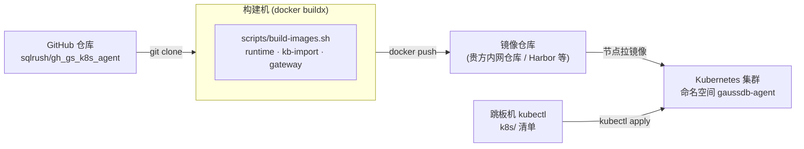
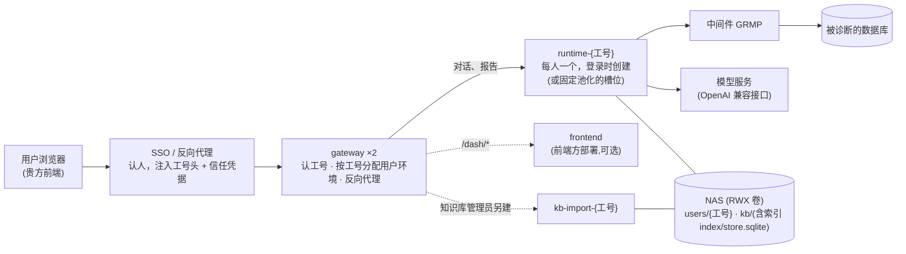
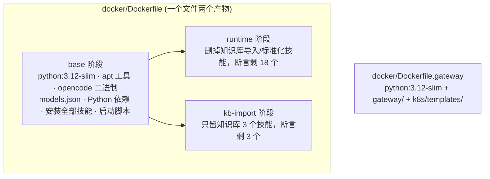
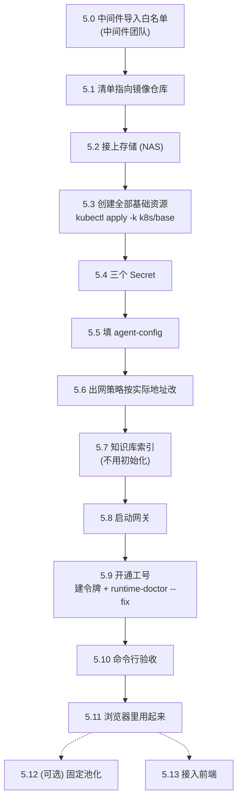
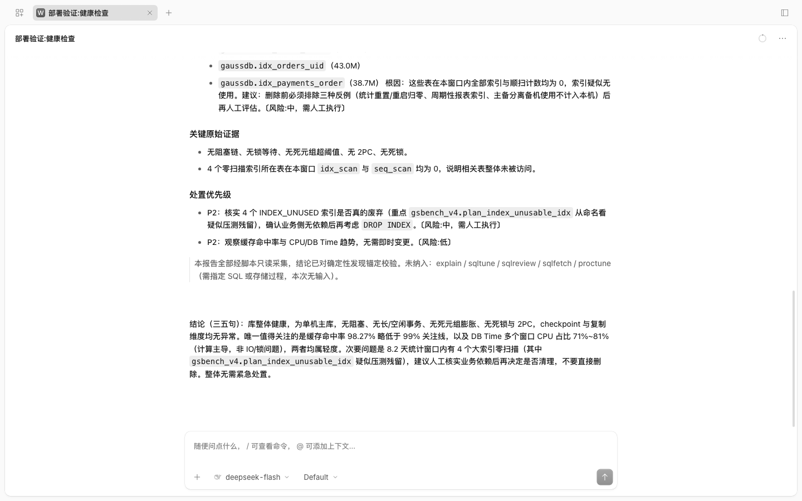

# 从源码构建到 K8s 运行：完整手册

从 GitHub 拉代码开始，自己构建后端全部 3 个镜像，推进镜像仓库，部署到 Kubernetes，
最后经网关登录、让模型对数据库做一次健康检查。**每一步都给出命令和执行后应该看到的输出。**

> **本手册的每条命令都实际跑过。** 2026-10-25 从本仓库 clone，构建 3 个镜像，部署到一个全新的 kind 集群
> （单节点，执行 NetworkPolicy），一直走到对话里完成健康检查，并另行验证了固定池化（5.12）。
> 输出都是那次的原样（工号统一写成示例 `u0001`，镜像地址与版本写成 `<REG>`、`<TAG>`）；`<...>` 是需要你换成自己的值的地方。验证记录见附录 C。
>
> **前端不在本仓库。** 本仓库是后端：网关 + 两个用户镜像。前端由前端方按《前端对接接口说明》（`docs/前端对接接口说明.md`）接入；
> 前端没接好之前，用户镜像里 opencode 自带的网页可以直接用来对话与验收（5.11）。
> 部署前还要让**中间件团队导入诊断脚本白名单**（全量 123 条，见 1.3 与 5.0）。

| 你要做的 | 章节 | 大约用时 |
|---|---|---|
| 准备构建机、集群、要填的值 | 1 | 看各团队响应速度 |
| 拉代码 | 2 | 1 分钟 |
| 构建 3 个镜像 | 3 | 2–10 分钟（看网络） |
| 推进镜像仓库 | 4 | 1–5 分钟 |
| 部署到 K8s、开通工号、用起来 | 5 | 15–30 分钟 |
| （可选）固定池化 | 5.12 | 10 分钟 |

---

## 0. 全景

### 0.1 从代码到运行的全过程



### 0.2 运行起来之后是什么样



用户容器里有两个容器：`opencode`（模型与技能在这里跑）和 `credproxy`（凭据代理）。中间件令牌、签名私钥、模型 Key
**只注入凭据代理**，由它在转发时加上；模型即使执行命令读环境变量，也读不到任何凭据。

### 0.3 三个镜像

| # | 镜像 | 从哪来 | 里面是什么 | 大小（arm64 实测） | 在集群里的形态 |
|---|---|---|---|---|---|
| 1 | `gaussdb-agent-runtime` | `docker/Dockerfile` 的 `runtime` 阶段 | opencode 1.18.27 + 18 个技能（17 个诊断 + 知识库只读查询）+ 凭据代理 | 666 MB | 每个工号一个，登录时由网关创建；固定池化时是池子 Pod 的槽位 |
| 2 | `gaussdb-agent-kb-import` | `docker/Dockerfile` 的 `kb-import` 阶段 | opencode + 知识库查询 / 导入 / 入库前标准化 3 个技能（另装 7zip、poppler、pillow，用于 CHM / PDF / 照片） | 761 MB | 只给知识库管理员，每人一个 |
| 3 | `gaussdb-agent-gateway` | `docker/Dockerfile.gateway` | 网关（Python 标准库 + PyYAML），带用户 Pod 模板 | 227 MB | 常驻 2 副本 |



---

## 1. 准备

### 1.1 构建机

一台 Linux（x86_64 或 ARM 都行）或 macOS 机器：

| 要求 | 怎么确认 |
|---|---|
| Docker 20.10 以上，带 buildx | `docker buildx version` 有输出 |
| git、curl | `git --version`、`curl --version` |
| 磁盘剩余 20 GB 以上 | `df -h` |
| 能访问外网的这些地址（构建时下载） | 见下表 |

| 构建时访问的地址 | 用途 |
|---|---|
| `github.com` | 拉代码；下载 opencode 二进制 |
| Docker Hub（`registry-1.docker.io`） | 基础镜像 `python:3.12-slim-bookworm` |
| `deb.debian.org` | 装 curl、git、ripgrep 等；导入镜像另装 7zip、poppler-utils |
| `pypi.org` / `files.pythonhosted.org` | psycopg2-binary、cryptography、PyYAML、sqlite-vec；导入镜像另装 pillow、pillow-heif |
| `models.dev` | opencode 的模型清单（构建期取好，运行时不再联网取） |

> **构建机要经代理上网时**：在 `~/.docker/config.json` 里配 `proxies`，Docker 会把它自动传进每一步构建。
> 构建机完全不能上外网时，3 个镜像需要一台能上网的机器构建后，`docker save` 带过去（或用 `scripts/package-images.sh` 打离线包）。

### 1.2 Kubernetes 集群

| 要求 | 说明 |
|---|---|
| Kubernetes 1.24 以上 | 本手册在 kind 自带的版本上验证（附录 C） |
| 网络插件支持 NetworkPolicy | Calico / Cilium / kind 自带的 kindnet 都可以。不支持的话策略不生效（不报错，但等于没有隔离） |
| 一个 RWX 存储 | NFS，或集群已有的 RWX StorageClass。所有用户的会话、报告、知识库都在上面 |
| 节点能从镜像仓库拉镜像 | 节点访问第 4 章推镜像的那个仓库 |
| 一台装了 `kubectl` 的跳板机 | 有 `gaussdb-agent` 命名空间的管理权限；也要能 `git clone`（或把仓库目录拷过去）；5.12 渲染池子要 Python 3.8+ |

> **手边没有集群？** 附录 A 用 kind 在一台装了 Docker 的机器上起一个单节点集群和一个本地镜像仓库，
> 本手册的验证就是在那上面做的。

### 1.3 需要准备的值

| 值 | 找谁要 | 用在哪一步 |
|---|---|---|
| 镜像仓库地址（下文 `REG`），以及推送权限 | 容器平台管理员 | 4、5.1 |
| NFS 服务器地址、导出路径（或 RWX StorageClass 名） | 存储管理员 | 5.2 |
| 模型服务地址（OpenAI 兼容，一般以 `/v1` 结尾）、key、模型名；模型能否看图 | AI 平台管理员 | 5.4、5.5 |
| 中间件（GRMP）的 IP 与端口 | 中间件团队 | 5.5、5.6 |
| 中间件**接口路径前缀**（形如 `/xxx/grmp/diagnostic/agent`） | 中间件团队 | 5.5 |
| 中间件要求签名时：Appkey 与 SM2 私钥 | 中间件团队 | 5.4、5.5 |
| 第一个要开通的工号，及该工号的中间件令牌 | 中间件团队 | 5.9 |
| **诊断脚本白名单已导入**（全量 123 条） | 中间件团队 | 5.0 |

---

## 2. 拉代码

```bash
git clone https://github.com/sqlrush/gh_gs_k8s_agent.git
cd gh_gs_k8s_agent
git log --oneline -1
```

> 进入目录。**之后所有命令都在这个目录里执行。** 最后一行是当前版本（提交号与说明）。

要构建某个发布版本，再执行 `git checkout <版本标签>`（`git tag` 列出全部标签）。不切就是最新的 `main`。

和构建、部署有关的目录：

| 目录 | 内容 |
|---|---|
| `agent/` | 技能的源码（runtime 与 kb-import 镜像把它装进 opencode 的技能目录） |
| `gateway/` | 网关源码 |
| `docker/` | 各镜像的 Dockerfile、容器启动脚本、凭据代理、固定池化的管家与槽位程序 |
| `k8s/base/` | 部署清单（命名空间、配置、网关、网络策略）；`*.example.yaml` 是样例 |
| `k8s/templates/` | 网关给每个用户建容器用的模板（构建网关镜像时拷进去） |
| `k8s/tools/` | 现场工具：`runtime-doctor.sh`（诊断/修复）、`sso-sim.py`（模拟 SSO）、`render-pool.py`（渲染固定池化的池子） |
| `scripts/` | 构建脚本 `build-images.sh`、离线打包 `package-images.sh`、大盘样例数据 `dash-samples.py` |
| `docs/` | 本手册；《前端对接接口说明》与 `docs/api/`（接口定义、报告字段契约）；《代码结构说明》（每个文件的作用） |

定一个版本号，后面构建、推送、部署都用它：

```bash
TAG=$(git describe --tags --always)-oc1.18.27
echo $TAG
```

> 切在发布标签上时就是 `<标签>-oc1.18.27`；没有标签时是提交号，形如 `79cc842-oc1.18.27`。
> `oc1.18.27` 是镜像里的 opencode 版本。也可以自己定，例如 `TAG=v20261025-oc1.18.27`，只要后面一直用同一个值。

---

## 3. 构建 3 个镜像

### 3.1 一条命令

```bash
bash scripts/build-images.sh "$TAG"
```

最后一行：

```
built: gaussdb-agent-{runtime,kb-import,gateway}:<TAG>
```

```bash
docker images | grep "gaussdb-agent.*$TAG"
```

> 3 行（arm64 实测；新版 Docker 把仓库与标签合成一列，并多一列压缩后大小）：
> ```
> gaussdb-agent-gateway:<TAG>     dfa7d09c68fc   227MB   48.3MB
> gaussdb-agent-kb-import:<TAG>   e114fec1f1a6   761MB    181MB
> gaussdb-agent-runtime:<TAG>     a8593a454a28   666MB    157MB
> ```
> 有缓存时 36 秒（验证时）；全新构建机主要花在下载上，网络慢时 5–10 分钟。

### 3.2 这条命令做了什么

`build-images.sh` 依次执行 3 次 `docker buildx build`：

| 镜像 | 构建命令（脚本里） | 关键步骤 |
|---|---|---|
| runtime | `-f docker/Dockerfile --target runtime` | ① `python:3.12-slim-bookworm` 上装 curl、git、ripgrep，建 uid 1000 的用户 `agent` ② 下载 opencode 1.18.27 官方 release（按架构选 x64 / arm64）③ 预取模型清单 `models.json` ④ `pip install` psycopg2-binary、cryptography、PyYAML、sqlite-vec（当场加载一次 sqlite-vec，加载不了构建就失败），装完删掉 pip ⑤ 用 `agent/install-opencode.sh` 把技能装进 `/opt/agent/config/opencode/skills` ⑥ 拷启动脚本与 `docker/*.py`，统一成人人可读 ⑦ 删掉知识库导入与标准化两个技能，**断言剩 18 个**，少一个构建就失败 |
| kb-import | `-f docker/Dockerfile --target kb-import` | ①–⑥ 与 runtime 共用（Docker 会复用这些层）⑦ 只留知识库 3 个技能，断言剩 3 个 ⑧ 装 7zip（官方文档 CHM）、poppler-utils（PDF）、pillow / pillow-heif（照片转码） |
| gateway | `-f docker/Dockerfile.gateway` | `python:3.12-slim` 上装 PyYAML，拷 `gateway/` 与 `k8s/templates/`，非 root（uid 1000）运行 |

不带 `--platform` 时构建本机架构，并载入本机 Docker（`--load`）。

### 3.3 验证镜像内容

```bash
docker run --rm --entrypoint sh gaussdb-agent-runtime:$TAG -c 'opencode --version; ls -d /opt/agent/config/opencode/skills/gaussdb-* | wc -l; id'
```

> ```
> 1.18.27
> 18
> uid=1000(agent) gid=1000(agent) groups=1000(agent)
> ```

```bash
docker run --rm --entrypoint sh gaussdb-agent-kb-import:$TAG -c 'ls /opt/agent/config/opencode/skills | grep gaussdb'
```

> `gaussdb-kb`、`gaussdb-kb-import`、`gaussdb-kb-init` 三行。

```bash
docker run --rm gaussdb-agent-gateway:$TAG
```

> `配置错误,网关拒绝启动:缺 GATEWAY_NAMESPACE(网关要在哪个命名空间里建 Pod)` —— 正常：
> 网关缺配置时**拒绝启动**，说明镜像本身是好的。

### 3.4 构建两种架构并直接推进仓库（正式发布用）

集群节点是 x86 而构建机是 ARM（或反过来）时，要构建对方架构。一次构建两种架构并直接推进仓库：

```bash
bash scripts/build-images.sh "$TAG" --registry <REG> --platform linux/amd64,linux/arm64 --push
```

- 在 Linux 构建机上先装一次跨架构模拟：`docker run --privileged --rm tonistiigi/binfmt --install all`（Mac 的 Docker Desktop / OrbStack 已自带）
- `--push` 有两道闸：必须给 `--registry`；必须两种架构，或显式加 `--single-arch` 认下「只推本机架构」。
  单架构推上去，推送这边一切正常，**只有另一种架构的节点会拉不到**（`no matching manifest`）。
- 推完核对：`docker buildx imagetools inspect <REG>/gaussdb-agent-runtime:$TAG`，应看到 `linux/amd64` 与 `linux/arm64` 两行。

用这种方式推了的，跳过第 4 章的 `docker tag` / `docker push`。

---

## 4. 推进镜像仓库

`REG` 是镜像仓库前缀，例如 `registry.example.com/gaussdb-agent`。先登录（有权限要求的仓库）：

```bash
REG=<镜像仓库前缀>
docker login ${REG%%/*}
```

> `Login Succeeded`。

```bash
for img in runtime kb-import gateway; do
  docker tag gaussdb-agent-$img:$TAG $REG/gaussdb-agent-$img:$TAG
  docker push $REG/gaussdb-agent-$img:$TAG
done
```

> 每个 push 最后一行是 `...: digest: sha256:... size: ...`。`denied` 是没有推送权限，找容器平台管理员。

---

## 5. 部署到 Kubernetes

下面的命令在跳板机的仓库目录里执行（跳板机与构建机可以是同一台）。跳板机上也要定义同样的 `REG` 与 `TAG`。



### 5.0 中间件导入诊断脚本白名单（中间件团队做）

用户容器里的技能只能按名字调用中间件里预先登记的脚本（白名单）。**白名单里没有的脚本，对应的功能用不了**
（报「未注册脚本」或「脚本不存在」）。这一步由中间件团队在部署前做。白名单 DML（全部是只读查询，只访问系统视图与系统表）
**由我方单独交付**，不在本仓库：

| 情况 | 用哪份 | 条数 |
|---|---|---|
| 第一次部署 | `scripts.sql`（全量） | 123 |
| 已导入过 123 条（v1.3.x） | `scripts-delta-20261024.sql`（增量，带每条的修改原因与导入后自检） | 更新 12，不新增 |

导完用交付包里的自检 SQL 核对：总数应为 123。

### 5.1 清单指向镜像仓库

```bash
sed -i "s#image: gaussdb-agent-gateway:.*#image: $REG/gaussdb-agent-gateway:$TAG#" k8s/base/gateway.yaml
sed -i "s#  USER_IMAGE_REGISTRY: .*#  USER_IMAGE_REGISTRY: \"$REG\"#; s#  USER_IMAGE_TAG: .*#  USER_IMAGE_TAG: \"$TAG\"#" k8s/base/configmap-gateway.yaml
```

> 在 Mac 上 `sed -i` 要写成 `sed -i ''`，其余不变。

```bash
grep -rn "image:\|USER_IMAGE_REGISTRY:\|USER_IMAGE_TAG:" k8s/base/ | grep -v ":\s*#" | grep -v example
```

> 3 行，地址都以你的 `REG` 开头、版本都是你的 `TAG`：
> ```
> k8s/base/configmap-gateway.yaml:12:  USER_IMAGE_TAG: "<TAG>"
> k8s/base/configmap-gateway.yaml:16:  USER_IMAGE_REGISTRY: "<REG>"
> k8s/base/gateway.yaml:91:          image: <REG>/gaussdb-agent-gateway:<TAG>
> ```

> **`USER_IMAGE_REGISTRY` 必须填。** 用户容器（runtime、kb-import）不在任何清单文件里：
> 网关在用户登录时按 `<USER_IMAGE_REGISTRY>/gaussdb-agent-runtime:<USER_IMAGE_TAG>` 现建。
> 留空的话镜像名不带仓库前缀，节点会去 Docker Hub 拉，用户一登录就卡在 `ImagePullBackOff`，浏览器等 2 分钟后 504。
>
> **网关与用户镜像必须同一版本**：网关建的用户 Pod 带凭据代理容器，跑的是用户镜像里的程序。

### 5.2 接上存储（NAS）

所有用户容器共用一个 RWX 卷，各自挂其中一个子目录。二选一：

- **集群已有 RWX 的 StorageClass**：把 `k8s/base/nas-pvc.yaml` 里的 `storageClassName: nas` 改成那个类名，跳过本节其余部分。
- **用 NFS**：

```bash
cp k8s/base/nas-pv-nfs.example.yaml k8s/base/nas-pv-nfs.yaml
vi k8s/base/nas-pv-nfs.yaml      # 只改最后两行:server 与 path
kubectl apply -f k8s/base/nas-pv-nfs.yaml
```

> `persistentvolume/nas-nfs created`

**存储管理员要先在导出目录下建好 `users/`、`admins/`、`kb/` 三个目录，属主 uid/gid 都是 1000**：

```bash
# 在 NFS 服务器上(或任何挂了这个导出目录、有 root 权限的机器上)
mkdir -p <导出路径>/users <导出路径>/admins <导出路径>/kb
chown -R 1000:1000 <导出路径>
```

> 单节点测试集群没有 NFS 时用节点本机目录，见附录 A.3。

### 5.3 创建全部基础资源

```bash
kubectl apply -k k8s/base
```

> ```
> namespace/gaussdb-agent created
> serviceaccount/gateway created
> role.rbac.authorization.k8s.io/gateway created
> rolebinding.rbac.authorization.k8s.io/gateway created
> configmap/agent-config created
> configmap/agent-roles created
> configmap/gateway-config created
> service/gateway created
> persistentvolumeclaim/nas created
> deployment.apps/gateway created
> networkpolicy.networking.k8s.io/frontend-policy created
> networkpolicy.networking.k8s.io/gateway-policy created
> networkpolicy.networking.k8s.io/kb-import-policy created
> networkpolicy.networking.k8s.io/runtime-policy created
> ```

```bash
kubectl -n gaussdb-agent get pvc
kubectl -n gaussdb-agent get pods
```

> PVC `nas` 是 `Bound`。两个 `gateway` Pod 是 `CrashLoopBackOff` 或 `Error`：**正常**。还没建信任凭据，网关按设计拒绝启动，5.8 之后就好；
> 它能起来再退出，说明节点已经能从你的镜像仓库拉镜像。
>
> 卡在 `ImagePullBackOff` / `ErrImagePull`：节点拉不到镜像，检查 `REG` 与仓库权限（私有仓库要配 `imagePullSecrets` 或节点级凭据）。

### 5.4 三个 Secret

**模型服务的 key**（输入时不显示）：

```bash
read -rs -p "模型服务 key: " V && echo
kubectl -n gaussdb-agent create secret generic model-api --from-literal=MODEL_API_KEY="$V"
unset V
```

**网关信任凭据与运维密钥**：上游 SSO 转发请求时带上信任凭据，网关才认请求头里的工号（5.11 的模拟 SSO 也要用）；
运维密钥给 `/admin/*` 接口用（5.12 要用）：

```bash
TRUST=$(openssl rand -hex 24); ADMIN=$(openssl rand -hex 24)
kubectl -n gaussdb-agent create secret generic gateway-auth --from-literal=TRUST_SECRET="$TRUST" --from-literal=ADMIN_TOKEN="$ADMIN"
printf '%s' "$TRUST" > ~/.agent-trust && printf '%s' "$ADMIN" > ~/.agent-admin && chmod 600 ~/.agent-trust ~/.agent-admin
unset TRUST ADMIN
```

**中间件签名私钥**（中间件要求 SM2 签名时才需要；不要求就跳过）：

```bash
read -rs -p "SM2 私钥: " V && echo
kubectl -n gaussdb-agent create secret generic grmp-sm2 --from-literal=GRMP_SM2_PRIVATE_KEY="$V"
unset V
```

```bash
kubectl -n gaussdb-agent get secret
```

> `gateway-auth`、`model-api` 两行（建了签名私钥的再多一行 `grmp-sm2`）。

### 5.5 填 agent-config

```bash
kubectl -n gaussdb-agent patch configmap agent-config --type merge -p '{"data":{
  "GRMP_API_HOST":"<中间件IP>","GRMP_API_PORT":"<中间件端口>","GRMP_PATH_PREFIX":"<中间件接口路径前缀>",
  "MODEL_BASE_URL":"<模型服务地址,如 https://api.deepseek.com/v1>","MODEL_ID":"<模型名>","MODEL_PROVIDER_NAME":"<随便起个名字,如 deepseek>"}}'
```

> **`GRMP_PATH_PREFIX` 必填，代码里没有默认值。** 技能调用中间件的两个接口是 `<前缀>/common-operations`（查脚本清单）与
> `<前缀>/common-operations/invoke`（执行脚本）。前缀各家部署不同，**向中间件团队要**，填法：以 `/` 开头、只写路径（不写协议、地址、端口）、
> 末尾不带 `/`，例如 `/xxx/grmp/diagnostic/agent`。没填时用户一登录数据库就报「中间件接口路径前缀没有配置:环境变量 GRMP_PATH_PREFIX」，
> `runtime-doctor`（5.9）的 ① 也会报出来；填错时中间件回 404，表现为「请求 <前缀>/common-operations 失败：HTTP 404」。改了之后重启用户容器才生效。

中间件要求签名时再填 Appkey（签名的其余旋钮见下表，默认值是国标 / Java 常见形态）：

```bash
kubectl -n gaussdb-agent patch configmap agent-config --type merge -p '{"data":{"GRMP_APPKEY":"<中间件给的 Appkey>"}}'
```

```bash
kubectl -n gaussdb-agent get configmap agent-config -o go-template='{{range $k,$v := .data}}{{$k}}={{$v}}{{"\n"}}{{end}}' | grep -E "^(GRMP_API|GRMP_APPKEY|GRMP_PATH|MODEL_)"
```

> 验证时的值（中间件是测试用的模拟服务；路径前缀写成占位）：
> ```
> GRMP_API_HOST=0.250.250.254
> GRMP_API_PORT=8781
> GRMP_APPKEY=gaussdb-agent
> GRMP_PATH_PREFIX=<中间件接口路径前缀>
> MODEL_BASE_URL=https://api.deepseek.com/v1
> MODEL_ID=deepseek-flash
> MODEL_INPUT_MODALITIES=
> MODEL_PROVIDER_NAME=deepseek
> ```

**中间件地址不能写 `localhost` / `127.0.0.1`**：那在容器里指容器自己。

`agent-config` 的全部键（改了之后，**之后创建 / 重启的**用户容器才读到新值）：

| 键 | 说明 |
|---|---|
| `GRMP_API_HOST` / `GRMP_API_PORT` | 中间件地址 |
| `GRMP_PATH_PREFIX` | **必填**。中间件接口路径前缀，中间件团队提供（见上） |
| `GRMP_APPKEY` | 中间件签名的 Appkey；空 = 不签名 |
| `GRMP_SIGN_MODE` | `full`（Appkey + Timestamp + Signature，私钥在 Secret `grmp-sm2`）/ `headers-only`（只发 Appkey + Timestamp，过渡期用）。`full` 时拿不到私钥直接报错，不会自动降级 |
| `GRMP_SIGN_USER_ID` | SM2 签名的 userId，默认 `1234567812345678`（国标默认）；OpenSSL 默认是空串，用哪个必须问清中间件团队 |
| `GRMP_SIGN_TIMESTAMP` | `ms` / `s` |
| `GRMP_SIGN_FORMAT` / `GRMP_SIGN_ENCODING` | 签名格式 `raw` / `der`；编码 `hex` / `base64` |
| `GRMP_SIGN_PAYLOAD` | 被签名的串，默认 `{path}+{timestamp}` |
| `GRMP_USER_ID_HEADER` / `GRMP_USER_ID_PARAM` | 中间件要显式收调用人工号时，放在哪个请求头 / 报文顶层键；都空 = 不发 |
| `GRMP_INSTANCE_ALIASES` | 实例别名，`别名=实例IP/库名  # 说明`，换行或分号分隔。用户说「核心库」时模型能直接登录 |
| `MODEL_BASE_URL` / `MODEL_ID` / `MODEL_PROVIDER_NAME` | 模型服务（OpenAI 兼容）地址、模型名、显示名 |
| `MODEL_INPUT_MODALITIES` | 模型能接收的输入，如 `text,image`；空 = 纯文本。**只在模型服务确实支持图片时**才加 `image`（知识库导入读照片要它） |
| `GSDB_DASH_BASE_URL` | 回答里「打开报告」链接的站点前缀；空 = 根相对地址 `/dash/...`。大盘在别的站点时填那个站点（见《前端对接接口说明》第 7 章） |

### 5.6 出网策略按实际地址改

清单里的出网地址段是占位值（`10.0.0.0/8`）。不改的话，要么用户容器连不上模型和中间件，要么网关连不上 k8s API。要改 4 处：

| 策略 | 第几条出站规则（从 0 数） | 放行什么 | 填什么 |
|---|---|---|---|
| `gateway-policy` | 3 | 网关 → k8s API | **apiserver 的真实地址**（下面查） |
| `runtime-policy` | 1 | 用户容器 → 中间件 | 中间件 IP/32 与端口 |
| `runtime-policy` | 2 | 用户容器 → 模型服务 | 模型服务的地址段；模型在公网时只能 `0.0.0.0/0`（端口 443/80） |
| `kb-import-policy` | 1 | 知识库导入容器 → 模型服务 | 同上 |

**查 apiserver 的真实地址**（NetworkPolicy 按真实端点判，不按 Service 的 ClusterIP）：

```bash
kubectl -n default get endpoints kubernetes
```

> ```
> NAME         ENDPOINTS            AGE
> kubernetes   192.168.155.3:6443   13m
> ```
> 例子里是 `192.168.155.3`；多 master 的集群会有多个，每个都要放行。

```bash
APISERVER=<上面查到的 IP>
GRMP_IP=<中间件IP>; GRMP_PORT=<中间件端口>
MODEL_CIDR=0.0.0.0/0          # 模型服务在内网且地址固定时,换成它的地址段
kubectl -n gaussdb-agent patch networkpolicy gateway-policy --type json -p "[{\"op\":\"add\",\"path\":\"/spec/egress/3/to/-\",\"value\":{\"ipBlock\":{\"cidr\":\"$APISERVER/32\"}}}]"
kubectl -n gaussdb-agent patch networkpolicy runtime-policy --type json -p "[{\"op\":\"replace\",\"path\":\"/spec/egress/1\",\"value\":{\"to\":[{\"ipBlock\":{\"cidr\":\"$GRMP_IP/32\"}}],\"ports\":[{\"port\":$GRMP_PORT,\"protocol\":\"TCP\"}]}},{\"op\":\"replace\",\"path\":\"/spec/egress/2/to\",\"value\":[{\"ipBlock\":{\"cidr\":\"$MODEL_CIDR\"}}]}]"
kubectl -n gaussdb-agent patch networkpolicy kb-import-policy --type json -p "[{\"op\":\"replace\",\"path\":\"/spec/egress/1/to\",\"value\":[{\"ipBlock\":{\"cidr\":\"$MODEL_CIDR\"}}]}]"
```

> 三行 `... patched`。核对：

```bash
for p in gateway-policy runtime-policy kb-import-policy; do echo "--- $p"; kubectl -n gaussdb-agent get networkpolicy $p -o jsonpath='{range .spec.egress[*]}{.to[*].ipBlock.cidr}{" "}{.to[*].podSelector.matchLabels}{" -> "}{.ports[*].port}{"\n"}{end}'; done
```

> ```
> --- gateway-policy
>  {"k8s-app":"kube-dns"} -> 53 53
>  {"app":"gaussdb-agent"} -> 4096 4097
>  {"app":"gaussdb-frontend"} -> 8080
> 10.96.0.0/12 172.16.0.0/12 192.168.155.3/32  -> 443 6443
> --- runtime-policy
>  {"k8s-app":"kube-dns"} -> 53 53
> 0.250.250.254/32  -> 8781
> 0.0.0.0/0  -> 443 80
> --- kb-import-policy
>  {"k8s-app":"kube-dns"} -> 53 53
> 0.0.0.0/0  -> 443 80
> ```

> 公司出网要经 HTTPS 代理时，模型那条不用放开 `0.0.0.0/0`：开通工号后执行
> `bash k8s/tools/runtime-doctor.sh <工号> --fix --proxy <代理IP:端口>`，它给用户容器配上代理，并把模型那条改成只放行代理。

**验证策略确实在生效**（网络插件不支持 NetworkPolicy 时策略不报错、只是不生效）：起两个临时 Pod，一个带用户容器的标签（受 `runtime-policy` 约束），
一个不带，各访问一次中间件（放行了）和集群里的网关（用户容器的出站规则里没有它）：

```bash
for lbl in "app=gaussdb-agent,role=runtime,user=policytest" "app=policytest"; do
  kubectl -n gaussdb-agent run pt-$RANDOM --rm -i --restart=Never --labels="$lbl" --image=$REG/gaussdb-agent-runtime:$TAG --command -- \
    sh -c "sleep 8; echo \"[$lbl] 中间件 -> \$(curl -s -m 5 -o /dev/null -w '%{http_code}' http://$GRMP_IP:$GRMP_PORT/)  网关 -> \$(curl -s -m 5 -o /dev/null -w '%{http_code}' http://gateway/healthz)\"" 2>&1 | grep 中间件
done
```

> ```
> [app=gaussdb-agent,role=runtime,user=policytest] 中间件 -> 404  网关 -> 000
> [app=policytest] 中间件 -> 404  网关 -> 200
> ```
> - 中间件那一列是任何 HTTP 码都算通（`000` 才是不通：回头查 `GRMP_IP` / `GRMP_PORT` 与中间件的防火墙）；
> - **带用户容器标签的那个访问网关必须是 `000`**。两行都是 `200`，说明集群没在执行 NetworkPolicy，找容器平台确认网络插件。
> - `sleep 8` 不能省：新 Pod 的策略要过几秒才生效，抢在之前测会误以为没生效。

### 5.7 知识库索引（不用初始化）

**没有向量库要初始化。** 知识库的向量 + 词法索引是 NAS 上知识库目录里的一个文件 `kb/index/store.sqlite`
（SQLite + sqlite-vec，runtime 与 kb-import 两个镜像里都已装好），由导入容器里的 `kb.py index` 建：
管理员导入规范 / 工单时导入流程会自动跑；runtime 与固定池化的槽位只读打开它。还没建索引时检索直接走 `kb/` 下的文件（文件模式），
不影响使用。要手工建一次（例如知识库目录是从别处拷来的）：

```bash
kubectl -n gaussdb-agent exec deploy/kb-import-<管理员工号> -c opencode -- sh -c '. /data/env.sh && python3 /opt/agent/config/opencode/skills/gaussdb-kb-import/scripts/kb.py index'
```

> 空知识库上的输出（末几行）：
> ```
> 分层已重建  : L0-总索引.md + 0 个专题导航(topics/*.md)
> 提示:kb.yaml 未配 embeddings,向量列留空;配好后再跑一次 `kb.py index` 就会补齐
> 文档      : 新写 0 · 未变 0 · 删除 0 · 切块 0
> 向量      : 引擎 sqlite-vec(未配 embedding) · 新算 0 · 缓存 0 · 失败 0 · 覆盖 0/0
> 图        : none · 节点 0 · 边 0(已确认 0)
> ```
>
> 导入容器要在运行（管理员登录进导入容器一次即可，5.11；首次实测 10 秒建好）。知识库管理员：SSO 传的角色含 `gateway-config` 的 `KB_ADMIN_ROLES`（默认 `kb-admin`），
> 或把工号登记进 ConfigMap `agent-roles` 的 `kb-admins`。不配 embedding 时检索走词法 + 图，不影响使用。

### 5.8 启动网关

```bash
kubectl -n gaussdb-agent rollout restart deploy/gateway
kubectl -n gaussdb-agent rollout status deploy/gateway --timeout=180s
kubectl -n gaussdb-agent logs -l app=agent-gateway --tail=2
```

> 最后出现：
> ```
> 网关就绪:0.0.0.0:8080 · 命名空间 gaussdb-agent · 用户镜像标签 <TAG> · 诊断容器 按需建 · 回收 scale(闲置 1800 秒)· 信任来源 共享密钥 · 控制 API 已启用
> ```

```bash
kubectl -n gaussdb-agent get pods
```

> 两个 `gateway-...` 都是 `1/1 Running`。

### 5.9 开通工号

开通一个工号 = 两步：建这个工号的中间件令牌，再用诊断脚本把它的个人目录建好并做一遍检查。

```bash
STAFF=<工号>          # 例如 u0001,小写
read -rs -p "$STAFF 的中间件令牌: " V && echo
kubectl -n gaussdb-agent create secret generic grmp-token-$STAFF --from-literal=GRMP_AUTH_TOKEN="$V"
unset V
bash k8s/tools/runtime-doctor.sh $STAFF --fix
```

> ```
> 诊断工号 u0001(命名空间 gaussdb-agent)…… 约 30 秒到 1 分钟
> == ① 配置与开通 ==
>   [正常] 模型地址 https://api.deepseek.com/v1,模型 deepseek-flash
>   [正常] 模型 key 已配置(Secret model-api,不打印内容)
>   [正常] 中间件地址 0.250.250.254:8781
>   [正常] 中间件接口路径前缀 <中间件接口路径前缀>
>   [正常] 已开通(有 Secret grmp-token-u0001)
> == ② NAS 个人目录 ==
>   [正常] users/u0001 还没建:上一层 users/ uid 1000 可写,首次登录时用户容器会自己建好
> == ③ 用户容器 runtime-u0001 ==
>          还没有 runtime-u0001:这个工号还没登录过,首次登录时网关会创建
> == ④ 出网实测(从集群里连) ==
>   [正常] 模型服务 https://api.deepseek.com/v1:用户容器能连上,通(HTTP 401)
>          401 是因为探测没带 key,网络是通的
>   [正常] 中间件 http://0.250.250.254:8781:用户容器能连上,通(HTTP 404)
> == ⑤ 出网策略 runtime-policy 现状 ==
>          模型服务规则(第 2 条)放行 0.0.0.0/0 的 443 80
>          中间件规则(第 1 条)放行 0.250.250.254/32 的 8781
> == ⑥ 运行本脚本的这台电脑的代理 ==
>          没发现代理设置
>
> == 修复 ==
>   没有可自动修的项
> ...(复查,同上)
> ================ 诊断意见 ================
> 全部正常。对话页刷新后重试即可。
> ```

> **② 什么时候要修：** 用户容器以 uid 1000 运行。`users/` 属主是 1000（5.2 那样建的）时，个人目录由容器首次启动时自己建，② 是「正常」；
> 存储不让 1000 在 `users/` 下建目录、或个人目录已被建成 root 属主时，② 是「问题」，`--fix` 用一个临时 root Pod 建好目录、属主改成 1000，
> 并重启这个人的容器（不修的话容器一启动就退出，日志 `mkdir: cannot create directory '/nas/me/gdaa': Permission denied`）。
>
> ④ 是从集群里实际连一次模型与中间件。哪一项不通，「诊断意见」里会写原因和可以执行的修复命令。

### 5.10 命令行验收

把网关接到本机端口（这个窗口保持打开）：

```bash
kubectl -n gaussdb-agent port-forward svc/gateway 18089:80
```

> `Forwarding from 127.0.0.1:18089 -> 8080`。提示 `address already in use` 就换一个端口，下面跟着换。

另开一个终端（回到仓库目录，重新定义 `STAFF`）：

```bash
STAFF=<工号>; TRUST=$(cat ~/.agent-trust)
curl -s http://127.0.0.1:18089/healthz; echo
curl -s -o /dev/null -w "%{http_code}\n" -H "X-Agent-User: $STAFF" http://127.0.0.1:18089/session
curl -s -m 150 -o /dev/null -w "%{http_code}\n" -H "X-Agent-Trust: $TRUST" -H "X-Agent-User: $STAFF" http://127.0.0.1:18089/global/health
kubectl -n gaussdb-agent get deploy runtime-$STAFF -o wide
```

> ```
> {"ok": true, "version": "gaussdb-agent-gateway"}
> 403
> 200
> NAME            READY   UP-TO-DATE   AVAILABLE   AGE   CONTAINERS           IMAGES                                                    SELECTOR
> runtime-u0001   1/1     1            1           8s    opencode,credproxy   <REG>/gaussdb-agent-runtime:<TAG>,<REG>/gaussdb-agent-runtime:<TAG>   app=gaussdb-agent,role=runtime,user=u0001
> ```
> - `403`：不带信任凭据的请求被拒，**必须是 403**；
> - `200`：首次登录网关为这个工号新建容器，实测 8 秒；
> - `CONTAINERS` 是 `opencode,credproxy` 两个（同一个镜像），`IMAGES` 列带着你的 `REG` 前缀。
>
> 第三条挂着超过 30 秒没返回，说明容器起不来（网关会等满 2 分钟才回 504）。不用干等，另开终端执行
> `bash k8s/tools/runtime-doctor.sh <工号>`，它会说明原因并给出修复命令。

### 5.11 浏览器里用起来

生产环境由贵方 SSO 在认完人之后把工号头和信任凭据注入请求（《前端对接接口说明》第 1 章）。SSO 还没接时，
用仓库里的「模拟 SSO」在本机站在 SSO 的位置上（需要 Python 3.8+，只用标准库）。保持 5.10 的 port-forward 窗口开着，再开一个终端：

```bash
python3 k8s/tools/sso-sim.py 18090 18089 <工号> ~/.agent-trust
```

> `模拟 SSO:http://127.0.0.1:18090 → 网关 127.0.0.1:18089,工号 u0001(头名 X-Agent-User)`。这个窗口也保持打开。
> 知识库管理员在末尾再加一个参数 `kb-admin`（作为角色头），再访问 `http://127.0.0.1:18090/kb-import` 即切到导入容器。

前端接好之前，用用户镜像里 opencode 自带的网页验收。浏览器（必须在同一台机器上）打开：

```
http://127.0.0.1:18090/L2RhdGEvc3RhdGUvd29ya3NwYWNl
```

在对话页新建会话，输入：

```
登录 <数据库IP> 的 <库名> 库,然后做一次健康检查。不要向我提问,遇到选择按默认做。完成后用三五句话总结结论。
```

模型会经中间件登录数据库，跑健康检查的各个子项，最后给出报告与结论（实测 12 秒到 1 分钟，看库的大小）：



回答末尾有一行「打开报告」链接，形如 `[打开报告](/dash/health?inst=api_10-0-0-9-postgres&run=20261025T143428Z.json)`：
它指向前端的大盘页面（前端还没接时点开是 502，见 5.13）。报告同时存进这个人的报告目录，前端的大盘经 `/reports/` 读它
（《前端对接接口说明》第 5–7 章）。命令行核对：

```bash
curl -s http://127.0.0.1:18090/reports/health/targets.json
```

> ```
> [
>   {
>     "key": "api_10-0-0-9-postgres",
>     "conn": "api/10-0-0-9-postgres",
>     "last_at": "20261025T143428Z",
>     "count": 1,
>     "label": "10.0.0.9 / postgres",
>     "login": "登录 10.0.0.9 的 postgres 库"
>   }
> ]
> ```

**到这里，从源码到运行的全过程完成。** 测完在两个窗口按 Ctrl-C，并删掉 `~/.agent-trust`。

### 5.12 （可选）固定池化

默认是**按需模式**：每个工号登录时现建一个 Pod，闲置后收起。**固定池化**是另一种部署形态：部署时固定 N 个 Pod、每个 Pod K 个槽位，
运行中不建、不删、不补；N 人以内各自独占一个 Pod，多出来的人共用。人走了先写回 NAS、槽位仍归他（粘性保留），回来 0–1 秒恢复；
满员时排队，等待页每 30 秒自动重试。知识库管理员的导入容器两种模式下都按需建。两种模式的 NAS 布局相同，可以来回切。

**前提**：上面 5.1–5.11 的按需模式能跑通。

**① 控制密钥**（网关与各 Pod 的管家共用，至少 16 个字符）：

```bash
kubectl -n gaussdb-agent create secret generic sandbox-control --from-literal=KEY="$(openssl rand -hex 32)"
```

**② 渲染并部署池子**（Pod 里的容器数等于槽位数，所以清单由脚本渲染，只用 Python 标准库）：

```bash
python3 k8s/tools/render-pool.py --image $REG/gaussdb-agent-runtime:$TAG \
    --pool-size 16 --slots-per-pod 8 \
    --grmp-cidr $GRMP_IP/32 --grmp-port $GRMP_PORT --model-cidr $MODEL_CIDR --model-ports 443 \
    > pool.yaml
kubectl apply -f pool.yaml
kubectl -n gaussdb-agent get pods -l app=gaussdb-agent,role=pool
```

> ```
> service/agent-pool created
> statefulset.apps/agent-pool created
> poddisruptionbudget.policy/agent-pool created
> networkpolicy.networking.k8s.io/pool-policy created
> networkpolicy.networking.k8s.io/gateway-to-pool created
> ```
> 每个 Pod 应为 `9/9 Running`（8 个槽位 + 1 个管家；验证时用 `--pool-size 2 --slots-per-pod 2`，是 `3/3`）。
> `pool-policy`：池子只接受网关的连接；`gateway-to-pool`：网关可以连池子。

**③ 网关切到固定池化**：

```bash
kubectl -n gaussdb-agent patch configmap gateway-config --type merge -p '{"data":{"RUNTIME_MODE":"pool"}}'
kubectl -n gaussdb-agent rollout restart deploy/gateway
kubectl -n gaussdb-agent rollout status deploy/gateway --timeout=180s
kubectl -n gaussdb-agent logs -l app=agent-gateway --tail=1
```

> ```
> 网关就绪:0.0.0.0:8080 · 命名空间 gaussdb-agent · 用户镜像标签 <TAG> · 诊断容器 固定池化(app=gaussdb-agent,role=pool) · 回收 scale(闲置 1800 秒)· 信任来源 共享密钥 · 控制 API 已启用
> ```

**再把按需模式留下的用户容器缩到 0**（从按需模式切过来时必做）：

```bash
kubectl -n gaussdb-agent scale deploy -l role=runtime --replicas=0
kubectl -n gaussdb-agent wait --for=delete pod -l role=runtime --timeout=180s
```

> 每个按需容器一行 `deployment.apps/runtime-<工号> scaled`。容器退出前把数据写回 NAS，实测约 1 分半。
>
> **为什么**：同一个人的数据同一时刻只许一个容器打开（独占标记）。按需容器还在跑时，这个人在池子里分不到槽位，
> 每个请求都回 `503 {"reason": "waiting", ...}`，要等按需容器闲置回收（默认 30 分钟）后才进得去。缩掉之后数据原样都在，会话与报告不丢。

**④ 验证**：用一个工号经模拟 SSO（5.11）登录一次，再看池子：

```bash
curl -s -H "X-Admin-Token: $(cat ~/.agent-admin)" http://127.0.0.1:18089/admin/pool | python3 -c '
import json,sys
for p in json.load(sys.stdin)["pods"]:
    print(p["name"], "reachable" if p["reachable"] else "UNREACHABLE", "in_use", p["in_use"], "free", p["free"],
          [(s["slot"], s["state"], s["user_id"]) for s in p["slots"]])'
```

> 每个 Pod `reachable`；这个工号占了一个槽位（`active`），其余是 `free`：
> ```
> agent-pool-0 reachable in_use 1 free 1 [(0, 'active', 'u0001'), (1, 'free', None)]
> agent-pool-1 reachable in_use 0 free 2 [(0, 'free', None), (1, 'free', None)]
> ```
> 进入实测 1 秒（槽位里的 opencode 已经起好）；按需模式下建的会话与报告都还在。

**资源**：

```
集群预留 = POOL_SIZE × (SLOTS_PER_POD × 槽位 request + 管家 request)
默认    = 16 × (8 × 100m / 768Mi + 50m / 64Mi) ≈ 13.6 CPU / 97 GiB
```

单人实测：空闲 350–500 MiB；一个会话做 WDR 分析峰值约 0.7 GiB、CPU 平均 0.3 核、峰值 0.9 核。按「人数 × 0.9 GiB、人数 × 0.5 核，再留 30%」配；
**上线前在贵方环境装 metrics-server 复测**。保留状态的人已停 opencode，几乎不占内存与 CPU，占的是槽位的盘（`--slot-state-size`）。

**渲染参数**（`k8s/tools/render-pool.py`）：

| 参数 | 默认 | 说明 |
|---|---|---|
| `--image` | （必填） | 运行时镜像，与按需模式同一个 |
| `--image-pull-policy` | `IfNotPresent` | |
| `--namespace` | `gaussdb-agent` | |
| `--pool-size` | 16 | Pod 数（1–64） |
| `--slots-per-pod` | 8 | 每个 Pod 的槽位数（1–16） |
| `--users-subpath` | `users` | NAS 上用户目录的上一层，与按需模式一致 |
| `--nas-claim` | `nas` | NAS 的 PVC 名 |
| `--slot-cpu-request` / `--slot-memory-request` | `100m` / `768Mi` | 每个槽位的预留 |
| `--slot-cpu-limit` / `--slot-memory-limit` | `2` / `2Gi` | 每个槽位的上限 |
| `--slot-state-size` | `4Gi` | 每人在槽位里的文件上限（对话库、工作目录、报告） |
| `--steward-memory-limit` | `512Mi` | 管家的内存上限 |
| `--grace-seconds` | 180 | 删 Pod 时的宽限期：管家要把所有在用的槽位并行完整写回 |
| `--runtime-class` | 空 | 集群有 gVisor / Kata 时填 runtimeClassName，整 Pod 启用 |
| `--grmp-cidr` / `--grmp-port` | `10.0.0.0/8` / 8080 | 槽位能连的中间件地址 |
| `--model-cidr` / `--model-ports` | `10.0.0.0/8` / `443,80` | 槽位能连的模型服务地址 |
| `--egress` | 无 | 额外的出站目标，可重复，如 embedding 服务 `10.1.2.3/32:11434` |
| `--test-override` | 无 | **只给测试集群**缩短时长；渲染结果会带标签 `gaussdb-agent/test-overrides`，正式部署不要用 |

改了参数：重新渲染、`kubectl apply`，再**逐个**删 Pod 让它按新清单重建（StatefulSet 是 `OnDelete`，不会自动滚动；
删 Pod 时在用的人先完整写回，下次请求自动分到别的槽位）。

**网关的池化参数**（ConfigMap `gateway-config`，改完重启网关）：

| 键 | 默认 | 下限 | 说明 |
|---|---|---|---|
| `RUNTIME_MODE` | `ondemand` | | `pool` = 固定池化 |
| `POOL_SELECTOR` | `app=gaussdb-agent,role=pool` | | 池子 Pod 的标签，与渲染脚本一致 |
| `POOL_IDLE_SECONDS` | 1800 | 300 | 在用多久没有交互（也没有会话在跑）就转保留 |
| `POOL_EARLY_IDLE_SECONDS` | 600 | 60 | 满员时，闲置超过这么久的在用者可被提前转保留；不能长于上一项 |
| `POOL_RETAIN_DAYS` | 7 | 1 | 保留多少天没来就腾挪 |
| `POOL_FREE_SLOTS` | 1 | 0 | 每个 Pod 后台至少留几个空闲槽位给新人 |
| `POOL_SWEEP_SECONDS` | 30 | 5 | 后台多久一轮：报活动、转保留、腾挪、核验 |
| `POOL_WAIT_SECONDS` | 60 | 10 | 一次请求为分配最多等多久，等不到回等待页 |

控制密钥由 `gateway.yaml` 从 Secret `sandbox-control` 读，不在 ConfigMap 里。低于下限、`RUNTIME_MODE` 不认识、
池化模式没有控制密钥时，网关拒绝启动。

**什么算「在用」**：用户的交互请求（打开页面、发消息、看报告）与正在跑的会话。页面开着时的探活和一直挂着的事件流**不算**——
否则开着的标签页永远不闲置；这两类请求也不会把转保留的槽位拉回来，下一次真正的操作才会（前端要按《前端对接接口说明》1.5 处理）。

切回按需模式：先 `kubectl delete -f pool.yaml`（管家把在用的人完整写回后退出，释放独占标记），再把 `RUNTIME_MODE` 改回 `ondemand`、重启网关。
实测切回后这个人再登录 8 秒拿到新的按需容器，会话与报告都在。

### 5.13 接入前端

前端由前端方按《前端对接接口说明》（`docs/前端对接接口说明.md`）接入，后端这边要做的只有：

- 前端部署进本集群时：按 `k8s/base/frontend.example.yaml` 填上前端镜像后 `kubectl apply -f`。网关把 `/dash/*` 转给 Service `frontend`
  （改名用 `gateway-config` 的 `FRONTEND_SERVICE`），网络策略已放行网关 → 前端 8080；
- 前端在贵方门户上（不进本集群）时：`agent-config` 的 `GSDB_DASH_BASE_URL` 填门户上大盘的站点前缀，回答里的「打开报告」链接就指向那里；
- 贵方 SSO 按接口说明 1.1–1.2 加身份头，并在反向代理上只放行接口说明 2.2 的 v1 范围。
- 后端 v1 **不提供**的三样 —— 跨源访问、网关层的接口白名单、知识库文档的上传接口 —— 及贵方的处理方式见接口说明第 9 章。
  其中文档上传最常用的做法：贵方上传服务挂同一个 NAS，把文件写进 `kb/inbox/uploads/`（对 uid 1000 可读）；
  或运维 `kubectl -n gaussdb-agent cp <文件> <导入容器 Pod>:/nas/kb/inbox/uploads/<文件名> -c opencode`。

---

## 6. 升级

改了代码（或拉了新版本）之后。**先看发版说明**：要导白名单增量的版本，先让中间件团队导入（5.0），再换镜像。

```bash
git pull
TAG=$(git describe --tags --always)-oc1.18.27
bash scripts/build-images.sh "$TAG"          # 或 3.4 的多架构 --push 方式
for img in runtime kb-import gateway; do
  docker tag gaussdb-agent-$img:$TAG $REG/gaussdb-agent-$img:$TAG && docker push $REG/gaussdb-agent-$img:$TAG
done
kubectl apply -k k8s/base                     # 清单有变化时(新的配置项、网络策略);已改过的值会被清单里的值覆盖,先核对
kubectl -n gaussdb-agent set image deploy/gateway gateway=$REG/gaussdb-agent-gateway:$TAG
kubectl -n gaussdb-agent patch configmap gateway-config --type merge -p "{\"data\":{\"USER_IMAGE_TAG\":\"$TAG\"}}"
kubectl -n gaussdb-agent rollout restart deploy/gateway
```

> `USER_IMAGE_TAG` 是用户容器的升级开关：改了之后，**之后登录**的人用新版本，已经在用的人的容器不动。
> **网关与用户镜像必须同一版本**（5.1）。NAS 上的数据在小版本间兼容，回滚把上面的 `TAG` 换回旧值即可。
>
> `kubectl apply -k` 会把 ConfigMap 恢复成清单里的值：5.5 用 `patch` 改过的配置，升级前先把它们写进 `k8s/base/configmap-*.yaml`，
> 或 apply 之后重新 patch 一遍。
>
> **固定池化**：重新渲染 `pool.yaml`（换 `--image`）、`kubectl apply -f pool.yaml`，再逐个删池子的 Pod 让它按新镜像重建（5.12）。

---

## 7. 常见问题

| 现象 | 原因 | 处理 |
|---|---|---|
| 用户容器反复重启，日志 `mkdir: cannot create directory '/nas/me/...': Permission denied` | 个人目录被 kubelet 以 root 建成，容器的 uid 1000 写不进 | `bash k8s/tools/runtime-doctor.sh <工号> --fix`（5.9） |
| 登录后等 2 分钟 504；`kubectl get pod` 看到用户容器 `ImagePullBackOff`，镜像名不带仓库前缀 | `gateway-config` 的 `USER_IMAGE_REGISTRY` 没填 | 填上（5.1），`kubectl -n gaussdb-agent rollout restart deploy/gateway`，删掉那个用户的 deploy 后重新登录 |
| 用户容器 `credproxy` 起不来，或 `opencode` 连不上中间件 / 模型 | 网关与用户镜像版本不一致 | 5.1：两者同一个 `TAG` |
| `port-forward` 报 `address already in use` | 本机端口被别的程序占着 | 换一个端口，后面的地址跟着换 |
| 网关 `CrashLoopBackOff`，日志 `配置错误,网关拒绝启动:...` | 缺配置或 Secret（网关缺信任配置时刻意拒绝启动） | 按日志说的补；5.4 之前出现属正常 |
| 网关日志 `连不上 k8s API` | `gateway-policy` 没放行 apiserver 的真实地址 | 5.6 第一条 |
| 网关 `ImagePullBackOff` | 节点拉不到镜像：地址错、没推、没权限、架构不对 | `kubectl -n gaussdb-agent describe pod <名字> \| tail` 看原因；架构不对用 3.4 推两种架构 |
| 对话页报 `Cannot connect to API`，或登录数据库连不上中间件 | 出网不通、地址填错 | `bash k8s/tools/runtime-doctor.sh <工号>`，按「诊断意见」执行 |
| 登录数据库报「中间件接口路径前缀没有配置:环境变量 GRMP_PATH_PREFIX」 | 5.5 漏填了路径前缀 | 填上中间件团队给的前缀，重启用户容器（固定池化重启池子的 Pod） |
| 登录数据库报「请求 …/common-operations 失败：HTTP 404」 | 路径前缀填错 | 向中间件团队核对前缀，改 `GRMP_PATH_PREFIX` 后重启用户容器 |
| `/dash/*` 回 502「大盘服务未部署或不可达」 | 没部署前端（或 Service 名不是 `frontend`） | 5.13；不影响对话与报告接口 |
| 固定池化下请求回 `503 {"reason": "not_active"}` | 这个人的槽位已转保留，而这个请求是探活 / 事件流（不唤醒） | 正常；任一交互请求即恢复（《前端对接接口说明》1.5） |

---

## 附录 A：用 kind 起一个单机测试集群（本手册的验证环境）

需要一台装了 Docker 的机器（Linux 或 macOS），以及 [kind](https://kind.sigs.k8s.io/) 与 `kubectl`。
集群跑在 Docker 容器里，和机器上原有的 Kubernetes 互不影响。

### A.1 本地镜像仓库 + 集群

```bash
docker run -d --restart=always -p 127.0.0.1:5001:5000 --network bridge --name gaussdb-e2e-registry registry:3

cat <<'EOF' | kind create cluster --name gaussdb-e2e --kubeconfig ~/gaussdb-e2e.kubeconfig --config=-
kind: Cluster
apiVersion: kind.x-k8s.io/v1alpha4
containerdConfigPatches:
- |-
  [plugins."io.containerd.grpc.v1.cri".registry]
    config_path = "/etc/containerd/certs.d"
EOF

for node in $(kind get nodes --name gaussdb-e2e); do
  docker exec "$node" mkdir -p /etc/containerd/certs.d/localhost:5001
  printf '[host."http://gaussdb-e2e-registry:5000"]\n' | docker exec -i "$node" cp /dev/stdin /etc/containerd/certs.d/localhost:5001/hosts.toml
done
docker network connect kind gaussdb-e2e-registry

export KUBECONFIG=~/gaussdb-e2e.kubeconfig
kubectl get nodes
```

> ```
> NAME                        STATUS   ROLES           AGE   VERSION
> gaussdb-e2e-control-plane   Ready    control-plane   70s   v1.36.1
> ```

- `--kubeconfig` 让这个集群的凭据写进单独的文件，**不改动你原来的 kubectl 当前上下文**；之后在这个终端里 `export KUBECONFIG=...` 即可。
- 镜像仓库在本机 `localhost:5001`，集群节点经 `hosts.toml` 访问它。第 4 章用 `REG=localhost:5001`，不需要 `docker login`。
- kind 自带的网络插件执行 NetworkPolicy（5.6 的验证方法在上面实测有效）。

### A.2 apiserver 地址

5.6 里查到的就是 kind 节点的 IP，照常放行。

### A.3 存储：节点本机目录

单节点没有 NFS，用节点上的一个目录。先在节点里建好三个子目录、属主改成 1000：

```bash
docker exec gaussdb-e2e-control-plane sh -c 'mkdir -p /srv/gaussdb-agent-nas/users /srv/gaussdb-agent-nas/admins /srv/gaussdb-agent-nas/kb && chown -R 1000:1000 /srv/gaussdb-agent-nas && ls -ln /srv/gaussdb-agent-nas'
```

再建一个指向它的 PV（代替 5.2 的 NFS PV）：

```bash
cat <<'EOF' | kubectl apply -f -
apiVersion: v1
kind: PersistentVolume
metadata:
  name: nas-hostpath
spec:
  capacity:
    storage: 500Gi
  accessModes: [ReadWriteMany]
  persistentVolumeReclaimPolicy: Retain
  storageClassName: nas
  hostPath:
    path: /srv/gaussdb-agent-nas
    type: Directory
EOF
```

> `persistentvolume/nas-hostpath created`。**只适用于单节点测试集群**：多节点时各节点的目录互不相通。

### A.4 不用镜像仓库

kind 也可以把镜像直接载到节点上：`kind load docker-image <镜像> --name gaussdb-e2e`，三个镜像各执行一次。
这时清单里的镜像名不带仓库前缀、`USER_IMAGE_REGISTRY` 留空（5.1 的 sed 里 `REG` 部分都不做）。
**正式环境不要只靠节点本地镜像**：用户全部闲置回收后，kubelet 可能把没人引用的镜像清掉，之后用户登录就拉不到了。

---

## 附录 B：清理

kind 测试集群整个删掉：

```bash
kind delete cluster --name gaussdb-e2e
docker rm -f gaussdb-e2e-registry
rm -f ~/gaussdb-e2e.kubeconfig
```

在正式集群上删掉整套部署（NAS 上的数据保留）：

```bash
kubectl delete -f pool.yaml --ignore-not-found      # 用了固定池化的话
kubectl delete namespace gaussdb-agent
# PV 是 Retain,删命名空间后变成 Released、仍记着旧的 PVC,下次部署会绑不上。重新部署前解除旧绑定:
kubectl patch pv nas-nfs --type json -p '[{"op":"remove","path":"/spec/claimRef"}]'
```

---

## 附录 C：验证记录

| 项 | 内容 |
|---|---|
| 日期 | 2026-10-25 |
| 代码 | 本仓库，从本地 clone 构建（`TAG` 为提交号形式 `<提交号>-oc1.18.27`） |
| 构建机 | macOS（Apple Silicon），Docker 29，buildx 0.37 |
| 3 个镜像 | arm64 本机构建（有缓存，36 秒）；3.3 的三项核对全部符合 |
| 集群 | kind v0.32.0，单节点，Kubernetes v1.36.1，kindnet（执行 NetworkPolicy）；按附录 A 从空集群建起 |
| 镜像仓库 | `registry:3`，本机 `localhost:5001` |
| 模型 / 中间件 | DeepSeek（`deepseek-flash`）/ 中间件模拟服务（开 SM2 签名） |
| 按需模式（5.1–5.11） | 全部按本手册的输出通过：清单指向仓库、`apply -k`、出网策略与策略实测（用户容器到网关 `000`）、`runtime-doctor` 全部正常、首次登录 8 秒（`opencode,credproxy` 两个容器）、经模拟 SSO 在对话里完成健康检查（12 秒，回答带「打开报告」链接）、报告接口 `targets.json` |
| 知识库管理员（5.7、5.11） | 带 `kb-admin` 角色切到导入容器（`303` + cookie）、导入容器 10 秒建好、容器里 `kb.py index` 正常、切回、非管理员切换得 `403` |
| 固定池化（5.12） | `--pool-size 2 --slots-per-pod 2`：池子 `3/3 Running`、网关切到池化；**发现**按需容器还在时这个人分不到槽位（`503 waiting`），已把「缩掉按需容器」写进 5.12 ③；缩掉后 1 秒分到槽位，按需模式下的会话与报告都在 |
| 中间件路径前缀改为部署配置后复验 | 同一集群，换上新镜像：`GRMP_PATH_PREFIX` 没填时 `runtime-doctor` ① 报「没填」、对话里登录数据库直接报「中间件接口路径前缀没有配置」；填上、重建池子的 Pod 后固定池化下完成健康检查（13 秒）；按 5.12 末尾切回按需模式，8 秒拿到新的按需容器（`opencode,credproxy`）并完成健康检查；`kubectl cp` 把文件放进导入容器的收件目录（属主 1000:1000，接口说明 9.3 的做法②） |
| 过程中发现并已修复 | `runtime-doctor.sh`：集群里还没有用户容器时，临时 Pod 的镜像漏了 `USER_IMAGE_REGISTRY` 前缀，镜像在仓库里的部署 ② 误报「NAS 挂不上」、④ 不测出网（已修，加了单测） |
| 未在本次重跑 | 3.4 的两种架构构建与推送（构建脚本未改）；第 6 章升级 |
