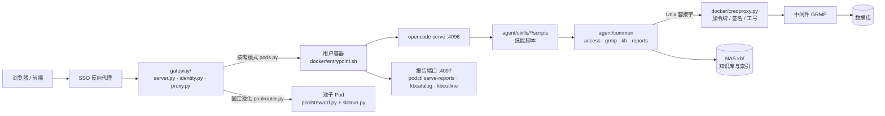

# 代码结构说明

本文逐个目录说明**每个代码文件的作用**，给后端与前端两方（含各自的编码智能体）在本仓库里找代码、改代码用。
构建与部署见《从源码构建到K8s运行-完整手册》，前端接口见《前端对接接口说明》。

> **本文有守卫测试**（`scripts/k8s/tests/test_code_structure_doc_units.py`）：新增、删除、改名代码文件而没有同步本文，测试就失败。
> 加文件时在对应目录的表里加一行；目录表的规则：标题里的 `` `路径/` `` 是这一节的目录，表格第一列是相对它的文件名。

## 0. 全景

### 0.1 顶层目录

| 目录 | 是什么 | 进哪个镜像 | 负责方 |
|---|---|---|---|
| `agent/` | 技能代码：公共层 `common/`、20 个技能 `skills/`、白名单 SQL `scripts/registry/`、模拟中间件、单测 | runtime、kb-import | 后端 |
| `docker/` | 镜像的 Dockerfile 与容器里的程序：启动脚本、`podctl`、凭据代理、报告端口的数据、固定池化的管家与槽位 | 全部 | 后端 |
| `gateway/` | 接入网关：认身份、按工号分配用户环境、反向代理、闲置回收、固定池化的分配与清扫 | gateway | 后端 |
| `k8s/` | 部署清单、网关建用户 Pod 的模板、现场工具（诊断、模拟 SSO、渲染池子）、本地测试覆盖层 | gateway（`templates/`） | 后端 |
| `scripts/` | 构建、离线打包、样例数据、测试集群与端到端脚本 | — | 后端 |
| `docs/` | 构建部署手册、前端对接接口说明、本文、机器可读的接口定义 | — | 双方 |
| `frontend/` | 前端（前端方建立与维护，本文不覆盖） | 前端方自建 | 前端 |

### 0.2 运行时：一个请求怎么走

- **对话**：网关把请求转给本人的 opencode；模型按 `agent/AGENTS.md` 与各技能的 `SKILL.md` 选技能，执行 `skills/<技能>/scripts/` 下的入口脚本；
  脚本经 `common/access.py` 取数——容器里走凭据代理到中间件，执行的 SQL 只能是 `scripts/registry/` 里登记过的白名单脚本。
- **报告**：脚本把结构化结果交给 `common/reports.py` 存进本人 NAS 的 `reports/`；报告端口（`docker/podctl.py serve-reports`）只读地端给前端。
- **知识库**：诊断脚本经 `common/kbsection.py` → `common/kb/query.py` 检索 NAS 上的共享知识库；知识库管理员在导入容器里用 `gaussdb-kb-import` 写入。

### 0.3 构建：代码怎么进镜像

| 镜像 | Dockerfile | 拷进去的代码 |
|---|---|---|
| `gaussdb-agent-runtime` | `docker/Dockerfile --target runtime` | `agent/` 经 `install-opencode.sh` 装成 opencode 技能（删掉 `gaussdb-kb-import`、`gaussdb-kb-init`，剩 18 个）；`docker/*.py`、`entrypoint.sh` |
| `gaussdb-agent-kb-import` | `docker/Dockerfile --target kb-import` | 同上，只留 `gaussdb-kb`、`gaussdb-kb-import`、`gaussdb-kb-init` |
| `gaussdb-agent-gateway` | `docker/Dockerfile.gateway` | `gateway/`、`k8s/templates/` |

### 0.4 命名约定

- 测试：`test_*_units.py` 不连库、不需要服务（默认都跑）；`test_*_live.py` 需要真实数据库或 Neo4j，没配时自动跳过；`*_e2e.py` 真跑脚本。
- 技能目录：`SKILL.md`（给模型读的说明）、`scripts/`（入口脚本与模块）、`references/`（给模型读的方法论）。入口脚本与技能同名（如 `health.py`）。
- `render.py`（Markdown 输出原语）、`sqlfetch.py`（sql_id → SQL 文本）、`procanalyze.py`（存储过程静态分析）在几个技能里各有一份**同源副本**——技能要能单独安装，所以不共用模块：
  `render.py` 除 config（参数体检自己的渲染，不是同一份）与 wdr（多了方块字符图）外逐字相同；`procanalyze.py` 两份逐字相同；`sqlfetch.py` 五份各有少量适配。改共同部分时把各份一起改（四份 sqlfetch 的降级行为由 `test_sqlfetch_degrade_units.py` 一起测）。

## 1. 仓库根目录 `./`

| 文件 | 作用 |
|---|---|
| `.dockerignore` | 构建镜像时不进构建上下文的目录(测试、文档、缓存),镜像里只有运行要的东西 |
| `.gitignore` | 不进仓库的东西:凭据与现场配置、构建产物、缓存;测试夹具里的日志样本例外 |
| `README.md` | 仓库首页:组成、目录、分工与协作约定、怎么跑测试 |
| `pytest.ini` | 仓库根的 pytest 配置:四组测试一起跑必须用 importlib 导入模式(否则同名的 tests 包互相冲突) |

## 2. `agent/` —— 技能代码

技能代码随技能仓库（gh_skill）同步而来（`UPSTREAM` 记录每次同步），加上容器部署的适配。两个用户镜像在构建时用 `install-opencode.sh` 把它装进 opencode 的技能目录。

### 2.1 `agent/`

| 文件 | 作用 |
|---|---|
| `AGENTS.md` | opencode 的全局提示词:智能体的角色、知识检索策略、安全红线、工具权限;装进用户镜像的 opencode 配置目录 |
| `LICENSE` | 技能代码的许可证(Apache License 2.0) |
| `NOTICE` | 版权声明 |
| `UPSTREAM` | 技能代码从技能仓库(gh_skill)同步的记录:每次同步的来源提交、内容与方向 |
| `deploy.sh` | 非容器部署的交互式安装:装技能、写 config.yaml(直连或中间件模式)、跑一轮连通性测试。容器部署不用它 |
| `install-opencode.sh` | 把技能装进 opencode 的技能目录(镜像构建时调用;也可单机安装),带快照与回滚 |
| `pytest.ini` | 技能单测的 pytest 标记定义(live = 需要真实数据库,没配连接时自动跳过) |
| `requirements.txt` | 技能的 Python 依赖:psycopg2、cryptography、PyYAML、sqlite-vec |

### 2.2 `agent/common/` —— 公共层

所有技能共用：取数统一入口、配置、会话、风险表达、报告存档、时间段解析，以及下面三个子包。

| 文件 | 作用 |
|---|---|
| `__init__.py` | 公共层的包标记:所有技能共用的连接、取数、报告、知识库模块都在这个包里 |
| `access.py` | 技能取数的统一入口:按连接的 driver 选路 —— 中间件(GRMP,含凭据代理)或直连数据库;前置条件不满足在这里就报清楚 |
| `audit.py` | 执行人标识:每次取数、每份发现都能落到人(容器里取平台注入的 GSDB_USER_ID) |
| `catalog_scope.py` | 目录类结果(表、索引、列统计、统计新鲜度、列类型)按 schema 过滤 |
| `cli.py` | 各技能共用的命令行参数,如 --session <会话句柄> |
| `config.example.yaml` | config.yaml 的样例(中间件模式):连接方式、中间件端点、令牌变量名 |
| `config.py` | 读取与校验 config.yaml:连接方式(gsql 直连 / api 中间件)、连接定义、中间件端点与签名设置、实例别名 |
| `config.yaml` | 随技能安装的默认 config.yaml(中间件模式样例值);容器里由 podctl 按环境变量重新生成 |
| `credential.py` | 直连模式的口令加密存取:AES-256-GCM,AAD 绑定连接名,配置文件里不允许出现明文口令 |
| `credential_cli.py` | 口令加密存取的命令行(python3 -m common.credential_cli set <连接名>) |
| `db.py` | Database 门面:对技能暴露稳定的取数接口,内部委托给某个直连后端 |
| `explain_actual.py` | 判断 EXPLAIN ANALYZE 到底执行了没有:看计划文本,不看请求标志 |
| `finding.py` | 跨技能统一的风险表达:Finding(级别、维度、代码、指标、取值、阈值、证据)与 Severity(健康 / 关注 / 告警 / 严重) |
| `kbsection.py` | 诊断技能接入「客户知识库参照」小节的公共入口:按每条发现检索客户知识库 |
| `kernel_funcs.py` | GaussDB 私有内核函数的探测与使用:gs_get_explain(运行态计划)、gs_get_kernel_info(内核事务水位) |
| `lockmodes.py` | 8 级表锁的互斥矩阵(锁等待解释「为什么被挡」用) |
| `proc_locate.py` | 存储过程「找不到」时代为排查:连的库对不对、执行账号有没有权限、过程在不在,并列出要问用户的问题 |
| `procname.py` | 存储过程名的解析与定位(支持 schema.package.proc;同名多个时拒绝,不猜)—— procinfo / proctune 共用 |
| `red_lines.md` | 公共安全红线正文:注入每个 SKILL.md 的「安全红线」与 AGENTS.md,逐字一致(有单测核对) |
| `reports.py` | 报告存档:技能跑完把结构化 JSON 写进本人 NAS 的 reports/(latest / index / targets),并在回答里给「打开报告」链接 |
| `schema_infer.py` | 贴 SQL 文本没带 --schema 时按表名找 schema:唯一就用,多个候选就问,没有就照旧 |
| `search_path.py` | EXPLAIN 前把 search_path 切到 SQL 原本的 schema |
| `session.py` | 当前会话选中的数据库连接,按会话句柄分文件(多会话又没给句柄时拒绝,不猜) |
| `spillnote.py` | 库级临时文件溢出 → 归到具体语句的那一句说明(WDR 与健康检查时段体检共用) |
| `sql.py` | 历史遗留的空模块(SQL 已全部移到 scripts/registry 的白名单脚本),保留以兼容旧的导入 |
| `sqlnotfound.py` | sql_id 在统计视图里查不到时的说明:为什么查不到、文本去哪找(explain 与 sqltune 共用) |
| `sqlqualify.py` | 把 SQL 里不带 schema 的表名补成 schema.表(search_path 切不成时的替代);也用来找出哪些表名没带 schema |
| `sqlrefs.py` | 从 SQL 文本里找出引用了哪些表(纯文本解析,不连库) |
| `sysobjects.py` | 识别数据库自带对象(系统 schema)—— sqltune 与 proctune 共用 |
| `syssql.py` | 慢 SQL / Top SQL 排行里排除 GaussDB 自己的系统 SQL(慢 SQL、Top SQL、健康检查、WDR 共用) |
| `timewin.py` | 时间段的覆盖解析:用户说「最近 N 分钟」或「某个时间段」时,实际评估哪一段、为什么 |
| `windata.py` | 时间段功能的取数:快照列表、数据库时钟(Top SQL 与健康检查共用) |

#### `agent/common/backends/` —— 直连后端

非容器部署的直连模式（`connection_mode: gsql`）用；容器部署走中间件，不用这里。

| 文件 | 作用 |
|---|---|
| `__init__.py` | 直连后端的包标记 |
| `base.py` | 直连后端的抽象接口与共用的 DBError |
| `gsql_backend.py` | gsql 后端:用 openGauss / GaussDB 的命令行客户端经本机 TCP 直连 |
| `gsql_protocol.py` | gsql 协议层(纯函数):参数注入、语句判别、结果与错误解析 |
| `psycopg2_backend.py` | psycopg2 后端:经 PostgreSQL 线协议直连 openGauss / GaussDB |

#### `agent/common/grmp/` —— 中间件协议

技能侧的中间件客户端、签名、白名单脚本的定义与渲染；本地模拟中间件（`agent/grmp_middleware/`）也复用这里。

| 文件 | 作用 |
|---|---|
| `__init__.py` | 中间件(GRMP)协议的运行时共用部分:技能侧客户端与本地模拟中间件共用 |
| `client.py` | 中间件客户端:查脚本清单 → 按逻辑名取 ID → 执行;响应按协议校验(只看 HTTP 200 会把业务错误当成功);经凭据代理时本进程不持凭据 |
| `columns.py` | 结果列名的唯一性检查 |
| `errors.py` | 统一入口的异常契约(QueryError 等),技能只需捕获一种异常 |
| `hints.py` | 把数据库 / 中间件的原始报错翻成一句现场 DBA 看得懂的话 |
| `params.py` | 技能传的原生取值 → 协议要求的字符串取值 |
| `paths.py` | 中间件接口的路径前缀:取部署配置 GRMP_PATH_PREFIX 并校验,没配就报清楚(代码里不写死) |
| `placeholder.py` | {{占位符}} 的类型校验与文本替换:中间件与直连两条执行路径共用的渲染器 |
| `proxy.py` | 经凭据代理访问中间件:走本 Pod 的 Unix 套接字,令牌、签名、工号由代理加 |
| `registry.py` | 白名单脚本仓库:按逻辑名(如 health.overview)查脚本定义 |
| `runner.py` | 直连路径的执行器:不经中间件,直接连库执行已注册的白名单脚本 |
| `script.py` | 脚本定义:白名单 YAML → ScriptRecord(与中间件 script_config 表的 21 列对应) |
| `serialize.py` | 结果集序列化(与中间件的返回形态一致) |
| `settings.py` | 协议兼容性开关的集中定义 |
| `signing.py` | 中间件请求签名:Appkey / Timestamp / Signature(SM2),签名的各项旋钮 |
| `sm2.py` | 国密 SM2 数字签名(GB/T 32918.2-2016),纯 Python |
| `sm3.py` | 国密 SM3 杂凑(GB/T 32905-2016),纯 Python,给 SM2 签名用 |
| `statement.py` | 语句形态判定:这条 SQL 是不是只读 |
| `userid.py` | 把调用人工号送到中间件(请求头或报文字段,按部署配置) |
| `values.py` | 把中间件返回的字符串值还原成 Python 类型 |

#### `agent/common/kb/` —— 客户知识库

知识库的读写全在这里：类型与格式、导入、索引（SQLite + sqlite-vec，Neo4j 可选）、检索与渲染、渐进式披露、官方文档集。

| 文件 | 作用 |
|---|---|
| `__init__.py` | 客户知识库共享层的包标记:所有技能都从这里查知识库 |
| `atomic.py` | 先写临时文件再改名:读写双方共享 NAS,任何时刻读到的都是完整文件 |
| `bm25.py` | 词法打分(BM25,信号词加权,归一到 0..1),文件模式与 SQLite 索引共用 |
| `cases.py` | 案例文件(cases/S<级>-日期-系统-标题.md)的解析与校验 |
| `catalog.py` | 全库条目的统一视图:规范条款、修正、案例、旧指南、六类类型化条目 → Entry |
| `chmdoc.py` | 官方文档包:解包(.chm / 含 .hhc 的 .zip / 已解开的目录)与读目录(.hhc) |
| `citestyle.py` | 知识引用在回答里的样子:按编号认出是哪个库、上什么颜色(贵行知识蓝色、产品文档青色),拼成「上色的句子(引用自 xxx 库 编号)」;WDR 渲染与回答格式检查共用 |
| `config.py` | 知识库配置:<kb>/kb.yaml、opencode 的模型端点、凭据名 |
| `docindex.py` | 官方文档集的检索索引(docsets/<代号>/index.sqlite,与客户知识库的索引分开) |
| `docnav.py` | 官方文档集在分层里的呈现:L0 一行、L1 专题页里的一节、按原书目录导航 |
| `docset.py` | 官方文档集(标准知识库的一层):由脚本从 CHM 生成、现场只读 |
| `docset_pack.py` | 标准知识库包:docsets/<代号>/ 与 kb-std-<代号>-<版本>.tar.gz 互转(打包前检查测试开关与校验错误) |
| `docsplit.py` | 官方文档的切分:目录节点 + 页面 → 产品文档条目(纯函数) |
| `embed.py` | OpenAI 兼容的 /v1/embeddings 客户端:分批、失败隔离、按内容哈希缓存 |
| `extract.py` | 把文档变成纯文本:txt / md / docx / doc / pdf / pptx(扫描件 PDF 报 UnreadablePdf,交给 pdfpages 渲染) |
| `graphfiles.py` | 关系图文件(graph/*.yaml 三元组)与实体别名表(graph/canonical.yaml)的解析、归一、校验 |
| `htmldoc.py` | 官方文档页面(DITA 导出的 HTML)→ markdown |
| `imgconv.py` | 把 read 工具打不开的图片(HEIC / HEIF / TIFF)转成 JPEG 副本,给模型看图用 |
| `inbox.py` | 知识库导入的收件目录,以及「文件在用户电脑上、不在环境里」时给用户的说明 |
| `indexer.py` | 索引器:知识库文件 → SQLite 索引 index/store.sqlite(切块、词法、向量、节点向量),配了 Neo4j 再同步图 |
| `ingest.py` | 工单导入的确定性半边:csv / xlsx / md / txt → 一单一文件 |
| `initstd.py` | 入库前的标准化:各种工单材料 → 统一的六要素 md |
| `layers.py` | 渐进式披露的上两层:L0 总索引、L1 专题导航(由条目元数据与关系图生成) |
| `lock.py` | 知识库写入互斥(两个导入不能互相覆盖) |
| `pdfpages.py` | 扫描件 / 乱码 PDF 的每一页渲染成 jpg(pdftoppm),交给模型看图转录;页数有上限 |
| `query.py` | 混合检索编排:按诊断发现查库 —— 词法 ∥ 向量 ∥ 图扩展 → RRF 融合 → 分类型 top-k → 阈值;客户池与官方文档池分开 |
| `render.py` | 「客户知识库参照」固定小节的渲染器(所有接入的技能共用一个) |
| `rulesfile.py` | 规则文件(rules/*.yaml、guides/*.md、errata/*.md)的读取辅助 |
| `store.py` | 存储层共用的数据形状:索引器写、检索读,两种存储都用这一套 |
| `store_files.py` | 文件模式存储:还没建索引或打不开时,直接在知识库文件上检索与推路径 |
| `store_graph.py` | Neo4j 存储:经 HTTP Query API 跑 Cypher(标准库实现,可选组件) |
| `store_sqlite.py` | 知识库的派生索引 index/store.sqlite:切块、词法倒排、向量(sqlite-vec)、节点向量 |
| `text.py` | 分词(中文二元组 + 标识符),词法检索的确定性半边 |
| `topics.py` | 专题(L1 的划分):定义、文字 → 专题、诊断发现 → 专题 |
| `types.py` | 八类知识的登记表,与类型化条目(md + frontmatter)的解析与校验 |
| `versions.py` | 适用性判断:条目声明的产品系列 / 版本 / 系统 与本实例的环境画像比对(适用 / 不适用 / 未知) |
| `webclip.py` | 网页剪藏:剪藏批次(书签交来的网页或另存的 .mhtml)→ 干净的 md(找正文、去导航评论页脚、保留表格代码与截图);登录页 / 无权限页拒绝 |

#### `agent/common/answer_templates/` —— 回答模板

各类回答的固定版式,唯一正文;由 `tools/inject_answer_templates.py` 按技能类型拼接后注入各 SKILL.md 的「## 回答模板」与 AGENTS.md(守卫测试保证逐字一致)。

| 文件 | 作用 |
|---|---|
| `cite.md` | 知识引用写法:句子上色、句后括号注明出处(引用自 xxx 库 编号)、库名与颜色对照、兜底说法 |
| `common.md` | 所有回答共用的开头与结尾(评估时段 → 总体状态 → 短结论 …「需要就 … 吗?」)、两种读者写法、照旧的写法规矩 |
| `explain.md` | 只看执行计划时的版式 |
| `fault.md` | 故障排查四段:现象(含关联现象)→ 根因 → 解决方案 → 总结 |
| `health.md` | 巡检四段(健康检查、参数体检):现象 → 根因和证据链 → 解决方案 → 总结和结论 |
| `proctune.md` | 存储过程优化三段 |
| `qa.md` | 知识问答:第一行解答来源 → 解答正文 → 举例说明 → 引申和拓展 |
| `ranking.md` | 榜单(Top SQL、慢 SQL):短结论 → 榜单 → 为什么排上来 → 建议下一步 |
| `related.md` | 关联现象清单:用户报的现象 → 必查的关联现象 → 用哪个技能取 |
| `routing.md` | 先判断问题属于哪一类(只注入 AGENTS.md) |
| `sqltune.md` | SQL 优化四段:现状与趋势 → 文本和执行计划解读 → 怎么优化(前后对比)→ 总结 |
| `wdr.md` | WDR 解读(由脚本渲染):interp.json 各字段落在报告的哪一段 |

### 2.3 `agent/skills/` —— 20 个技能

| 技能 | 做什么 | 装在哪个镜像 |
|---|---|---|
| `gaussdb-login` | 登录并选定本次会话的数据库,所有数据库操作的第一步 | runtime |
| `gaussdb-health` | 数据库健康检查(此刻巡检 / 时段体检),汇总 waitevent、vacuum、lockwait | runtime |
| `gaussdb-slowsql` | 按耗时阈值找慢 SQL | runtime |
| `gaussdb-topsql` | Top SQL 多维排名、时间段与增量、等待与自身耗时 | runtime |
| `gaussdb-sqlfetch` | sql_id → 完整 SQL 文本 | runtime |
| `gaussdb-explain` | 查看与对比执行计划 | runtime |
| `gaussdb-sqltune` | 慢 SQL 深度调优与证据化验证(证据包、代价推演、假设索引、改写验证) | runtime |
| `gaussdb-sqlreview` | SQL / DDL 规范审查 | runtime |
| `gaussdb-lockwait` | 锁等待与阻塞链、时段锁回溯、死锁日志解析 | runtime |
| `gaussdb-waitevent` | DB time 分解与等待事件下钻 | runtime |
| `gaussdb-vacuum` | 死元组、autovacuum、膨胀与冻结水位评估 | runtime |
| `gaussdb-memanalyze` | 动态内存冲高分析 | runtime |
| `gaussdb-wdr` | WDR 窗口诊断与报告解读 | runtime |
| `gaussdb-config` | 运行参数体检 | runtime |
| `gaussdb-topproc` | 存储过程 / 函数耗时排名 | runtime |
| `gaussdb-procinfo` | 存储过程只读诊断(源码结构与热点) | runtime |
| `gaussdb-proctune` | 存储过程调优与证据化验证 | runtime |
| `gaussdb-kb` | 客户知识库查询与引用核对(只读) | runtime、kb-import |
| `gaussdb-kb-import` | 知识库导入与治理(规范、工单、官方文档、类型化条目、索引) | kb-import |
| `gaussdb-kb-init` | 入库前的标准化:杂格式工单材料 → 六要素 md | kb-import |

每个技能一节；表里 `SKILL.md` 是给模型读的说明，`scripts/` 是脚本，`references/` 是给模型读的参考资料。

#### `agent/skills/gaussdb-login/`

| 文件 | 作用 |
|---|---|
| `SKILL.md` | 技能说明(给模型读):何时使用、工作流、命令、输出与引用要求、安全红线 |
| `scripts/login.py` | 入口:登录并选定本次会话的数据库(中间件模式按实例 IP / 库名或别名),核对库名、探测主备,发会话句柄 |
| `scripts/render.py` | Markdown 输出的公共原语 |

#### `agent/skills/gaussdb-health/`

| 文件 | 作用 |
|---|---|
| `SKILL.md` | 技能说明(给模型读):何时使用、工作流、命令、输出与引用要求、安全红线 |
| `scripts/aggregate.py` | 以子进程调用 waitevent / vacuum / lockwait,把它们的发现并入健康检查 |
| `scripts/collectors.py` | 本地维度的只读采集器:概览、慢 SQL、长事务、连接、检查点 / WAL / 归档、复制、对象、并发、存储;单项失败只降级不中断 |
| `scripts/counters.py` | 累计计数器的「距上次」增量(如死锁新增) |
| `scripts/health.py` | 入口:此刻巡检或时段体检,汇总各维度与子技能,出报告并存档 |
| `scripts/model.py` | 证据与发现的数据结构、维度名常量 |
| `scripts/render.py` | Markdown 输出的公共原语 |
| `scripts/report.py` | 健康检查报告的渲染 |
| `scripts/running_sql.py` | 执行中、还没结束的长 SQL(慢 SQL 维度的另一半) |
| `scripts/thresholds.py` | 确定性判定的阈值(可调) |
| `scripts/util.py` | 格式化与级别判定的小工具 |
| `scripts/window.py` | 时段体检:评估某个时间段 / 最近 N 分钟 |
| `references/gaussdb-health-methodology.md` | 参考资料(给模型读):健康检查方法论 |
| `references/health-thresholds.md` | 参考资料(给模型读):阈值的默认值与取值理由 |
| `references/setup.md` | 参考资料(给模型读):安装与故障对照 |

#### `agent/skills/gaussdb-slowsql/`

| 文件 | 作用 |
|---|---|
| `SKILL.md` | 技能说明(给模型读):何时使用、工作流、命令、输出与引用要求、安全红线 |
| `scripts/render.py` | Markdown 输出的公共原语 |
| `scripts/slowsql.py` | 入口:列出平均耗时超过阈值的语句(排除内核系统 SQL),可导出 CSV |

#### `agent/skills/gaussdb-topsql/`

| 文件 | 作用 |
|---|---|
| `SKILL.md` | 技能说明(给模型读):何时使用、工作流、命令、输出与引用要求、安全红线 |
| `scripts/delta.py` | 窗口增量:两次采样相减,回答「最近这段时间谁在冲高」 |
| `scripts/render.py` | Markdown 输出的公共原语 |
| `scripts/span.py` | 某个时间段 / 最近 N 分钟的 Top SQL |
| `scripts/topsql.py` | 入口:Top SQL 多维排名(time / avg / calls / reads / rows / self / self_avg),存档并给大盘链接 |
| `scripts/waits.py` | 把被锁挡住的语句与自己慢的语句分开(等待占比、自身耗时) |

#### `agent/skills/gaussdb-sqlfetch/`

| 文件 | 作用 |
|---|---|
| `SKILL.md` | 技能说明(给模型读):何时使用、工作流、命令、输出与引用要求、安全红线 |
| `scripts/render.py` | Markdown 输出的公共原语 |
| `scripts/sqlfetch.py` | 入口:把 unique_sql_id 解析成完整 SQL 文本(统计视图 → SQL 历史,备机自动降级) |

#### `agent/skills/gaussdb-explain/`

| 文件 | 作用 |
|---|---|
| `SKILL.md` | 技能说明(给模型读):何时使用、工作流、命令、输出与引用要求、安全红线 |
| `scripts/explain.py` | 入口:取 SQL 的执行计划(估算 / 运行态 / 历史真实计划)并给出确定性风险发现 |
| `scripts/render.py` | Markdown 输出的公共原语(各技能各一份同源副本) |
| `scripts/sqlfetch.py` | sql_id → SQL 文本(各调优类技能各一份同源副本) |

#### `agent/skills/gaussdb-sqltune/`

| 文件 | 作用 |
|---|---|
| `SKILL.md` | 技能说明(给模型读):何时使用、工作流、命令、输出与引用要求、安全红线 |
| `references/gaussdb-a-compat-gotchas.md` | 参考资料(给模型读):A 兼容(Oracle 模式)陷阱 |
| `references/gaussdb-cbo-and-diagnosis.md` | 参考资料(给模型读):CBO 与诊断深度知识 |
| `references/gaussdb-partition-distribution.md` | 参考资料(给模型读):分区与分布 |
| `references/gaussdb-rewrite-patterns.md` | 参考资料(给模型读):改写正例库 |
| `references/og-internals.md` | 参考资料(给模型读):内核速查表 |
| `references/setup.md` | 参考资料(给模型读):安装与连接 |
| `references/tuning-methodology.md` | 参考资料(给模型读):SQL 调优方法论 |
| `scripts/calibrate.py` | 校准闸:用公式复算 EXPLAIN 给出的计划,逐节点与实测比对 |
| `scripts/catalog.py` | 把证据包整理成可按名字查的目录,并守住两道前置门 |
| `scripts/coltypes.py` | 按目录推断占位符的列类型 |
| `scripts/cost.py` | 计划代价提取与 SQL 引号处理 |
| `scripts/costconst.py` | 参数 → 代价常数(含单位换算) |
| `scripts/costmodel.py` | 代价模型:按规划器公式复算每个算子的 cost |
| `scripts/derivation.py` | 推演报告:把「凭什么信这些数」摊开 |
| `scripts/evidence.py` | 调优证据包:计划、表、索引、列统计、参数、风险 |
| `scripts/hypoindex.py` | 假设索引验证(hypopg) |
| `scripts/placeholder.py` | SQL 占位符自动代入合成值 |
| `scripts/planrules.py` | 根因规则:计划节点 + SQL 正文都能确定的才报 |
| `scripts/plantree.py` | EXPLAIN (FORMAT JSON) → 节点树 |
| `scripts/render.py` | Markdown 输出的公共原语 |
| `scripts/resolve.py` | 把计划节点接到目录与代价模型上 |
| `scripts/rewritediff.py` | 改写前后的对比:SQL 文本差异与两棵执行计划(verify 输出里的「SQL 文本差异」「执行计划(改写前 / 改写后)」) |
| `scripts/selectivity.py` | 选择率估算(从解释现状走到预测改动) |
| `scripts/sqlfetch.py` | sql_id → SQL 文本 |
| `scripts/sqltrend.py` | SQL 优化第 ① 段「现状与趋势」的取数与判定:执行次数与耗时、快照相减按小时、突然变慢的拐点、执行计划指纹与结构比对 |
| `scripts/sqltrendmd.py` | 「现状与趋势」三节的 markdown:## Current Stats / ## Trend / ## Plan Changes |
| `scripts/sqltune.py` | 入口:取 SQL → 代入占位符 → 采证据包 → 假设索引验证 → 推演 |
| `scripts/systables.py` | 系统 SQL 策略闸:数据库自己的语句不调优 |
| `scripts/verify.py` | 改写验证:新旧写法的计划与结果对比 |
| `scripts/whatif.py` | 假设路径:把还不存在的索引代进计划重算代价 |

#### `agent/skills/gaussdb-sqlreview/`

| 文件 | 作用 |
|---|---|
| `SKILL.md` | 技能说明(给模型读):何时使用、工作流、命令、输出与引用要求、安全红线 |
| `scripts/checks.py` | 规则判定(纯函数) |
| `scripts/lexer.py` | SQL 词法分析(纯函数,只用标准库) |
| `scripts/model.py` | 审查的数据模型(不可变值类型) |
| `scripts/objects.py` | 目录采集(只取数,不判定) |
| `scripts/render.py` | Markdown 输出的公共原语 |
| `scripts/report.py` | 审查报告渲染 |
| `scripts/rules.py` | 加载并校验 rules.yaml |
| `scripts/sqlfetch.py` | sql_id → SQL 文本 |
| `scripts/sqlreview.py` | 入口:按 rules.yaml 审查 SQL / DDL / 已有 schema / 线上 Top SQL |
| `references/rules.yaml` | SQL 规范清单:审查规则的唯一来源,改这个文件就是改规范 |

#### `agent/skills/gaussdb-lockwait/`

| 文件 | 作用 |
|---|---|
| `SKILL.md` | 技能说明(给模型读):何时使用、工作流、命令、输出与引用要求、安全红线 |
| `scripts/aspchain.py` | 时段锁回溯:从活跃会话采样(ASP,落表 + 内存)还原一段时间里谁挡了谁 |
| `scripts/chain.py` | 阻塞链的上溯与环检测(纯函数),根阻塞会话算到链尾 |
| `scripts/deadlocklog.py` | 死锁日志解析(纯函数) |
| `scripts/deadlockreport.py` | 死锁日志解析结果的呈现 |
| `scripts/locktypes.py` | 按锁类型解释「为什么会被挡」(8 级矩阵只适用于表级锁) |
| `scripts/lockwait.py` | 入口:锁等待分析 —— 谁挡了谁、挡在什么锁上、挡了多久、根源是谁 |
| `scripts/recovery.py` | 快速恢复语句的生成(只生成文本,绝不执行) |
| `scripts/render.py` | Markdown 输出的公共原语 |

#### `agent/skills/gaussdb-waitevent/`

| 文件 | 作用 |
|---|---|
| `SKILL.md` | 技能说明(给模型读):何时使用、工作流、命令、输出与引用要求、安全红线 |
| `scripts/dbtime.py` | DB time 分解与判定(纯函数) |
| `scripts/render.py` | Markdown 输出的公共原语 |
| `scripts/waitevent.py` | 入口:多窗口 DB time 分解 + 等待事件下钻 |

#### `agent/skills/gaussdb-vacuum/`

| 文件 | 作用 |
|---|---|
| `SKILL.md` | 技能说明(给模型读):何时使用、工作流、命令、输出与引用要求、安全红线 |
| `scripts/bloat.py` | 表膨胀估算(纯函数) |
| `scripts/freeze.py` | 事务号冻结水位判定(纯函数) |
| `scripts/render.py` | Markdown 输出的公共原语 |
| `scripts/rules.py` | autovacuum 触发线现算 + 四条手工清理判定 |
| `scripts/thresholds.py` | 手工清理判定的阈值 |
| `scripts/vacuum.py` | 入口:死元组 / autovacuum 健康度评估、卡住回收的事务、冻结水位 |

#### `agent/skills/gaussdb-memanalyze/`

| 文件 | 作用 |
|---|---|
| `SKILL.md` | 技能说明(给模型读):何时使用、工作流、命令、输出与引用要求、安全红线 |
| `scripts/capability.py` | 参数探测:哪些层能取到数据,取不到时为什么 |
| `scripts/collectors.py` | 实例 / 内存上下文 / 会话 / 配置四层采集 |
| `scripts/memanalyze.py` | 入口:动态内存冲高分析(snapshot / history / watch),六层逐级下钻 |
| `scripts/model.py` | 证据数据结构 |
| `scripts/probe.py` | 运行时视图发现(让技能在 openGauss 与 GaussDB 上都能跑) |
| `scripts/render.py` | Markdown 输出的公共原语 |
| `scripts/report.py` | 报告渲染(纯函数) |
| `scripts/thresholds.py` | 判定阈值 |
| `scripts/trend.py` | watch 模式的趋势判定(泄漏还是冲高) |
| `scripts/util.py` | 格式化与类型转换小工具 |
| `scripts/wlm.py` | SQL 级与算子级资源跟踪的采集 |
| `references/gaussdb-memory-internals.md` | 参考资料(给模型读):内存架构背景知识 |
| `references/memory-methodology.md` | 参考资料(给模型读):动态内存冲高归因方法论 |

#### `agent/skills/gaussdb-wdr/`

| 文件 | 作用 |
|---|---|
| `SKILL.md` | 技能说明(给模型读):何时使用、工作流、命令、输出与引用要求、安全红线 |
| `references/setup.md` | 参考资料(给模型读):安装与常见症状 |
| `references/wdr-methodology.md` | 参考资料(给模型读):WDR 解读方法论 |
| `references/wdr-thresholds.md` | 参考资料(给模型读):WDR 阈值口径 |
| `scripts/ansi.py` | 终端彩色输出与中文对齐的表格 |
| `scripts/appendix.py` | WDR 报告的附录与校验区:本报告没覆盖的、SQL 附录(全文 + 执行计划)、模型遗漏 / 未锚定 / 未验证建议 |
| `scripts/collectors.py` | 七个维度的快照增量采集与编排 |
| `scripts/finalreport.py` | 由证据与模型解读渲染最终 WDR 报告 |
| `scripts/followup.py` | 给模型执行的「下一步要查什么」(走标准错误,不进用户看的报告) |
| `scripts/interp.py` | 模型解读(interp.json)的结构与加载 |
| `scripts/kbrefs.py` | WDR 报告里的知识引用:渲染前用 cite-check 核对编号,再上色、加出处括号;核对不过的不进正文 |
| `scripts/mdreport.py` | WDR 报告的 markdown 版式:负载画像 → 问题与元凶 → 解决方案 → 总结和结论 → 附录 |
| `scripts/model.py` | 证据与发现的数据结构、维度名常量 |
| `scripts/native.py` | 快照窗口加载,原生 WDR 报告留底(尽力而为) |
| `scripts/recheck.py` | 确定性锚定闸:模型解读里的数字必须能在证据里找到 |
| `scripts/render.py` | Markdown 输出的公共原语(另有对话里的方块字符图) |
| `scripts/report.py` | WDR 证据包(collect 输出)的渲染 |
| `scripts/snaps.py` | wdr snaps:列快照、按时间段找窗口、检查 WDR 开关 |
| `scripts/thresholds.py` | 确定性判定的阈值 |
| `scripts/util.py` | 格式化小工具 |
| `scripts/wdr.py` | 入口:snaps / collect / render 三个子命令;从不创建快照、从不执行变更 |

#### `agent/skills/gaussdb-config/`

| 文件 | 作用 |
|---|---|
| `SKILL.md` | 技能说明(给模型读):何时使用、工作流、命令、输出与引用要求、安全红线 |
| `scripts/audit.py` | 参数体检的判定(纯函数,不连库) |
| `scripts/baseline.py` | 参数基线(纯数据 + 单位归一) |
| `scripts/config.py` | 入口:取全量参数、比对基线、出报告并存档 |
| `scripts/render.py` | 参数体检报告的渲染(纯函数;与其它技能的 render.py 不是同一份) |

#### `agent/skills/gaussdb-topproc/`

| 文件 | 作用 |
|---|---|
| `SKILL.md` | 技能说明(给模型读):何时使用、工作流、命令、输出与引用要求、安全红线 |
| `scripts/render.py` | Markdown 输出的公共原语 |
| `scripts/topproc.py` | 入口:存储过程 / 函数按总耗时、自身耗时、调用次数排名 |

#### `agent/skills/gaussdb-procinfo/`

| 文件 | 作用 |
|---|---|
| `SKILL.md` | 技能说明(给模型读):何时使用、工作流、命令、输出与引用要求、安全红线 |
| `scripts/procanalyze.py` | PL/pgSQL 静态结构分析:循环内 SQL、逐行 DML、动态 SQL、循环内异常 |
| `scripts/procinfo.py` | 入口:存储过程只读诊断(源码、结构扫描、内嵌游标 SELECT、关键参数) |
| `scripts/render.py` | Markdown 输出的公共原语 |

#### `agent/skills/gaussdb-proctune/`

| 文件 | 作用 |
|---|---|
| `SKILL.md` | 技能说明(给模型读):何时使用、工作流、命令、输出与引用要求、安全红线 |
| `scripts/cost.py` | 计划代价提取与 SQL 引号处理 |
| `scripts/evidence.py` | 调优证据包:计划、表、索引、列统计、参数、风险 |
| `scripts/hypoindex.py` | 假设索引验证(hypopg) |
| `scripts/procanalyze.py` | PL/pgSQL 静态结构分析(与 procinfo 同源) |
| `scripts/proctune.py` | 入口:存储过程分析与游标 SELECT 调优 |
| `scripts/render.py` | Markdown 输出的公共原语 |
| `scripts/sqlfetch.py` | sql_id → SQL 文本 |
| `scripts/sysprocs.py` | 系统存储过程策略闸:只调优用户自己的过程 |
| `scripts/verify.py` | 改写验证:新旧写法的计划与结果对比 |
| `references/gaussdb-a-compat-gotchas.md` | 参考资料(给模型读):A 兼容(Oracle 模式)陷阱 |
| `references/gaussdb-cbo-and-diagnosis.md` | 参考资料(给模型读):CBO 与诊断深度知识 |
| `references/gaussdb-partition-distribution.md` | 参考资料(给模型读):分区与分布 |
| `references/gaussdb-rewrite-patterns.md` | 参考资料(给模型读):改写正例库 |
| `references/proc-internals.md` | 参考资料(给模型读):存储过程内幕 |
| `references/proc-setup.md` | 参考资料(给模型读):安装与排错 |
| `references/proc-tuning-methodology.md` | 参考资料(给模型读):存储过程调优方法论 |

#### `agent/skills/gaussdb-kb/`

| 文件 | 作用 |
|---|---|
| `SKILL.md` | 技能说明(给模型读):何时使用、工作流、命令、输出与引用要求、安全红线 |
| `scripts/kb.py` | 查询技能入口:query / health / search / cite-check;诊断环境里只有这一个知识库技能(只读) |
| `scripts/kb_cite.py` | cite-check:核对一段回答里引用的知识 ID 是否真的在库里(找不到即疑似编造) |
| `scripts/kb_read.py` | 只读命令:渐进式披露的四层读取(overview / topic / doc / show / evidence),与导入技能共用一份 |

#### `agent/skills/gaussdb-kb-import/`

| 文件 | 作用 |
|---|---|
| `SKILL.md` | 技能说明(给模型读):何时使用、工作流、命令、输出与引用要求、安全红线 |
| `references/case-format.md` | 参考资料(给模型读):案例文件格式 |
| `references/docset.md` | 参考资料(给模型读):官方文档集的导入方法与读法 |
| `references/graph-schema.md` | 参考资料(给模型读):关系图与三元组文件的格式 |
| `references/kb-contract.md` | 参考资料(给模型读):知识库契约(注入各诊断技能的 SKILL.md):优先级、按层读、标蓝、无先例声明 |
| `references/kb-layout.md` | 参考资料(给模型读):知识库目录与条款格式规范 |
| `references/knowledge-types.md` | 参考资料(给模型读):八类知识:类型、目录、必须记什么 |
| `references/selection-list.md` | 参考资料(给模型读):选择列表(写库前的唯一闸门)的格式 |
| `references/storage-setup.md` | 参考资料(给模型读):存储接入(kb.yaml 与凭据) |
| `references/web-clip-guide.md` | 参考资料(给模型读):分浏览器的书签安装步骤、剪藏用法、排障表与 .mhtml 退路 |
| `scripts/kb.py` | 导入技能入口:知识库的建设与治理(ingest、review、apply、index、validate、官方文档集等子命令的分派) |
| `scripts/kb_cases.py` | 工单 / 案例侧子命令:ingest(工单)/ propose / review(选择列表)/ apply |
| `scripts/kb_clip.py` | 网页剪藏子命令:clip status / list / ingest / add / clean(剪藏开没开、批次转 md、另存的 .mhtml 成批次、清理) |
| `scripts/kb_docset.py` | 官方文档集子命令:CHM → 标准知识库的一层(扫描、计划、精修摘要、应用、校验、打包) |
| `scripts/kb_items.py` | 写命令:类型化条目入库、证据存档、改类型、存量迁移、画像起草、专题定义、清理收件目录 |
| `scripts/kb_read.py` | 只读命令:渐进式披露的四层读取(与查询技能共用一份) |
| `scripts/kb_store.py` | 存储侧子命令:setup / index / feedback / eval |

**`testdata/`**（测试与演示数据，52 个文件）：`sample-kb/` 是一套虚构系统（CBST / CBMS）的样例知识库——规范 `rules/`、案例 `cases/`、手册 `runbooks/`、缺陷 `defects/`、基线 `baselines/`、产品文档 `product/`、环境画像 `profiles/`、Wiki `wiki/`、关系图 `graph/`、评测问题集 `eval/`；`demo/` 是演示用的工单导出、故障报告与演示手册。单测与 `scripts/dash-samples.py` 都用它。

#### `agent/skills/gaussdb-kb-init/`

| 文件 | 作用 |
|---|---|
| `SKILL.md` | 技能说明(给模型读):何时使用、工作流、命令、输出与引用要求、安全红线 |
| `scripts/kb_init.py` | 入口:scan → 模型写草稿 → render → validate,把杂格式工单材料标准化成六要素 md |
| `references/std-format.md` | 参考资料(给模型读):统一格式(六要素 md)的规范 |

### 2.4 `agent/scripts/registry/` —— 白名单 SQL 脚本

技能执行的每一条 SQL 都在这里登记：一个 YAML 一条脚本（`name` 逻辑名、`description`、`readonly`、`sql`、`params`）。
容器部署时，这些脚本由中间件团队按交付的 DML 导入中间件（白名单），技能按**逻辑名**调用；直连模式下由 `common/grmp/runner.py` 直接执行同一份 SQL。
子目录名与使用它的技能同名（`perf/`、`session/` 两组例外，见各自说明）。下表「作用」取自各文件自己的 `description`。全部只读（`readonly` 不写即为只读，没有一条写成 false）。

#### `agent/scripts/registry/config/`

| 文件 | 逻辑名 | 作用 |
|---|---|---|
| `settings.yaml` | `config.settings` | 全量运行参数（含单位、默认值、生效方式），供参数体检比对基线 |

#### `agent/scripts/registry/explain/`

| 文件 | 逻辑名 | 作用 |
|---|---|---|
| `active_pid.yaml` | `explain.active_pid` | 按 unique_sql_id 定位正在执行该 SQL 的会话(pid / query / query_start) |
| `from_history.yaml` | `explain.from_history` | 按 unique_query_id 从 SQL 历史里取最近一条完整语句 |
| `from_statement.yaml` | `explain.from_statement` | 按 unique_sql_id 从 SQL 统计视图里取语句正文 |
| `kernel_funcs.yaml` | `explain.kernel_funcs` | 探测 GaussDB 私有内核函数(gs_get_explain / gs_get_kernel_info)是否存在,并带回 version() |
| `multi_stmt_probe.yaml` | `explain.multi_stmt_probe` | 探测中间件能否在一条脚本里执行两条语句(SET 后 SELECT 1) |
| `plan_from_history.yaml` | `explain.plan_from_history` | 按 unique_query_id 从 SQL 历史里取最近一次真实执行计划(含执行时间、耗时、返回行数) |
| `plan_text.yaml` | `explain.plan_text` | 取一条只读 SQL 的执行计划（TEXT 格式，不执行该 SQL） |
| `plan_text_analyze.yaml` | `explain.plan_text_analyze` | 取一条只读 SQL 的执行计划（TEXT 格式；现场按客户只读要求把 ANALYZE 固定关闭，不执行该 SQL，结果与 plan_text 相同，是估算计划；保留此名只为兼容） |
| `plan_text_analyze_schema.yaml` | `explain.plan_text_analyze_schema` | 先把 search_path 切到指定 schema,再取一条只读 SQL 的执行计划(TEXT格式;现场按客户只读要求 ANALYZE 固定关闭,估算计划) |
| `plan_text_schema.yaml` | `explain.plan_text_schema` | 先把 search_path 切到指定 schema,再取一条只读 SQL 的执行计划(TEXT格式,不执行该 SQL) |
| `relation_schemas.yaml` | `explain.relation_schemas` | 按表名查它们所在的 schema(贴文本没带 --schema 时推断 schema 用) |
| `runtime_plan.yaml` | `explain.runtime_plan` | 按后台线程 pid 取运行态执行计划(gs_get_explain(bigint),GaussDB 私有,505.2.1 实测签名;不执行 SQL) |
| `runtime_plan_int4.yaml` | `explain.runtime_plan_int4` | 按后台线程 pid 取运行态执行计划(gs_get_explain(integer),文档签名的内核用;不执行 SQL) |
| `session_by_pid.yaml` | `explain.session_by_pid` | 按 pid 取会话当前语句(pid / query / query_start / state) |

#### `agent/scripts/registry/health/`

| 文件 | 逻辑名 | 作用 |
|---|---|---|
| `archive_mode.yaml` | `health.archive_mode` | 归档模式是否开启 |
| `bgwriter.yaml` | `health.bgwriter` | 检查点计数（定时/请求触发） |
| `conn_concentration.yaml` | `health.conn_concentration` | 活跃连接是否集中在同一条语句上 |
| `conn_states.yaml` | `health.conn_states` | 连接状态分布 |
| `db_concurrency.yaml` | `health.db_concurrency` | 当前库的死锁与事务提交/回滚计数 |
| `db_info.yaml` | `health.db_info` | 查看数据库相关信息（编码、兼容模式、连接限制等） |
| `invalid_index.yaml` | `health.invalid_index` | 失效索引数量 |
| `live_counters.yaml` | `health.live_counters` | 此刻的库级累计计数（与 snap_counters 对应）及实例启动 / 统计重置时刻 |
| `live_waits.yaml` | `health.live_waits` | 此刻的等待事件累计值（按等待类与事件） |
| `long_xact.yaml` | `health.long_xact` | 长事务与长时间未变状态的会话 |
| `overview.yaml` | `health.overview` | 实例概览（缓存命中率/连接数/恢复态/最老事务） |
| `partitions.yaml` | `health.partitions` | 分区表的分区数量与分区策略 |
| `prepared_xacts.yaml` | `health.prepared_xacts` | 悬挂的两阶段事务数量 |
| `replication.yaml` | `health.replication` | 主备复制状态与延迟 |
| `slow_sql.yaml` | `health.slow_sql` | 平均耗时超阈值的语句 |
| `snap_counters.yaml` | `health.snap_counters` | 指定快照时刻的库级累计计数（DB time / 事务 / 死锁 / 溢出 / 命中 / 检查点） |
| `snap_waits.yaml` | `health.snap_waits` | 指定快照时刻的等待事件累计值（按等待类与事件） |
| `stale_stats.yaml` | `health.stale_stats` | 表的统计信息新鲜度证据（页数漂移 + 统计列数 + 上次 ANALYZE） |
| `stats_window.yaml` | `health.stats_window` | 统计计数器上次重置的时间与至今时长（解释一切累计值的前提） |
| `storage.yaml` | `health.storage` | 库与表空间的占用量（取不到剩余空间，见脚本注释） |
| `sync_commit.yaml` | `health.sync_commit` | 同步提交配置与部署形态（判断主库会不会因等同步备而卡住） |
| `thread_pool.yaml` | `health.thread_pool` | 线程池是否开启、池大小与真实会话数 |
| `unused_index.yaml` | `health.unused_index` | 索引用量全局视图（含扫描次数、大小、是否约束背书、所属表的扫描分布） |
| `wal_slots.yaml` | `health.wal_slots` | 复制槽落后的 WAL 字节数与是否活跃 |

#### `agent/scripts/registry/lockwait/`

| 文件 | 逻辑名 | 作用 |
|---|---|---|
| `asp_pairs.yaml` | `lockwait.asp_pairs` | 时段内的锁阻塞对(活跃会话采样:落表的 gs_asp + 内存里的 local_active_session):等待者、阻塞者、锁、锁对象、采到次数、首末次时间 |
| `asp_sessions.yaml` | `lockwait.asp_sessions` | 时段内锁阻塞涉及的会话(活跃会话采样:落表的 gs_asp + 内存里的 local_active_session):最后状态、语句、应用、客户端、事务开始时间 |
| `asp_status.yaml` | `lockwait.asp_status` | 活跃会话采样(ASP)的开关、采样/落表参数、保留天数,时段内落表与内存里各有多少样本、各覆盖到哪 |
| `chain.yaml` | `lockwait.chain` | 阻塞关系的边（会话 → 阻塞它的会话） |
| `pairs.yaml` | `lockwait.pairs` | 锁堵塞的持有者/等待者成对明细（含双方锁模式、锁对象、等待时长、双方 SQL） |

#### `agent/scripts/registry/memanalyze/`

| 文件 | 逻辑名 | 作用 |
|---|---|---|
| `activity.yaml` | `memanalyze.activity` | 会话在跑什么（用于关联） |
| `cols_bare.yaml` | `memanalyze.cols_bare` | 在候选模式里找某个表/视图的列清单 |
| `cols_qualified.yaml` | `memanalyze.cols_qualified` | 取某个 schema.table 的列清单 |
| `context.yaml` | `memanalyze.context` | 内存上下文占用 Top N |
| `gucs.yaml` | `memanalyze.gucs` | 与内存相关的 GUC 参数 |
| `instance.yaml` | `memanalyze.instance` | 实例级内存分布 |
| `session.yaml` | `memanalyze.session` | 会话级内存 Top N |
| `wlm_operator.yaml` | `memanalyze.wlm_operator` | 算子级资源跟踪（实时） |
| `wlm_operator_hist.yaml` | `memanalyze.wlm_operator_hist` | 算子级资源跟踪（历史） |
| `wlm_sql.yaml` | `memanalyze.wlm_sql` | SQL 级资源跟踪（实时） |
| `wlm_sql_hist.yaml` | `memanalyze.wlm_sql_hist` | SQL 级资源跟踪（历史） |

#### `agent/scripts/registry/perf/`

> 这一组只给模拟中间件的场景测试与自测用，技能不调用，也不在交付给中间件团队的白名单里（`agent/tests/test_delivery_scope_units.py` 会把它们点出来）。

| 文件 | 逻辑名 | 作用 |
|---|---|---|
| `bgwriter.yaml` | `perf.bgwriter` | 检查点与后台写统计（pg_stat_bgwriter） |
| `db_stat.yaml` | `perf.db_stat` | 库级统计与缓存命中率（pg_stat_database） |
| `instance_time.yaml` | `perf.instance_time` | 实例级时间模型（dbe_perf.global_instance_time） |
| `locks.yaml` | `perf.locks` | 当前锁与持有者（pg_locks 关联 pg_class / pg_stat_activity） |
| `memory.yaml` | `perf.memory` | 实例内存分布（dbe_perf.memory_node_detail） |
| `sessions.yaml` | `perf.sessions` | 当前非空闲会话（pg_stat_activity） |
| `table_stat.yaml` | `perf.table_stat` | 表级统计与膨胀比例，按死元组倒序（pg_stat_user_tables） |
| `wait_events.yaml` | `perf.wait_events` | 等待事件汇总，按累计等待时间倒序（dbe_perf.wait_events） |
| `wait_status.yaml` | `perf.wait_status` | 线程等待状态与阻塞关系（pg_thread_wait_status） |

#### `agent/scripts/registry/procinfo/`

| 文件 | 逻辑名 | 作用 |
|---|---|---|
| `key_gucs.yaml` | `procinfo.key_gucs` | 与执行计划相关的关键 GUC 参数 |
| `locate_context.yaml` | `procinfo.locate_context` | 过程找不到时的排查:当前库、当前账号与实例上的库清单 |
| `locate_schema.yaml` | `procinfo.locate_schema` | 过程找不到时的排查:目标 schema 在不在本库、执行账号有没有 USAGE 权限 |
| `locate_search.yaml` | `procinfo.locate_search` | 过程找不到时的排查:按名字模糊搜过程(schema 不可见时 nspname 为空)与包 |
| `proc_def.yaml` | `procinfo.proc_def` | 按名字取存储过程/函数的定义(源码 + 语言 + 形参 + 所属包);支持包内过程与按包名过滤 |

#### `agent/scripts/registry/proctune/`

| 文件 | 逻辑名 | 作用 |
|---|---|---|
| `column_stats.yaml` | `proctune.column_stats` | 游标 SQL 涉及的表的列级统计信息（证据包 ## Column Statistics） |
| `db_version.yaml` | `proctune.db_version` | 数据库版本串（证据包的 Environment 一节） |
| `indexes.yaml` | `proctune.indexes` | 游标 SQL 涉及的表上的索引定义（证据包 ## Indexes） |
| `key_gucs.yaml` | `proctune.key_gucs` | 与执行计划相关的关键 GUC 参数 |
| `locate_context.yaml` | `proctune.locate_context` | 过程找不到时的排查:当前库、当前账号与实例上的库清单 |
| `locate_schema.yaml` | `proctune.locate_schema` | 过程找不到时的排查:目标 schema 在不在本库、执行账号有没有 USAGE 权限 |
| `locate_search.yaml` | `proctune.locate_search` | 过程找不到时的排查:按名字模糊搜过程(schema 不可见时 nspname 为空)与包 |
| `plan_text.yaml` | `proctune.plan_text` | 取一条只读 SQL 的执行计划（TEXT 格式，不执行该 SQL） |
| `plan_text_analyze.yaml` | `proctune.plan_text_analyze` | 取一条只读 SQL 的执行计划（TEXT 格式；现场按客户只读要求把 ANALYZE 固定关闭，不执行该 SQL，结果与 plan_text 相同，是估算计划；保留此名只为兼容） |
| `plan_text_analyze_schema.yaml` | `proctune.plan_text_analyze_schema` | 先把 search_path 切到指定 schema,再取一条只读 SQL 的执行计划(TEXT格式;现场按客户只读要求 ANALYZE 固定关闭,估算计划) |
| `plan_text_schema.yaml` | `proctune.plan_text_schema` | 先把 search_path 切到指定 schema,再取一条只读 SQL 的执行计划(TEXT格式,不执行该 SQL) |
| `proc_def.yaml` | `proctune.proc_def` | 按名字取存储过程/函数的定义(源码 + 语言 + 形参 + 所属包);支持包内过程与按包名过滤 |
| `sql_from_history.yaml` | `proctune.sql_from_history` | 按 unique_query_id 从 SQL 历史里取最近一条完整语句 |
| `sql_from_statement.yaml` | `proctune.sql_from_statement` | 按 unique_sql_id 从 SQL 统计视图里取语句正文 |
| `tables.yaml` | `proctune.tables` | 游标 SQL 涉及的表的页数/行数/大小（证据包 ## Tables） |

#### `agent/scripts/registry/session/`

> 这一组只给模拟中间件的场景测试与自测用，技能不调用，也不在交付给中间件团队的白名单里（`agent/tests/test_delivery_scope_units.py` 会把它们点出来）。

| 文件 | 逻辑名 | 作用 |
|---|---|---|
| `active_only.yaml` | `session.active_only` | 列出会话，可选只看 active |
| `by_user.yaml` | `session.by_user` | 按用户名查当前会话 |
| `top_by.yaml` | `session.top_by` | 按指定列排序列出会话（占位符在 ORDER BY 位） |

#### `agent/scripts/registry/slowsql/`

| 文件 | 逻辑名 | 作用 |
|---|---|---|
| `slow_sql.yaml` | `slowsql.slow_sql` | 查询平均耗时超阈值的 SQL（dbe_perf.statement） |

#### `agent/scripts/registry/sqlfetch/`

| 文件 | 逻辑名 | 作用 |
|---|---|---|
| `from_history.yaml` | `sqlfetch.from_history` | 按 unique_query_id 从 SQL 历史里取最近一条完整语句 |
| `from_statement.yaml` | `sqlfetch.from_statement` | 按 unique_sql_id 从 SQL 统计视图里取语句正文 |

#### `agent/scripts/registry/sqlreview/`

| 文件 | 逻辑名 | 作用 |
|---|---|---|
| `from_history.yaml` | `sqlreview.from_history` | 按 unique_query_id 从 SQL 历史里取最近一条完整语句 |
| `from_statement.yaml` | `sqlreview.from_statement` | 按 unique_sql_id 从 SQL 统计视图里取语句正文 |
| `indexes.yaml` | `sqlreview.indexes` | 某模式下的索引清单（列顺序/唯一性/扫描次数） |
| `tables.yaml` | `sqlreview.tables` | 某模式下的表清单（主键/外键/列名） |
| `top_sql.yaml` | `sqlreview.top_sql` | 按总耗时排序的 Top N 线上语句（供静态审查用） |

#### `agent/scripts/registry/sqltune/`

| 文件 | 逻辑名 | 作用 |
|---|---|---|
| `column_stats.yaml` | `sqltune.column_stats` | SQL 涉及的表的列统计信息（证据包 ## Column Statistics） |
| `column_types.yaml` | `sqltune.column_types` | 占位符比较列的真实类型（替换前探测，让合成值类型正确） |
| `exec_history.yaml` | `sqltune.exec_history` | 按 unique_query_id 取近 N 天每小时的执行次数、平均 / 最大耗时与执行计划指纹(计划只在变化时给出) |
| `from_history.yaml` | `sqltune.from_history` | 按 unique_query_id 从 SQL 历史里取最近一条完整语句 |
| `from_statement.yaml` | `sqltune.from_statement` | 按 unique_sql_id 从 SQL 统计视图里取语句正文 |
| `indexes.yaml` | `sqltune.indexes` | SQL 涉及的表上已有的索引（证据包 ## Indexes） |
| `key_gucs.yaml` | `sqltune.key_gucs` | 与执行计划相关的关键 GUC 参数（证据包 ## Key Parameters） |
| `plan_json.yaml` | `sqltune.plan_json` | 取一条只读 SQL 的执行计划（JSON 格式，不执行该 SQL；代价推演用） |
| `plan_json_schema.yaml` | `sqltune.plan_json_schema` | 先把 search_path 切到指定 schema,再取一条只读 SQL 的执行计划(JSON格式,不执行该 SQL;代价推演用) |
| `plan_text.yaml` | `sqltune.plan_text` | 取一条只读 SQL 的执行计划（TEXT 格式，不执行该 SQL） |
| `plan_text_analyze.yaml` | `sqltune.plan_text_analyze` | 取一条只读 SQL 的执行计划（TEXT 格式；现场按客户只读要求把 ANALYZE 固定关闭，不执行该 SQL，结果与 plan_text 相同，是估算计划；保留此名只为兼容） |
| `plan_text_analyze_schema.yaml` | `sqltune.plan_text_analyze_schema` | 先把 search_path 切到指定 schema,再取一条只读 SQL 的执行计划(TEXT格式;现场按客户只读要求 ANALYZE 固定关闭,估算计划) |
| `plan_text_schema.yaml` | `sqltune.plan_text_schema` | 先把 search_path 切到指定 schema,再取一条只读 SQL 的执行计划(TEXT格式,不执行该 SQL) |
| `stat_now.yaml` | `sqltune.stat_now` | 按 unique_sql_id 取这条语句自统计清零以来的执行次数、平均 / 最大 / 最小耗时与 CPU、数据 IO 时间 |
| `stat_trend.yaml` | `sqltune.stat_trend` | 按 unique_sql_id 取近 N 天每个 WDR 快照时刻的累计执行次数与总耗时(用于按小时的趋势) |
| `stats_freshness.yaml` | `sqltune.stats_freshness` | SQL 涉及的表的统计信息新鲜度（推演前置门，不新鲜则不出代价结论） |
| `tables.yaml` | `sqltune.tables` | SQL 涉及的表的页数/行数/大小（证据包 ## Tables） |
| `version.yaml` | `sqltune.version` | 数据库版本（证据包的环境行） |

#### `agent/scripts/registry/topproc/`

| 文件 | 逻辑名 | 作用 |
|---|---|---|
| `top_procs.yaml` | `topproc.top_procs` | 资源消耗最高的存储过程/函数（pg_stat_user_functions） |

#### `agent/scripts/registry/topsql/`

| 文件 | 逻辑名 | 作用 |
|---|---|---|
| `snap_statement.yaml` | `topsql.snap_statement` | 指定快照时刻的语句累计值（按 sql_id 聚合），用于时间段 Top SQL |
| `top_sql.yaml` | `topsql.top_sql` | 资源消耗最高的语句（dbe_perf.statement） |

#### `agent/scripts/registry/vacuum/`

| 文件 | 逻辑名 | 作用 |
|---|---|---|
| `autovac_settings.yaml` | `vacuum.autovac_settings` | autovacuum / vacuum_cost 相关 GUC 现值 |
| `autovac_workers.yaml` | `vacuum.autovac_workers` | 当前正在执行的 autovacuum worker |
| `bloat_estimate.yaml` | `vacuum.bloat_estimate` | 表膨胀估算的输入（页数、行数、平均行宽、真实大小） |
| `dead_tuples.yaml` | `vacuum.dead_tuples` | 用户表死元组清单（含存活/死元组数、表大小、autovacuum 服务历史） |
| `freeze_age.yaml` | `vacuum.freeze_age` | 每个库的事务号回卷水位（frozenxid 落后当前快照多少） |
| `kernel_info.yaml` | `vacuum.kernel_info` | 内核事务水位(gs_get_kernel_info,GaussDB 私有):XACT / STANDBY / UNDO 各模块内存态指标 |
| `oldest_xmin.yaml` | `vacuum.oldest_xmin` | 卡住死元组回收的三类根因（长事务 / 两阶段事务 / 复制槽） |

#### `agent/scripts/registry/waitevent/`

| 文件 | 逻辑名 | 作用 |
|---|---|---|
| `events.yaml` | `waitevent.events` | 窗口内等待事件下钻明细（snap_global_wait_events，按具体 event 聚合，非仅 wait_class） |
| `instance_time.yaml` | `waitevent.instance_time` | 窗口内 DB time 各项的增量（snap_global_instance_time 后减前） |

#### `agent/scripts/registry/wdr/`

| 文件 | 逻辑名 | 作用 |
|---|---|---|
| `cache.yaml` | `wdr.cache` | 窗口内物理读最多的表（snap_summary_statio_all_tables） |
| `checkpoint.yaml` | `wdr.checkpoint` | 窗口内检查点次数增量（定时触发 / 请求触发） |
| `db_stat.yaml` | `wdr.db_stat` | 窗口内库级统计增量（提交/回滚/死锁/临时文件/缓存） |
| `db_summary.yaml` | `wdr.db_summary` | 窗口内库级提交数与缓存读写增量 |
| `file_io.yaml` | `wdr.file_io` | 窗口内物理读写最多的文件（snap_summary_file_iostat） |
| `load_profile.yaml` | `wdr.load_profile` | 【已弃用,勿用】窗口内 DB time 与 CPU time 增量(snap_summary_statement,内连接会漏语句) |
| `native_report.yaml` | `wdr.native_report` | 调用原生 WDR 报告生成（留底/审计用，失败不影响主流程） |
| `node_name.yaml` | `wdr.node_name` | 当前节点名 |
| `plan_in_window.yaml` | `wdr.plan_in_window` | 按 unique_query_id 取 WDR 窗口内最近一次真实执行计划(含执行时间、耗时、返回行数) |
| `snapshots.yaml` | `wdr.snapshots` | 最近的快照列表 |
| `top_sql.yaml` | `wdr.top_sql` | 窗口内耗时增量最大的语句 |
| `waits.yaml` | `wdr.waits` | 窗口内等待类聚合（snap_global_wait_events） |
| `wdr_enabled.yaml` | `wdr.wdr_enabled` | WDR 快照功能是否开启 |
| `window.yaml` | `wdr.window` | 快照窗口的起止时间与时长 |

### 2.5 `agent/scripts/` —— 知识库演示脚本

| 文件 | 作用 |
|---|---|
| `kb-e2e.md` | 知识库三态对照的记录(导入前 / 导入后 / 删库回退) |
| `kb/containers.sh` | 知识库测试用容器(Neo4j,可选),幂等 |
| `kb/demo-reset.sh` | 演示复位到「导入前」:清空知识库目录与图 |
| `kb/fault-lockwait.sh` | 演示故障:在测试库上制造「根阻塞会话 idle in transaction」的锁等待链 |
| `kb/model-3state.sh` | 模型层三态对照:同一提示词 × 导入前 / 导入后 / 回退 |
| `kb/model-demo.sh` | 模型层演示:非交互地复现演示手册的导入与查询步骤 |
| `kb/threestate.sh` | 检索层三态对照(不经模型):示例语料 → 评测 → health |

### 2.6 `agent/grmp_middleware/` —— 本地模拟中间件

协议级兼容客户中间件（GRMP）的本机测试替身与白名单工具，只用于开发与测试，不进运行时。

| 文件 | 作用 |
|---|---|
| `README.md` | 本地模拟中间件的说明:启动方式、脚本注册、与真实中间件的差异 |
| `__init__.py` | 开发与交付工具的包标记(不参与技能运行) |
| `dump_whitelist.py` | 把注册好的白名单脚本导成可读的 Markdown |
| `fixtures/script_config.db` | 模拟中间件的脚本表样本(SQLite),测试用 |
| `grmp_demo.sh` | 模拟中间件核心场景演示:自己起服务、自己停,输出打到屏幕 |
| `grmp_gen_memanalyze.py` | 为 memanalyze 生成按实例定制的白名单脚本 |
| `grmp_mock/__init__.py` | 模拟中间件(协议级兼容 GRMP 的本机测试替身)的包标记 |
| `grmp_mock/__main__.py` | 模拟中间件的启动入口(python3 -m grmp_middleware.grmp_mock --port …),令牌只从环境变量读 |
| `grmp_mock/dml.py` | 把脚本定义导出成客户格式的 INSERT DML |
| `grmp_mock/envelope.py` | 两套响应信封(查清单、执行)的构造 |
| `grmp_mock/executor.py` | 执行器:渲染 → 连库 → 查询 → 序列化 |
| `grmp_mock/http_server.py` | HTTP 外壳:只负责收发,协议逻辑全在 server.App |
| `grmp_mock/instances.example.yaml` | dataIp → 本机连接名映射的样例 |
| `grmp_mock/instances.py` | dataIp → 本机连接名的映射 |
| `grmp_mock/pagination.py` | 分页结果的序列化(与客户中间件的 PageInfo 18 个字段一致) |
| `grmp_mock/risk.py` | 注册期的风险标注(只标注,不拦截) |
| `grmp_mock/server.py` | 路由与请求处理:两个接口、鉴权、签名校验、备机模式;路径前缀取 GRMP_PATH_PREFIX |
| `grmp_mock/signature.py` | 校验 Appkey / Timestamp / Signature(模拟客户中间件的签名加固) |
| `grmp_mock/store.py` | 脚本表(script_config)的本地 SQLite 存储 |
| `grmp_register.py` | 白名单脚本注册工具:对应客户侧的「版本 DML 发布」环节 |
| `grmp_scenarios.py` | 四个业务场景的中间件端到端测试:真实 HTTP、真实数据库,结果完整打印 |

### 2.7 `agent/tools/` —— 开发与验证工具

不进运行时；在开发机上对真库或已安装的技能做实测与审计。

| 文件 | 作用 |
|---|---|
| `answer_check.py` | 回答格式检查(评估用,不进客户环境):段落、开头、展开提议、两种读者、上色引用的出处与颜色、旧写法残留 |
| `append_delivery_rows.py` | 把指定白名单脚本按客户真实 DML 形态追加进交付用的 scripts.sql(交付工具) |
| `audit_param_types.py` | 审计:每条白名单脚本的 {{占位符}} 声明类型与 SQL 里的实际用法是否自洽 |
| `inject_answer_templates.py` | 把回答模板(common/answer_templates/)按技能类型注入各 SKILL.md 的「## 回答模板」与 AGENTS.md;--check 只核对 |
| `inject_red_lines.py` | 把 common/red_lines.md 注入每个 SKILL.md 的「安全红线」与 AGENTS.md |
| `matrix_health_aggregate.py` | 健康检查汇总层的双模式端到端矩阵:同一批用例分别走中间件与直连,逐例断言 |
| `matrix_lockwait.py` | 锁等待技能的双模式端到端矩阵 |
| `matrix_vacuum.py` | vacuum 技能的双模式端到端矩阵 |
| `matrix_waitevent.py` | waitevent 技能的双模式端到端矩阵 |
| `probe_dbtime_containment.py` | 实测:快照时间模型的十项时间是否真的两层嵌套(DB time 分解的前提) |
| `probe_lock_chain_e2e.py` | 真库实测三层阻塞链,验证根阻塞会话算到链尾而不是中间 |
| `probe_lock_matrix.py` | 真库上把 8×8 锁互斥矩阵撞出来,与 common/lockmodes.py 逐格比对 |
| `scenario_matrix.py` | 场景矩阵:对已安装的技能跑一遍端到端用例,出通过 / 失败表 |

### 2.8 `agent/tests/` —— 技能单测

在仓库根执行 `python -m pytest agent/tests`。按被测对象分组：

**公共层与连接**

| 文件 | 作用 |
|---|---|
| `test_access_contract_units.py` | 统一入口的对外契约 —— 决定「换一种访问方式要改多少地方」 |
| `test_answer_check_units.py` | 回答格式检查:合格样例全过、每种典型走样都能抓到 |
| `test_answer_templates_units.py` | 回答模板的守卫:每份副本与正文逐字一致、每个技能都归了类、旧写法清干净、引用写法在契约与模板里是同一段原文 |
| `test_audit_units.py` | 执行人:容器里每个 Pod 一个人,GSDB_USER_ID 由平台注入;findings 信封与 health 报告都要能落到人 |
| `test_catalog_scope_units.py` | common.catalog_scope —— 目录行(表 / 索引 / 列统计 / 统计新鲜度 / 列类型)按 schema 过滤 |
| `test_cli_session_units.py` | `--session` 参数与句柄透传 |
| `test_common_live.py` | 公共连接层连真实数据库的冒烟(没配连接时跳过) |
| `test_config_units.py` | config.yaml 的解析与连接定义校验 |
| `test_credential_cli_units.py` | 口令加密存取 CLI 的单测 |
| `test_credential_units.py` | 口令加密存取:环境变量与加密文件两种来源 |
| `test_database_facade_units.py` | Database 门面：driver 严格生效，不做跨驱动兜底 |
| `test_degrade_contract_units.py` | 没有持久会话时的降级契约 |
| `test_explain_actual_units.py` | EXPLAIN ANALYZE 到底有没有真跑:看计划文本,不看请求标志 |
| `test_finding_units.py` | 统一 Finding —— health / wdr / memanalyze 原先各抄一份同样的 dataclass |
| `test_gsql_backend_units.py` | gsql 后端:命令行调用与结果解析 |
| `test_gsql_protocol_units.py` | gsql 协议层:参数注入、语句判别、结果与错误解析 |
| `test_kb_clip_cmd_units.py` | kb.py clip 子命令:status 说清开没开与名单、ingest 给出下一步、clean 不悄悄删未导入的、clip add |
| `test_kb_init_scanned_pptx_units.py` | kb-init 扫描:扫描件渲染成页面图片、pptx 抽文字与图片、剪藏 page.md 的出处写原网页 |
| `test_kb_pdfpages_units.py` | common.kb.pdfpages —— 扫描件按页渲染、页数上限、缺 pdftoppm 时报清楚 |
| `test_kb_pptx_units.py` | common.kb.extract 的 pptx —— 按放映顺序、标题要点表格备注、占位符不算内容、图片按页取出 |
| `test_kb_webclip_units.py` | common.kb.webclip —— 找正文与去噪、表格代码、编码、登录页拒绝、mhtml、批次与内容更新提示 |
| `test_kernel_funcs_units.py` | common.kernel_funcs —— GaussDB 私有函数(gs_get_explain / gs_get_kernel_info)的探测与使用 |
| `test_lockmodes_units.py` | 8 级锁互斥矩阵 |
| `test_proc_locate_units.py` | common.proc_locate —— 过程「找不到」时代为排查:连的库对不对、有没有权限、本身在不在,并给用户问题清单 |
| `test_procname_units.py` | common.procname —— 存储过程名的解析与定位:支持 schema.package.proc 三段名,同名多个时拒绝不猜 |
| `test_psycopg2_backend_units.py` | psycopg2 后端(取代原 pg8000 后端) |
| `test_schema_infer_units.py` | common.schema_infer —— 贴文本没带 --schema 时,按表名在目录里找 schema:唯一就用,多个候选就问,没有就照旧 |
| `test_search_path_units.py` | common.search_path —— EXPLAIN 前把 search_path 切到 SQL 原本的 schema |
| `test_session_units.py` | common.session —— 会话按句柄分文件;多会话又没给句柄时拒绝,不猜 |
| `test_sqlnotfound_units.py` | sql_id 查不到时的说明(common/sqlnotfound.py,explain 与 sqltune 共用) |
| `test_sqlqualify_units.py` | common.sqlqualify —— search_path 切不成时,把 SQL 里不带 schema 的表名补全成 schema.表 |
| `test_sqltune_trend_units.py` | SQL 优化「现状与趋势」与「前后对比」:快照相减、拐点判定、计划结构比对、逐节降级 |
| `test_statement_shape_units.py` | 语句形态判定的回归测试 —— 三条实测出来的绕过/误判 |
| `test_sysobjects_units.py` | 哪些 schema 是数据库自带的 |
| `test_timewin_units.py` | 时间段的覆盖解析(common/timewin.py,纯函数) |
| `test_wdr_template_units.py` | WDR 报告新版式:段落顺序、新字段的位置、旧格式 interp 照样渲染、知识引用核对与上色 |

**中间件协议与模拟中间件**

| 文件 | 作用 |
|---|---|
| `test_dual_path_live.py` | 双路径一致性：同一条脚本，走中间件和走直连，结果必须逐行相同 |
| `test_grmp_access_units.py` | skill 侧统一入口：按连接的 driver 选路，两条路径对外形状一致 |
| `test_grmp_client_network_units.py` | GRMP 客户端的网络层失败:任何连不上中间件的情况都要变成带地址的 GrmpError,不能是 Traceback |
| `test_grmp_columns_units.py` | 结果列名的唯一性检查 |
| `test_grmp_dml_units.py` | 导出客户格式的 INSERT DML |
| `test_grmp_hints_client_units.py` | 报错翻译(hints)与中间件客户端对 4xx 的处理 |
| `test_grmp_invoke_units.py` | 接口二（执行白屏化诊断命令） |
| `test_grmp_live.py` | grmp-mock 连真库的端到端验证 |
| `test_grmp_mock_signature_units.py` | 模拟中间件的签名校验:缺头、错 Appkey、过期时间戳、坏签名都拒;技能侧带签名的请求原样能过 |
| `test_grmp_mock_standby_units.py` | grmp-mock 的备机模式:读 statement_history 的脚本按真实 GRMP 形态回 HTTP 400 + unlogged 报错 |
| `test_grmp_placeholder_units.py` | {{占位符}} 的类型校验与文本替换 |
| `test_grmp_protocol_units.py` | GRMP 协议契约测试 —— 断言全部引自接口规范说明的【实】【规】【例】三档证据 |
| `test_grmp_proxy_units.py` | 经凭据代理访问 GRMP |
| `test_grmp_risk_units.py` | 注册期风险标注 |
| `test_grmp_script_units.py` | 脚本定义：YAML → ScriptRecord（script_config 21 列）→ API 响应结构 |
| `test_grmp_serialize_json_units.py` | 结构化列值的序列化 |
| `test_grmp_server_units.py` | 接口一（查询白屏化诊断命令列表）与其周边：实例映射、鉴权、请求校验 |
| `test_grmp_session_guard.py` | 统一入口的会话守卫 |
| `test_grmp_sign_mode_units.py` | 过渡期:只带 Appkey + Timestamp,先不带 Signature |
| `test_grmp_signing_units.py` | GRMP 请求签名:每个请求在 auth 之外再带 Appkey / Timestamp / Signature |
| `test_grmp_statement_units.py` | 语句形态判定 —— 只读还是写 |
| `test_grmp_store_units.py` | script_config 存储（SQLite） |
| `test_grmp_userid_units.py` | 把调用人工号送到 GRMP |
| `test_grmp_values_units.py` | 结果值的类型还原 |
| `test_hypopg_session_guard.py` | hypopg verify_indexes 必须拒绝无持久会话的后端(gsql) |
| `test_sm2_units.py` | common.grmp.sm2 —— 国密 SM2 数字签名(GB/T 32918.2-2016),纯 Python |
| `test_sm3_units.py` | common.grmp.sm3 —— 国密 SM3 杂凑,纯 Python,给 SM2 签名用 |

**白名单脚本与交付**

| 文件 | 作用 |
|---|---|
| `test_delivery_scope_units.py` | 交付 DML 的范围闸 |
| `test_health_registry_units.py` | health 注册脚本的 SQL 形态检查(不连库) |
| `test_lockwait_registry_units.py` | 注册脚本的形态检查 —— 白名单模式下这两条是 lockwait 的全部取数来源 |
| `test_registry_drift_units.py` | 跨 skill 重复脚本的防漂移闸 |
| `test_registry_sql_units.py` | 白名单 SQL 正文的静态检查 |
| `test_vacuum_registry_units.py` | 注册脚本的形态检查 —— 白名单模式下这四条是 vacuum 的全部取数来源 |
| `test_waitevent_registry_units.py` | 注册脚本的形态检查 —— 白名单模式下这两条是 waitevent 的全部取数来源 |

**报告存档与契约**

| 文件 | 作用 |
|---|---|
| `test_frontend_contract_units.py` | 报告字段契约守卫:用真实报告代码生成样例,逐条核对 docs/api/reports-contract.json 的字段路径 |
| `test_report_links_charts_units.py` | 报告链接带时间段、索引带 DB time、对话里的方块字符图(纯函数,不连库) |
| `test_reports_dash_link_units.py` | 技能存档后给大盘直达链接,以及 WDR 的快照窗口进索引(大盘按时间段筛选用) |
| `test_reports_hooks_units.py` | 四个技能的存档钩子:跑一次 main(取数被替换成假的),GSDB_REPORTS_DIR 下就该有按实例分目录的 latest.json |
| `test_reports_units.py` | common.reports —— 报告存档:目录未设即不存档;原子写;latest/index;保留 N 份;失败只 warn |

**知识库**

| 文件 | 作用 |
|---|---|
| `test_kb_cases_units.py` | kb_cases —— 工单 ingest / propose / review(选择列表)/ apply 的确定性半边(无库) |
| `test_kb_cite_units.py` | kb_cite —— cite-check:回答里引用的案例 / 条款 ID 逐个对文件核 |
| `test_kb_config_units.py` | common.kb.config —— kb.yaml、OpenCode provider 端点、凭据名解析(无库) |
| `test_kb_docset_units.py` | 官方文档集:CHM → 标准知识库的一层 |
| `test_kb_embed_model_drift_units.py` | 换了 embedding 模型但维度没变 —— 必须挡住 |
| `test_kb_embed_units.py` | common.kb.embed —— 用本地假 embeddings 服务钉住:归位、校验、批隔离、缓存、超时 |
| `test_kb_files_units.py` | common.kb.cases / graphfiles —— 案例文件与三元组文件的解析与校验(无库) |
| `test_kb_imgconv_units.py` | HEIC / TIFF 转 JPEG 副本(common/kb/imgconv.py),以及 kb-init scan 把工作单的 image_path 指向副本 |
| `test_kb_inbox_units.py` | common.kb.inbox —— 知识库导入的收件目录与「文件不在沙箱里」的说明 |
| `test_kb_indexer.py` | common.kb.indexer —— 切块/组图纯函数单测 + 端到端索引(SQLite 索引不用服务;配了 KB_TEST_NEO4J 再连真图库) |
| `test_kb_ingest_units.py` | common.kb.ingest —— csv/xlsx/文本 → 一单一文件;列名猜测;脱敏(无库) |
| `test_kb_init_skill_units.py` | gaussdb-kb-init 的命令行:scan → (模型写草稿) → render → validate |
| `test_kb_initstd_units.py` | common.kb.initstd —— 入库前的标准化格式:各种工单材料 → 统一的六要素 md |
| `test_kb_integration_units.py` | 诊断 skill 脚本层接入「客户知识库参照」——接入不可静默(无库) |
| `test_kb_layers_units.py` | 渐进式披露(L0 / L1 / show / evidence)与类型化条目的命令,在样例知识库 + 六类条目上跑真的文件 |
| `test_kb_lock_units.py` | 知识库写入互斥 + 原子写:导入 Pod 与读 Pod 共享 NAS 目录,写一半的清单不能被读到,两个 apply 不能互相覆盖 |
| `test_kb_query_skill_units.py` | gaussdb-kb(查询 skill)—— runtime 镜像里只有它;导入命令物理不在 |
| `test_kb_query_units.py` | common.kb.query / render —— 假存储钉住融合、阈值、降级与渲染纪律(无库) |
| `test_kb_rulesfile_units.py` | 规则文件读取辅助(查询技能与导入技能共用) |
| `test_kb_short_query_units.py` | 短问题与「后配 embedding」 |
| `test_kb_skill_reports_units.py` | gaussdb-kb 的 health --json 与 query 检索日志 —— 大盘知识库页的两个数据来源 |
| `test_kb_std_handoff_units.py` | 标准化(gaussdb-kb-init)→ 导入(gaussdb-kb-import)的交接 |
| `test_kb_store_cmds_units.py` | 知识库存储侧子命令在没有服务可连时的行为(还没 index 走文件模式,index 之后走 SQLite 索引) |
| `test_kb_store_files_units.py` | 文件模式存储:没建索引时直接在知识库文件上做词法检索与「现象 → 根因 → 处置」路径推理 |
| `test_kb_store_graph_live.py` | common.kb.store_graph —— 打真 Neo4j(HTTP Query API) |
| `test_kb_store_sqlite_units.py` | common.kb.store_sqlite —— 知识库的 SQLite 索引 |
| `test_kb_store_units.py` | store_graph 的纯函数部分(不连库,CI 常跑) |
| `test_kb_text_units.py` | common.kb.text —— 分词(纯函数,无库) |
| `test_kb_types_units.py` | 八类知识的纯函数层:类型化条目校验、专题归类、版本与适用性 |
| `test_kb_units.py` | 知识库技能的综合单测(不连库) |

**各诊断技能**

| 文件 | 作用 |
|---|---|
| `test_calibrate_units.py` | 校准闸的单测（不连库） |
| `test_catalog_units.py` | 目录与两道前置门的单测（不连库） |
| `test_coltypes_units.py` | sqltune 按目录推断占位符列类型 |
| `test_config_audit_units.py` | 参数体检的判定（纯函数，不连库） |
| `test_costconst_units.py` | 代价常数解析的单测（不连库） |
| `test_costmodel_index_units.py` | 索引扫描复算的单测（不连库） |
| `test_costmodel_join_units.py` | Join 算子复算的单测（不连库） |
| `test_costmodel_mergejoin_units.py` | 归并连接与直方图扫描比例的单测 |
| `test_costmodel_streaming_units.py` | Streaming(LOCAL GATHER) 复算的单测 |
| `test_costmodel_units.py` | 代价模型的单测（不连库） |
| `test_derivation_units.py` | 推演报告与出数闸的单测 |
| `test_explain_entry_units.py` | explain 入口的收尾路径 —— 走模板时 db 是 None，别拿它调方法 |
| `test_explain_guard_units.py` | 把用户 SQL 递进 EXPLAIN 模板之前的守卫 |
| `test_health_aggregate_units.py` | 健康检查的子进程汇总(假 runner 注入,不起真实子进程、不连库) |
| `test_health_capacity_units.py` | health 新增的四项容量/可用性判定（纯函数式，用假 runner，不连库） |
| `test_health_counters_units.py` | 健康检查的累计计数器增量(纯函数,不连库) |
| `test_health_deadlock_delta_units.py` | 死锁「距上次新增」接进报告(health.annotate_counters,假 runner + 临时存档目录,不连库) |
| `test_health_handover_units.py` | health 交出 waits/bloat/lwlock/locks 四个维度，改为汇总三个子 skill 的风险 |
| `test_health_running_units.py` | 执行中、还没结束的长 SQL(health 慢 SQL 维度的另一半,假 runner,不连库) |
| `test_health_stale_stats_units.py` | 统计新鲜度:采集器一侧(假 runner,不连库) |
| `test_health_units.py` | 健康检查:阈值、级别、渲染(不连库) |
| `test_health_window_units.py` | 时段体检(gaussdb-health --from/--to/--window,window.py) |
| `test_lockwait_asp_units.py` | 时段锁回溯(lockwait --from/--to,aspchain.py) |
| `test_lockwait_chain_units.py` | 阻塞链上溯。含环必须终止 —— 死锁就是链上有环，而死锁正是最该报的情形 |
| `test_lockwait_deadlocklog_units.py` | 死锁日志解析(gaussdb-lockwait --deadlock-log) |
| `test_lockwait_entry_units.py` | lockwait 入口 |
| `test_lockwait_locktypes_units.py` | 「互斥关系」按锁类型解释 —— 8 级矩阵与「典型语句」只适用于表级锁(locktype=relation) |
| `test_lockwait_recovery_units.py` | kill 语句的生成 —— 只生成，不执行 |
| `test_login_alias_units.py` | api 模式的实例别名:部署时登记「别名 → 实例 IP / 库名」,login --list 列出、--alias 登录 |
| `test_login_config_units.py` | 新配置格式、会话、内联密文的单测 |
| `test_login_database_check_units.py` | api 模式登录时核对库名 |
| `test_login_role_units.py` | gaussdb-login 登录时探测主备:备机要说出来(unlogged 表读不到),探测不了要如实写「未探测」,永不阻断 |
| `test_login_session_units.py` | gaussdb-login 的句柄:登录发句柄并醒目打印;第二次登录不覆盖第一次;--status 列全; --logout 按句柄退,分不清时拒绝 |
| `test_memanalyze_units.py` | memanalyze:采集、判定、渲染(不连库) |
| `test_plantree_units.py` | EXPLAIN JSON → 节点树的单测（不连库） |
| `test_procfamily_units.py` | topproc / procinfo(不连库) |
| `test_proctune_sysproc_units.py` | proctune:系统自带的存储过程一律不调优 |
| `test_proctune_units.py` | proctune 的静态分析(不连库) |
| `test_resolve_units.py` | resolver 的单测：把计划节点接到目录和模型上的那一层 |
| `test_selectivity_units.py` | 选择率估算的单测 |
| `test_slowsql_access_units.py` | slowsql 走统一入口后的取数环节 |
| `test_slowsql_export_units.py` | slowsql 的 CSV 导出 |
| `test_sqlfamily_units.py` | slowsql / topsql / sqlfetch / explain(不连库) |
| `test_sqlfetch_degrade_units.py` | 四份同源的 sqlfetch:SQL 历史查不了(备机上是 unlogged 表)时退到统计视图 |
| `test_sqlreview_live.py` | sqlreview 的目录采集连真库(没配连接时跳过) |
| `test_sqlreview_units.py` | sqlreview:词法、规则、判定、目录、报告(不连库) |
| `test_sqltune_placeholder_fallback_units.py` | sqltune 占位符:算术表达式里的推断 + 推断错了的降级(纯函数 + 假 runner,不连库) |
| `test_sqltune_planrules_units.py` | sqltune 根因规则(planrules):计划节点 + SQL 正文都能确定的才报,拿不准不报 |
| `test_sqltune_stats_inputs_units.py` | 代价推演所需统计输入的采集层单测（不连库） |
| `test_sqltune_units.py` | sqltune 纯逻辑模块(不连库) |
| `test_syssql_health_units.py` | 健康检查里排除内核系统 SQL:慢 SQL 维度、时段 Top SQL 的标题、时段落盘冠军 |
| `test_syssql_rankings_units.py` | 慢 SQL / Top SQL 排行排除内核系统 SQL—— slowsql 与 topsql 的接线 |
| `test_syssql_units.py` | 排行里排除内核系统 SQL(common/syssql.py) |
| `test_syssql_wdr_units.py` | WDR 的 Top SQL 排除内核系统 SQL:榜单与各维度元凶都不从系统 SQL 里挑 |
| `test_systables_units.py` | sqltune 的系统 SQL 策略闸 |
| `test_topsql_delta_units.py` | Top SQL 的窗口增量(纯函数,不连库) |
| `test_topsql_selftime_units.py` | Top SQL:把「等锁 / 等待」和「自身慢」分开(纯函数 + 假 runner,不连库) |
| `test_topsql_span_units.py` | Top SQL 的「某个时间段 / 最近 N 分钟」(span.py + topsql.py --from/--to/--window) |
| `test_topsql_window_source_units.py` | 「最近 N 分钟」怎么回答:用基线回看,还是现场采一小段(纯函数,不连库) |
| `test_vacuum_bloat_units.py` | 表膨胀估算的判定（纯函数，不连库） |
| `test_vacuum_entry_units.py` | vacuum 入口。用假 runner，不连库 |
| `test_vacuum_freeze_units.py` | 事务号冻结水位的判定（纯函数，不连库） |
| `test_vacuum_rules_units.py` | autovacuum 触发线与四条手工清理规则 —— 纯函数，不连库 |
| `test_waitevent_dbtime_units.py` | DB time 分解与判定 —— 纯函数，不连库 |
| `test_waitevent_entry_units.py` | waitevent 入口 |
| `test_wdr_champions_units.py` | WDR 的「各维度元凶」与临时溢出归属(回归:曾把溢出归错语句) |
| `test_wdr_dbtime_units.py` | WDR 的 DB time 取数与 Top SQL 分母(回归:压测抓到的两个静默错误) |
| `test_wdr_followup_units.py` | WDR 的「下一步」:给模型执行的计划,走标准错误,不进用户看的报告(纯函数,不连库) |
| `test_wdr_nextsteps_units.py` | WDR 的三件「让结论能接着往下走」的事(纯函数,不连库) |
| `test_wdr_snaps_window_units.py` | wdr snaps --from/--to:按时间段算出刚好围住它的快照窗口 |
| `test_wdr_units.py` | WDR:证据 JSON 往返、锚定闸、报告渲染、阈值(不连库) |
| `test_wdr_waits_units.py` | WDR「等待」维度要带事件名,不只是等待类 |
| `test_whatif_units.py` | 假设路径的单测 |

**安装、部署与工程闸**

| 文件 | 作用 |
|---|---|
| `conftest.py` | 技能单测的公共设置:统一设样例的中间件路径前缀(GRMP_PATH_PREFIX) |
| `test_code_scan_gate_units.py` | 客户代码扫描(SonarQube 规则集,CERT 规范)会扫我们的 Python 源码——这里把已知会被报的写法钉成闸门 |
| `test_deploy_sh_e2e.py` | deploy.sh 的端到端测试 —— 真跑脚本，不是 dry-run |
| `test_install_rollback_e2e.py` | install-opencode.sh 的快照与回滚 —— 端到端跑真脚本，不做桩 |
| `test_red_lines_units.py` | 公共安全红线:一份正文(common/red_lines.md),每个 SKILL.md 与 AGENTS.md 各带一份逐字相同的副本 |
| `test_scenario_matrix_units.py` | 场景矩阵判定逻辑的单测 —— 给验证器做验证 |
| `test_shell_scripts_units.py` | shell 脚本的静态闸 —— 中文注释/提示语里最容易踩的两个坑 |
| `test_skill_md_structure_units.py` | SKILL.md 的结构闸 |

#### `agent/tests/fixtures/`

| 文件 | 作用 |
|---|---|
| `deadlock/og5_sanitized.log` | 死锁日志样本(已脱敏),死锁日志解析的测试数据 |

## 3. `docker/` —— 镜像与容器里的程序

用户容器有两种跑法：**按需模式**（`entrypoint.sh` 当 1 号进程，一个 Pod 一个人）与**固定池化**（`slotrun.py` 当槽位的 1 号进程、`poolsteward.py` 当管家）。两种都用同一个 runtime 镜像。

| 文件 | 作用 |
|---|---|
| `Dockerfile` | 两个用户镜像出自同一文件:base 阶段装 opencode、依赖与全部技能,--target runtime(18 个技能)/ kb-import(知识库 3 个技能 + 7zip、poppler、pillow) |
| `Dockerfile.gateway` | 网关镜像:python:3.12-slim + gateway/ + k8s/templates/,非 root 运行 |
| `clipd.py` | 网页剪藏接收(只在导入容器,podctl serve-clip,4095):网关转来的剪藏落成 kb/inbox/clips/<批次>/,图片按文件头认、SVG 不收,再在本容器 opencode 里新开会话发出「导入剪藏」 |
| `credproxy.py` | 凭据代理:中间件令牌、SM2 私钥、模型 Key 只在这里,转发时加上;只转发配置的中间件与模型地址、只转两个诊断接口,工号按本人强制写入 |
| `entrypoint.sh` | 用户容器(按需模式)的入口:建目录 → 渲染配置 → 独占标记 → NAS 载入状态 → 自检 → opencode serve + 报告端口 + 定期回写;退出时完整回写并释放独占 |
| `fdtree.py` | 按文件描述符操作目录树(不信任目录内容时用,不跟随符号链接);固定池化的管家与槽位用它清盘、搬运 |
| `kbcatalog.py` | 大盘「知识条目 / 案例 / 条款 / 关系图」页签的数据:由共享知识库现读现算(不读收件目录与原件) |
| `kboutline.py` | 大盘「目录」页签的数据:按渐进式披露 L0 → L3 一层层取(L3 的客户条目只给出处) |
| `netcheck.py` | 读 /proc/net/tcp 认出端口上的监听者(按 uid),固定池化防同 Pod 的别的槽位冒充 |
| `opencode.jsonc.tmpl` | opencode 配置的对照模板(实际由 podctl render-opencode-config 按环境变量生成) |
| `podctl.py` | 容器生命周期里的确定性动作(entrypoint 逐条调用):渲染 opencode 与技能配置、工具权限、独占标记、状态载入 / 回写、库自检、报告端口 |
| `poolauth.py` | 网关 ↔ 管家控制接口的签名与令牌加密(网关侧有同一份副本,单测核对两份一致) |
| `poolrun.py` | 固定池化槽位守护进程的基类:按指令起停 opencode、生成库快照、写回执 |
| `poolslot.py` | 管家一侧的一个槽位:状态机、载入 / 回写、握手、腾挪核验 |
| `poolsteward.py` | 固定池化的管家容器:一个 Pod 里各槽位的载入、回写、腾挪,控制接口 4098,兼任槽位的凭据代理 |
| `poolsync.py` | 固定池化的状态搬运:NAS 的 users/ ↔ 槽位的状态盘(权限、版本令牌) |
| `slotrun.py` | 固定池化槽位容器的 1 号进程:在 poolrun 之上加槽位端口、启动编号、占位监听、报告令牌 |
| `statesync.py` | 按需模式下容器本地态 ⇄ NAS 的同步(对话库走 SQLite 在线备份,其余按修改时间增量) |

### `docker/tests/`

| 文件 | 作用 |
|---|---|
| `__init__.py` | 测试包标记 |
| `fake_opencode.py` | 测试用的假 opencode(serve 子命令),驱动真进程的池化测试用 |
| `test_clipd_units.py` | 剪藏接收:名单外网站拒收、图片按文件头认与超限跳过、批次要么完整要么不出现、webclip 转得了、口令不对 401、自动发起导入 |
| `test_credproxy_units.py` | 凭据代理:只转两个诊断接口与模型、令牌与签名由代理加、工号强制写入、路径前缀没配时报清楚 |
| `test_entrypoint_units.py` | entrypoint.sh 的结构契约(只检查结构,不运行):步骤顺序、退出时回写与释放独占 |
| `test_fdtree_pool_units.py` | fdtree 为固定池化加的能力:目标权限、看不见的子目录、清盘、给组加权限 |
| `test_fdtree_units.py` | 按文件描述符的目录树操作:不跟随符号链接、FIFO、套接字 |
| `test_image_contents_units.py` | entrypoint / podctl 用到的东西必须真的在镜像里 |
| `test_kbcatalog_units.py` | 知识库目录(大盘知识条目 / 案例 / 条款 / 关系图页签的数据) |
| `test_kboutline_units.py` | 知识库大盘「目录」页签的数据:按渐进式披露一层层取 |
| `test_netcheck_units.py` | 按 uid 认出端口上的监听者(防同 Pod 别的槽位抢占端口冒充本人) |
| `test_podctl.py` | podctl 的各子命令:配置渲染、工具权限、独占标记、状态载入 / 回写、库自检、报告端口 |
| `test_poolauth_units.py` | 网关 ↔ 管家的签名(固定池化):冒充者截到签名也用不了,应答也伪造不了 |
| `test_poolrun_units.py` | 池化槽位守护进程的基类:用假 opencode 驱动真进程,起停、快照、回执 |
| `test_poolsteward_units.py` | 固定池化的管家:槽位状态机、载入 / 回写 / 腾挪、控制接口、经管家代理调中间件 |
| `test_poolsync_pool_units.py` | poolsync 为固定池化加的能力:两侧权限、版本令牌、看不见的子目录不传播删除、锁目录不搬 |
| `test_poolsync_units.py` | 固定池化的状态搬运(NAS ↔ 槽位状态盘) |
| `test_slotrun_units.py` | 固定池化槽位的 1 号进程:用假 opencode 驱动真进程,端口、启动编号、占位监听、报告令牌 |
| `test_statesync_units.py` | 按需模式下容器本地态与 NAS 的同步 |

## 4. `gateway/` —— 接入网关

纯 Python 标准库 + PyYAML。入口 `__main__.py`；请求处理在 `server.py`；按需模式靠 `pods.py` + `reaper.py`，固定池化靠 `pool*.py`。

| 文件 | 作用 |
|---|---|
| `__init__.py` | 网关包标记 |
| `__main__.py` | 网关入口:python3 -m gateway(读配置、连 k8s、起 HTTP 服务与回收器) |
| `config.py` | 网关的环境变量契约:缺关键配置时拒绝启动(fail closed),各项下限校验 |
| `diagnose.py` | 用户 Pod 起不来时读 Pod 状态与事件,归成一类原因(镜像拉不到、目录写不进……),给用户与日志不同详略的说明 |
| `identity.py` | 身份边界:凭信任凭据或来源网段相信上游 SSO 加的工号头,工号格式校验 |
| `kbclip.py` | 网页剪藏的网关这一半:/kb-import/clip(剪藏页)、/install(书签安装页)、/upload(只认剪藏页同源上传,转给本人导入容器的 4095);只给知识库管理员 |
| `kbclip_pages.py` | 剪藏页与安装页的 HTML 和书签代码(nonce CSP、不许嵌套;书签地址按浏览器里的 location.origin 现生成) |
| `kube.py` | k8s API 的薄封装(标准库实现,网关镜像里不装 kubectl) |
| `pods.py` | 按需模式:按工号建 / 查 / 删用户 Pod(由 k8s/templates 渲染)、等就绪、记活动时间 |
| `poolalloc.py` | 固定池化的分配器:纯函数,决定新人 / 回来的人分到哪个槽位、何时转保留与腾挪 |
| `poolauth.py` | 网关 ↔ 管家控制接口的签名(与 docker/poolauth.py 同一份) |
| `poolclient.py` | 调各 Pod 管家控制接口(4098)的客户端 |
| `poolrouter.py` | 固定池化下「这个请求转到哪」:把分配器的结论落成对管家的调用 |
| `poolsweeper.py` | 固定池化的后台清扫:报活动、转保留、腾挪、核验 |
| `pooltable.py` | 网关看到的整个池子:k8s 的 Pod 列表 + 各管家的状态,缓存几秒 |
| `proxy.py` | 反向代理:转发请求、注入用户环境的 Basic 口令、过滤逐跳头与网关自用头;读响应不设超时(事件流) |
| `reaper.py` | 按需模式的闲置回收:闲置多久、什么情况下可以收掉一个人的 Pod(缩到 0 或删除) |
| `server.py` | 网关的 HTTP 层:按路径分三路(/dash、/reports、对话),控制接口 /admin/*,固定池化的等待页与 503 |

### `gateway/tests/`

| 文件 | 作用 |
|---|---|
| `__init__.py` | 测试包标记 |
| `test_config_units.py` | 网关配置层:这一层的职责是 fail closed |
| `test_diagnose_units.py` | 用户 Pod 起不来时的原因归类(镜像拉不到、目录写不进、调度不上……) |
| `test_identity_units.py` | 网关身份层:凭什么相信请求头里的工号 |
| `test_kbclip_units.py` | 网页剪藏网关:只给管理员、名单为空即关闭、上传只认剪藏页、名单外网站不进导入容器、转发注入口令、页面 CSP;本机有 node 时检查脚本语法 |
| `test_manifest_guards_units.py` | 清单守卫:关掉 Service 链接注入、emptyDir 限额、报告端口与网络策略、镜像版本一致、前端接入位 |
| `test_pods_units.py` | 网关的 Pod 生命周期策略:建什么、什么时候不重建、活动时间怎么记 |
| `test_pool_docs_units.py` | 固定池化部署说明的守卫:手册列全网关的池化配置项与渲染脚本的全部参数 |
| `test_pool_manifest_units.py` | 固定池化清单的守卫(render-pool.py 渲染结果) |
| `test_poolalloc_units.py` | 固定池化分配器:表驱动用例 + 随机不变量(不分到非空闲槽位、一人一槽、满额判定等) |
| `test_poolgw_units.py` | 网关的固定池化部分:池子视图、分配落地、后台清扫、运维接口、管家客户端 |
| `test_prepare_home_units.py` | 新工号首次登录时的个人目录准备 |
| `test_reaper_units.py` | 闲置回收:什么时候可以把一个人的 Pod 收掉 |
| `test_server_pool_units.py` | 网关 HTTP 层在固定池化模式下:起真的网关 + 假 opencode + 假占位监听,路由器用替身 |
| `test_server_units.py` | 网关 HTTP 层:起真的服务 + 真的假上游,端到端走一遍 |

## 5. `k8s/` —— 部署清单与现场工具

### `k8s/base/` —— 交付给客户的基础清单

`kubectl apply -k k8s/base`；`*.example.yaml` 是样例，不在 kustomization 里。

| 文件 | 作用 |
|---|---|
| `configmap-agent-roles.yaml` | 知识库管理员名单(SSO 不传角色时按这张表判定),网关每 30 秒重读 |
| `configmap-agent.yaml` | 全体用户 Pod 共用的非密配置:中间件地址与路径前缀、签名旋钮、模型服务、实例别名、大盘链接前缀 |
| `configmap-gateway.yaml` | 网关的非密配置:用户镜像版本与仓库、身份头、回收、运行模式(按需 / 固定池化)与池化参数 |
| `frontend.example.yaml` | 给前端方的部署样例(Service frontend:80 → 容器 8080,标签 app=gaussdb-frontend),不在 kustomization 里 |
| `gateway.yaml` | 网关的 ServiceAccount、RBAC、Deployment(2 副本)与 Service |
| `kustomization.yaml` | kubectl apply -k k8s/base 的资源清单(样例文件不在内) |
| `namespace.yaml` | 命名空间 gaussdb-agent |
| `nas-pv-nfs.example.yaml` | NAS 的静态 PV 样例(NFS 地址写在这里,Retain、local_lock=all) |
| `nas-pvc.yaml` | NAS 的 RWX 卷声明:所有 Pod 共用,各自用 subPath 只挂自己那一层 |
| `networkpolicy.yaml` | 网络策略:用户容器只出到 DNS、中间件、模型服务,入站只放网关;网关只到用户容器、前端与 k8s API;前端出站全拒 |
| `secret-gateway.example.yaml` | Secret gateway-auth 样例(信任凭据、运维密钥),实际用 kubectl create secret 建 |
| `secret-grmp-sm2.example.yaml` | Secret grmp-sm2 样例(中间件签名私钥) |
| `secret-model.example.yaml` | Secret model-api 样例(模型服务 Key) |
| `secret-sandbox-control.example.yaml` | Secret sandbox-control 样例(固定池化:网关与管家共用的控制密钥) |

### `k8s/templates/` —— 网关按工号建 Pod 的模板

打进网关镜像；网关用 `${USER_ID}`、`${IMAGE}` 等占位符渲染后创建。

| 文件 | 作用 |
|---|---|
| `kb-import.yaml` | 网关按工号建知识库导入容器的模板(opencode + 凭据代理;/nas/kb 读写,不带中间件令牌) |
| `runtime.yaml` | 网关按工号建诊断容器的模板(opencode + 凭据代理;NAS 子目录、报告端口 4097) |

### `k8s/tools/` —— 现场工具

| 文件 | 作用 |
|---|---|
| `render-pool.py` | 渲染固定池化的清单:StatefulSet(每 Pod K 个槽位 + 1 个管家)、headless Service、PDB、两条网络策略 |
| `runtime-doctor.sh` | 一键诊断 / 修复(只依赖 bash 与 kubectl):配置与开通、NAS 目录、用户容器、出网实测、出网策略、本机代理,给出修复命令 |
| `sso-sim.py` | 模拟 SSO:给每个请求加工号头与信任凭据再转给网关,没接 SSO 之前测试用 |

### `k8s/local/` —— 本地测试集群覆盖层（客户环境不用）

| 文件 | 作用 |
|---|---|
| `configmap-agent-local.yaml` | 本地测试集群的 agent-config 覆盖(模拟中间件、DeepSeek、示例路径前缀),客户环境不用 |
| `configmap-agent-roles-local.yaml` | 本地测试集群的知识库管理员名单 |
| `kustomization.yaml` | 本地测试集群(OrbStack)的覆盖层:base + hostPath PV + 本地配置 + 本地网络策略 |
| `nas-pv-hostpath.yaml` | 本地测试集群用的 hostPath PV(直接读写宿主目录) |
| `networkpolicy-local.yaml` | 本地测试集群的网络策略覆盖(放行宿主上的模拟中间件与 embedding 服务) |

### `k8s/overlays/` —— 环境覆盖层样例

| 文件 | 作用 |
|---|---|
| `prod/configmap-agent-prod.yaml` | prod 覆盖层的 agent-config(样例值) |
| `prod/kustomization.yaml` | prod 覆盖层:同一镜像,只换 agent-config 里的地址与模型 |
| `test/configmap-agent-test.yaml` | test 覆盖层的 agent-config(样例值) |
| `test/kustomization.yaml` | test 覆盖层:同一镜像,只换 agent-config 里的地址与模型 |

## 6. `scripts/` —— 构建、打包与测试脚本

| 文件 | 作用 |
|---|---|
| `build-images.sh` | 构建 3 个镜像;--platform 交叉构建,--push 推仓库(必须带 --registry、必须两种架构或显式 --single-arch) |
| `check-opencode-permissions.py` | opencode 工具权限的确定性核对:镜像里起真 opencode + 真配置,假模型逐条发工具调用,看放行还是拦下 |
| `dash-samples.py` | 用后端真实的报告代码生成一整套 /reports/ 样例数据(前端开发与契约测试用) |
| `linux-pytest.sh` | 在与镜像同一个基础镜像(Linux)里跑单测(文件系统语义相关的测试用) |
| `md2html.py` | 把交付文档转成自带样式的单个 HTML,便于浏览器打开或打印 |
| `package-images.sh` | 离线交付包:3 个镜像(两种架构)导成 tar.gz + sha256,连同 k8s/ 与 docs/ |
| `smoke-image.sh` | 镜像冒烟:用本地目录模拟 NAS,在单机 Docker 上起容器验证 |
| `tcp-forward.py` | 简单的 TCP 端口转发(0.0.0.0:<端口> → 127.0.0.1:<端口>),本地测试用 |
| `vendor-from-gh-skill.sh` | 首次从技能仓库(gh_skill)某个标签导入技能代码到 agent/(之后按提交同步,不整目录覆盖) |

### `scripts/k8s/` —— 测试集群与端到端脚本

多数针对本地测试集群（OrbStack，上下文 `orbstack`），用来做集群级验证与端到端验收；交付给客户的现场工具在 `k8s/tools/`。

| 文件 | 作用 |
|---|---|
| `auth-proxy.py` | 本地验证用的小反向代理:给请求加 Basic 认证头,转给用户容器的 opencode |
| `e2e-credproxy.py` | 凭据代理与工具权限的端到端验收(本地测试集群):进程环境里查不到凭据、经代理能调通 |
| `e2e-fixed-pool.py` | 固定池化端到端:3 个 Pod × 3 个槽位,经池化模式的网关走完分配、转保留、腾挪等场景 |
| `e2e-kb-init.sh` | 端到端(模型级):在导入容器里让模型把杂格式材料标准化成六要素 md |
| `e2e-kb-scan-pptx.sh` | 端到端(模型级):扫描件 PDF 看图转录与 pptx 抽取,做到待确认清单为止;收尾还原知识库 |
| `e2e-reports.sh` | 报告存档端到端:登录 → 会话里跑健康检查 → 经网关读 /reports/health/latest.json |
| `e2e-web-clip.mjs` | 网页剪藏端到端的浏览器那一半(CDP):安装页 → 登录模拟 Wiki → 点书签 → 剪藏窗口 → 导入 |
| `e2e-web-clip.sh` | 端到端(模型级):网页剪藏到入库再检索得到;代管理员回答确认提问,收尾还原知识库 |
| `e2e-web.sh` | 端到端(对话接口):在用户容器上建会话、发提问、读回复 |
| `local-grmp-signing.sh` | 本地验证:让模拟中间件开着签名校验 |
| `local-testbed.sh` | 本地测试床:把容器版跑起来,供浏览器与命令行手工验证 |
| `mock-wiki.py` | 需要登录的模拟 Wiki(只在本机跑,内容虚构):事件复盘页、同源截图、跨源图片 |
| `pool-cli.py` | 固定池化管家控制接口的命令行(测试与排障用,请求签名、应答验签) |
| `provision.py` | 「按工号建 Pod」的参考实现与本地集群工具:角色判定、模板渲染 |
| `verify-cluster.sh` | 本地测试集群的六项集群级验证 |

### `scripts/k8s/tests/` —— 部署脚本与清单的守卫

| 文件 | 作用 |
|---|---|
| `__init__.py` | 测试包标记 |
| `test_build_images_units.py` | build-images.sh 的推送闸 |
| `test_code_structure_doc_units.py` | 本文的守卫:每个代码文件都要在本文里有一行,本文列的文件都要真实存在 |
| `test_docs_registry_steps_units.py` | 手册里「清单指向内网镜像仓库」的 sed 命令:对清单副本实际跑一遍,看改出来的镜像名对不对 |
| `test_package_completeness_units.py` | 交付包必须装齐清单里会用到的每一个镜像 |
| `test_provision.py` | provision.py:网关「按工号建 Pod」那一步的确定性部分——角色判定、模板渲染 |
| `test_runtime_doctor_units.py` | k8s/tools/runtime-doctor.sh 的约束闸 |
| `test_shell_scripts_units.py` | 本仓库自己的 shell 脚本的语法与陷阱闸 |
| `test_sso_sim_units.py` | 模拟 SSO(k8s/tools/sso-sim.py):加身份头、转发、参数校验 |

## 7. `docs/` —— 文档与接口定义

| 文件 | 作用 |
|---|---|
| `从源码构建到K8s运行-完整手册.md` | 构建与部署手册:拉代码 → 构建 3 个镜像 → 推仓库 → 部署 → 开通工号 → 验收;固定池化;接入前端;升级;常见问题 |
| `代码结构说明.md` | 本文 |
| `前端对接接口说明.md` | 前端对接接口说明(v1):身份与网关行为、对话接口与事件流、报告接口、大盘链接格式、已知限制、联调清单 |

### `docs/api/`

| 文件 | 作用 |
|---|---|
| `opencode-1.18.27-openapi.json` | opencode 1.18.27 的完整接口定义(从镜像里原样导出) |
| `reports-contract.json` | 报告接口的字段契约:前端可依赖的字段路径,后端单测逐条核对 |

### `docs/assets/`

| 文件 | 作用 |
|---|---|
| `build-deploy/chat.png` | 手册里的截图:对话页完成健康检查 |

## 8. 改代码时去哪里

| 要做的事 | 改哪里 | 别忘了 |
|---|---|---|
| 新增一条取数 SQL | `agent/scripts/registry/<技能>/<名字>.yaml`（逻辑名、说明、只读、SQL、参数） | 交付时给中间件团队的白名单 DML 要带上这一条；`agent/tests/test_registry_*` 会检查 SQL 形态 |
| 改某个诊断的判定 | 该技能的 `scripts/`（多数在 `thresholds.py` / `rules.py` / `collectors.py`） | 该技能的单测；判定结果的字段若进了报告，看契约 |
| 改报告字段（前端要读） | 技能的存档调用与 `agent/common/reports.py` | 先改 `docs/api/reports-contract.json` 与接口说明，同一个提交；`test_frontend_contract_units.py` |
| 改「打开报告」链接 | `agent/common/reports.py` 的 `dash_link` / `dash_url` | 接口说明第 7 章；`test_reports_dash_link_units.py` |
| 改模型的工作方式 | 技能的 `SKILL.md`、`references/`；全局在 `agent/AGENTS.md` | 安全红线改 `agent/common/red_lines.md` 后用 `agent/tools/inject_red_lines.py` 注入 |
| 改知识库检索 / 引用规则 | `agent/common/kb/query.py`、`render.py`；知识库契约 `agent/skills/gaussdb-kb-import/references/kb-contract.md` | 契约改了用 `python3 agent/skills/gaussdb-kb-import/scripts/kb.py contract --apply` 重新注入各诊断技能的 SKILL.md |
| 改中间件调用 | `agent/common/grmp/client.py`（技能侧）与 `docker/credproxy.py`（代理侧） | 两边的路径前缀规整规则有单测核对一致；模拟中间件 `agent/grmp_middleware/grmp_mock/` 跟着改 |
| 加网关配置项 | `gateway/config.py` → `k8s/base/gateway.yaml`（环境变量）→ `k8s/base/configmap-gateway.yaml` | 手册的配置表；`gateway/tests/test_config_units.py` |
| 加用户容器配置项 | `k8s/base/configmap-agent.yaml`（容器经 envFrom 读到）；用到的地方在 `docker/podctl.py` 或 `agent/common/` | 手册 5.5 的配置表；固定池化的渲染脚本也用 envFrom，不用另改 |
| 改用户 Pod 的形态 | `k8s/templates/runtime.yaml` / `kb-import.yaml`（按需模式）、`k8s/tools/render-pool.py`（固定池化） | 网关镜像要重建（模板打在里面）；`gateway/tests/test_manifest_guards_units.py`、`test_pool_manifest_units.py` |
| 改容器启动流程 | `docker/entrypoint.sh`、`docker/podctl.py`（按需）；`docker/slotrun.py`、`poolrun.py`（池化槽位） | `docker/tests/test_entrypoint_units.py`、`test_podctl.py`、`test_slotrun_units.py` |
| 新增一个技能 | `agent/skills/<名字>/`（SKILL.md + scripts/），白名单脚本放 `agent/scripts/registry/<名字>/` | `docker/Dockerfile` 里 runtime 阶段断言的技能个数；本文与 README 的技能表 |

