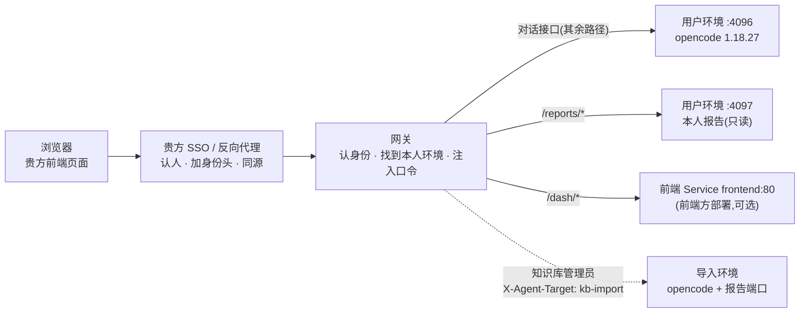

# 前端对接接口说明（v1.1）

本说明写给**前端方**：照着它，把本仓库构建出的后端镜像（`gaussdb-agent-gateway`、`gaussdb-agent-runtime`、
`gaussdb-agent-kb-import`）接进贵方自己的前端，不需要读后端源码。

| 项 | 值 |
|---|---|
| 接口版本 | **v1.1**（2026-10-26）。相对 v1（2026-10-25）只改了回答正文的写法：知识引用的颜色与出处格式（3.5）、回答版式（3.7）；接口、事件、报告字段都不变 |
| 绑定的后端 | 本仓库的网关与两个用户镜像；用户镜像里的 opencode **1.18.27**（对话接口由它提供） |
| 机器可读的部分 | `docs/api/opencode-1.18.27-openapi.json`（opencode 完整接口定义，从镜像里原样导出）<br>`docs/api/reports-contract.json`（报告字段契约，后端单测逐条核对） |
| 实测 | 第 2–5 章的每个接口与响应形状，2026-10-25 在测试集群（固定池化模式）上经网关实测过；示例里的 ID 与数字取自那次 |

> **约定用语**：「网关」= `gaussdb-agent-gateway`；「用户环境」= 网关按工号分给这个人的 runtime 容器（按需模式是一个 Pod，
> 固定池化是某个 Pod 里的一个槽位）；「导入环境」= 知识库管理员专用的 kb-import 容器。

---

## 0. 一页看懂



前端要用到的只有三组：

| 组 | 路径 | 谁提供 | 用来做什么 | 章节 |
|---|---|---|---|---|
| ① 对话接口 | 除 `/reports/`、`/dash/`、`/admin/`、`/healthz` 之外的路径 | opencode（经网关） | 会话、发消息、看回复、回答模型的提问、中止 | 2、3 |
| ② 报告接口 | `/reports/*` | 用户环境的报告端口（经网关） | 健康检查 / Top SQL / WDR / SQL 调优 / 知识库的结构化报告，做大盘 | 5、6 |
| ③ 大盘路由 | `/dash/*` | **前端方** | 回答里「打开报告」链接指向的页面 | 7 |

浏览器**永远不持有任何口令**：身份由贵方 SSO 认，网关在转发时注入用户环境的口令（第 1 章）。

---

## 1. 接入拓扑与身份

### 1.1 必须同源

前端页面与对话 / 报告接口要在**同一个源**（协议 + 域名 + 端口）下，原因有两条，都是实测：

- 网关不处理 `OPTIONS`（回 `501`），跨源请求的预检过不去；
- opencode 只给 `localhost` 来源回 `Access-Control-Allow-Origin`，别的来源一律不带。

做法：在贵方门户的反向代理上挂一个路径前缀（下例是 `/gs-agent/`），剥掉前缀后转给网关。对话接口与报告接口都是普通 HTTP，
挂在前缀下没有问题。跨源为什么不行、一定要跨源怎么办，见 9.1。

```nginx
# 贵方门户的反向代理(示意)。$sso_user / $sso_roles 换成贵方 SSO 认出的工号与角色
location /gs-agent/ {
    proxy_pass http://<网关地址>/;                # 末尾的 / 剥掉 /gs-agent 前缀
    proxy_http_version 1.1;
    proxy_set_header Connection "";
    proxy_set_header X-Agent-User  $sso_user;      # 覆盖客户端自带的同名头,防冒充
    proxy_set_header X-Agent-Roles $sso_roles;     # 可选,见 1.2
    proxy_set_header X-Agent-Trust "<信任凭据>";   # 与网关 Secret gateway-auth 的 TRUST_SECRET 相同
    proxy_buffering off;                           # 事件流(SSE)必须
    proxy_read_timeout 3600s;                      # 同步发消息可能几分钟才回,事件流长期挂着
    client_max_body_size 64m;                      # 与网关上限一致(带附件的消息)
}
```

> 前端页面本身也可以部署进本集群，由网关把 `/dash/*` 转给它（样例清单 `k8s/base/frontend.example.yaml`）。
> 这时对话、报告、页面天然同源，但**身份头仍要由贵方 SSO 加**——网关前面总要有一层认人的。

### 1.2 身份头（贵方 SSO 加，浏览器不加）

| 请求头 | 必需 | 说明 |
|---|---|---|
| `X-Agent-User` | 是 | 工号。头名可改（`gateway-config` 的 `USER_HEADER`）。网关转小写后校验：`^[a-z0-9]([a-z0-9-]{0,52}[a-z0-9])?$`，不合格回 403 |
| `X-Agent-Trust` | 二选一 | 信任凭据。网关凭它（或来源网段 `TRUST_CIDRS`）才相信上面那个工号。**只能由 SSO 加**，绝不能出现在浏览器里 |
| `X-Agent-Roles` | 否 | 角色，逗号分隔。含 `KB_ADMIN_ROLES`（默认 `kb-admin`）里的值即为知识库管理员；SSO 不传角色时，也可把工号登记在 ConfigMap `agent-roles` |

网关转发时会**去掉**客户端带来的 `Authorization`、`X-Agent-Trust`、`X-Agent-Target`，再注入用户环境的 Basic 口令。
所以前端不要（也不需要）自己带 `Authorization`，带了也会被丢掉。

### 1.3 诊断环境与导入环境

每个人都有诊断环境（runtime）；知识库管理员另有导入环境（kb-import，导入规范 / 工单 / 官方文档用）。两者的对话接口完全一样，
只是背后的容器不同。选哪个：

| 方式 | 写法 | 适用 |
|---|---|---|
| 请求头 | 每个请求带 `X-Agent-Target: kb-import` | 用 `fetch` 的单页应用。注意浏览器原生 `EventSource` 带不了自定义头：事件流要用 `fetch` 流式读，或改用下一种 |
| Cookie | 浏览器访问一次 `GET /kb-import` → 网关回 `303` 并设 `gsa_target=kb-import`（HttpOnly）；`GET /runtime` 清掉 | 页面级切换。`303` 的 `Location` 指向 opencode 自带网页，单页应用可以忽略跳转、只用它设 cookie |

不是管理员时：`GET /kb-import` 回 `403`（「您不是知识库管理员,没有导入容器。」）；带了请求头的请求按诊断环境处理。

### 1.4 网关自己的回答

下面这些响应**不是 opencode 回的**，前端要认得：

| 状态 | 内容类型 | 正文 | 什么时候 | 前端怎么办 |
|---|---|---|---|---|
| 403 | `text/plain` | 无法确认身份。请经统一认证入口访问。 | 没有身份头 / 信任凭据不对 / 工号不合格 | SSO 配置问题，提示联系管理员 |
| 503 | `text/plain` | 您的环境尚未开通,请联系管理员为您开通后再登录。 | 这个工号还没开通（缺中间件令牌等） | 提示联系管理员 |
| 503 | `text/plain` | 您的环境启动失败(…),等待不会好转,请联系管理员处理。 | 按需模式下环境起不来且不会自愈 | 提示联系管理员 |
| 504 | `text/plain` | 您的环境正在启动,请稍后重试。(… 秒内未就绪…) | 按需模式首次登录，等满 `READY_TIMEOUT_SECONDS`（默认 120）仍未就绪 | 稍后重试 |
| 502 | `text/plain` | 无法连接到您的环境,请稍后重试。 / 环境准备失败,请联系管理员。 | 环境不可达 | 稍后重试 |
| 413 | | | 请求体超过 64 MiB | 附件太大 |
| 503 | `application/json` | `{"reason": "not_active", "error": "…"}`，头 `Retry-After: 30` | **固定池化**：本人环境已转保留，而这个请求不唤醒环境（见 1.5） | 先发一个交互请求，再重试 |
| 503 | `application/json` | `{"reason": "waiting", "error": "当前使用人数已满,…"}`，头 `Retry-After` | 固定池化满员排队 / 正在分配 | 按 `Retry-After` 秒后重试，显示「排队中」 |
| 503 | `text/html` | 一张会自动刷新的等待页 | 同上两行，但请求是 `GET` 且 `Accept` 含 `text/html` | 单页应用的 `fetch` 一般不会遇到 |

### 1.5 环境的唤醒与闲置

后端有两种部署形态（运维决定，前端都要能应付）：

- **按需模式**：首次请求时网关现建这个人的环境，**请求会挂起直到就绪**（实测约 8 秒，上限 120 秒）；
  闲置 `IDLE_SECONDS`（默认 30 分钟）后环境被收起，下次请求再拉起，对话历史都在。
- **固定池化**：环境是池子里的一个槽位。闲置 `POOL_IDLE_SECONDS`（默认 30 分钟）后**转保留**（写回 NAS、停掉 opencode），
  有交互请求时 0–1 秒恢复。**只有「交互请求」会唤醒**，下面这些不会：
  - `GET /global/health`、`GET /api/health`、`GET /global/event`、`GET /event`；
  - 任何 `Accept: text/event-stream` 的请求。

  这是故意的：开着的页面每 10 秒探活、事件流一直挂着，若算作在用，环境永远不会闲置。

**所以前端要这样做**（两种模式下都对）：

1. 进入对话页时，**先发一个交互请求**（推荐 `GET /session`，顺便拿会话列表），再连事件流；
2. 事件流断开（转保留时网关会正常结束它）后，**不要立刻重连**：等用户下一次操作，先发交互请求，再重连；
3. 任何请求遇到 `503 not_active`：发一次 `GET /session` 唤醒，再重试原请求。

---

## 2. 对话接口：基本约定

- 都是 JSON（事件流除外）；请求带 `Content-Type: application/json`。
- ID 都有前缀：会话 `ses_`、消息 `msg_`、片段 `prt_`、提问 `que_`、权限请求 `per_`、事件 `evt_`。
- 时间是**毫秒**时间戳。
- **不需要** `directory` / `workspace` 查询参数：每个用户环境只有一个工作目录（`/data/state/workspace`），不带就是它。
- 模型、智能体（agent）、系统提示由平台配置，**前端不要传** `model`、`agent`、`system`、`tools`。
- 一个工号一套会话：会话存在本人 NAS 目录里，换浏览器、环境重建都还在。

### 2.1 支持的接口（v1 范围）

| # | 方法与路径 | 用途 | 成功响应 |
|---|---|---|---|
| 1 | `GET /global/health` | 用户环境是否健康（不唤醒，见 1.5） | `200 {"healthy": true, "version": "1.18.27"}` |
| 2 | `GET /session` | 会话列表（最近更新的在前） | `200 [Session]` |
| 3 | `POST /session` | 新建会话，body `{"title": "可选"}` | `200 Session` |
| 4 | `GET /session/{sessionID}` | 取一个会话 | `200 Session` |
| 5 | `PATCH /session/{sessionID}` | 改标题，body `{"title": "…"}` | `200 Session` |
| 6 | `DELETE /session/{sessionID}` | 删除会话 | `200 true` |
| 7 | `GET /session/status` | 各会话忙闲：`{"ses_…": {"type": "busy"}}`，空闲的不列 | `200 {…}` |
| 8 | `GET /session/{sessionID}/message` | 会话全部消息（历史），可选 `?limit=` | `200 [{info, parts}]` |
| 9 | `GET /session/{sessionID}/message/{messageID}` | 取一条消息 | `200 {info, parts}` |
| 10 | `POST /session/{sessionID}/prompt_async` | **发消息（推荐）**，立即返回，回复经事件流到达 | `204` |
| 11 | `POST /session/{sessionID}/message` | 发消息（同步），等整轮结束才返回 | `200 {info, parts}`（见 3.2） |
| 12 | `POST /session/{sessionID}/abort` | 中止正在进行的这一轮 | `200 true` |
| 13 | `GET /event` | 事件流（SSE） | `200 text/event-stream` |
| 14 | `GET /question` | 待回答的提问 | `200 [QuestionRequest]` |
| 15 | `POST /question/{requestID}/reply` | 回答提问，body `{"answers": [["选项的 label"]]}` | `200 true` |
| 16 | `POST /question/{requestID}/reject` | 拒绝回答这个提问 | `200 true` |
| 17 | `GET /permission` | 待批准的权限请求 | `200 [PermissionRequest]` |
| 18 | `POST /permission/{requestID}/reply` | 批准 / 拒绝，body `{"reply": "once" \| "always" \| "reject"}` | `200 true` |

第 17–18 条：当前平台配置的工具权限只有「放行 / 拒绝」两种，**不会产生权限请求**；实现它是为了以后配置变了也不卡住。

### 2.2 不在支持范围的接口

opencode 的接口远不止上表（完整清单见 `docs/api/opencode-1.18.27-openapi.json`）。**上表之外的一律不在 v1 范围**：
不保证跨版本不变，其中一部分还会绕过平台的工具权限（直接开终端、执行命令、读写文件、改配置）。前端不要调用它们：

| 类别 | 路径 |
|---|---|
| 终端与命令 | `/pty*`、`/session/{id}/shell`、`/session/{id}/command` |
| 文件与代码 | `/file*`、`/find*`、`/vcs*`、`/session/{id}/diff`、`/session/{id}/revert`、`/session/{id}/unrevert` |
| 配置与凭据 | `/config`、`/global/config`、`/auth/*`、`/provider*`、`/mcp*` |
| 进程控制 | `/global/dispose`、`/global/upgrade`、`/instance/dispose` |
| 其它 | `/tui/*`、`/sync/*`、`/experimental/*`、`/session/{id}/share`、`/session/{id}/fork`、`/session/{id}/init`、`/session/{id}/summarize`、`/api/*`（opencode 的 v2 预览接口） |

**建议贵方反向代理只放行 v1 范围**，其余回 404。可直接用的匹配规则（前缀按贵方实际改；已对上表逐条核对过）：

```
^/gs-agent/(global/health|event|session|session/status|session/ses_[A-Za-z0-9]+(/(message(/msg_[A-Za-z0-9]+)?|prompt_async|abort))?|question(/que_[A-Za-z0-9]+/(reply|reject))?|permission(/per_[A-Za-z0-9]+/reply)?|reports/.+|kb-import|runtime|dash(/.*)?)$
```

> 网关本身**不拦截**这些路径（opencode 自带网页要用其中一部分），见 9.2。

---

## 3. 对话接口：会话与消息

### 3.1 会话（Session）

`POST /session`，body `{"title": "接口说明实测"}`：

```json
{
  "id": "ses_e8c9cd495ffensckQ1zwIlt7pR",
  "slug": "playful-moon",
  "projectID": "f81dfda5ea74cf7d884f1cc0d49ef70c7e49a66a",
  "directory": "/data/state/workspace",
  "path": "",
  "title": "接口说明实测",
  "version": "1.18.27",
  "cost": 0,
  "tokens": {"input": 0, "output": 0, "reasoning": 0, "cache": {"read": 0, "write": 0}},
  "time": {"created": 1792937241450, "updated": 1792937241450}
}
```

前端用得到的字段：`id`、`title`（不传时 opencode 会在第一轮后自动起标题，经 `session.updated` 事件推来）、
`time.created` / `time.updated`、`parentID`（有值的是模型派生的子会话，会话列表里一般不显示）。

### 3.2 发消息

请求体（两个发消息接口相同）：

```json
{"parts": [
  {"type": "text", "text": "登录 10.0.0.9 的 postgres 库,然后做一次健康检查。"},
  {"type": "file", "mime": "image/png", "filename": "告警截图.png", "url": "data:image/png;base64,iVBORw0KGgo..."}
]}
```

- `text` 片段至少一个；`file` 片段可选，内容用 `data:` URL 内嵌（见 3.6）。
- **推荐 `prompt_async`**：立即回 `204`，回复经事件流逐字到达（第 4 章）；整轮结束的标志是该会话的 `session.idle` 事件。
- 同步的 `POST /session/{id}/message` 会一直挂到整轮结束（模型要跑诊断技能时常常几分钟）。它**只返回这一轮的最后一条助手消息**：
  一轮里模型每调一次工具就是一条新的助手消息（见 3.3），要完整展示仍需 `GET /session/{id}/message`。

### 3.3 消息结构

`GET /session/{id}/message` 返回按时间排列的数组，每项是 `{info, parts}`：

```json
[
  {"info": {"id": "msg_173632bb1001…", "sessionID": "ses_…", "role": "user",
            "time": {"created": 1792937241797}, "agent": "build",
            "model": {"providerID": "deepseek", "modelID": "deepseek-flash"}},
   "parts": [{"id": "prt_…", "sessionID": "ses_…", "messageID": "msg_…", "type": "text", "text": "只回答两个字:你好。"}]},
  {"info": {"id": "msg_1736d47e8001…", "sessionID": "ses_…", "role": "assistant", "parentID": "msg_1736d47e2001…",
            "finish": "stop", "time": {"created": 1792937904104, "completed": 1792937904826},
            "tokens": {"total": 16948, "input": 178, "output": 2, "reasoning": 0, "cache": {"read": 16768, "write": 0}},
            "cost": 0.000078204, "modelID": "deepseek-flash", "providerID": "deepseek", "agent": "build", "mode": "build"},
   "parts": [{"type": "step-start"}, {"type": "text", "text": "你好"}, {"type": "step-finish", "reason": "stop"}]}
]
```

**一轮对话 = 1 条用户消息 + N 条助手消息**。模型每走一步（想 → 调工具 → 拿结果）就产生一条助手消息，它们的 `parentID` 都指向那条用户消息；
最后一条的 `finish` 是 `"stop"`，中间的是 `"tool-calls"`。实测「用知识库查一下有没有锁等待相关的处置手册」：

| 消息 | `finish` | 片段 |
|---|---|---|
| 用户 | | `text` |
| 助手 1 | `tool-calls` | `step-start`、`reasoning`、`tool`（`skill`）、`step-finish` |
| 助手 2 | `tool-calls` | `step-start`、`reasoning`、`tool`（`bash`）、`step-finish` |
| 助手 3 | `stop` | `step-start`、`reasoning`、`text`（结论）、`step-finish` |

复杂一些的诊断一轮有十几条助手消息。

助手消息的 `info` 里前端要看的：

| 字段 | 含义 |
|---|---|
| `time.completed` | 有值 = 这条已写完 |
| `finish` | `stop`（本轮结束）/ `tool-calls`（还要继续）/ 其它 |
| `error` | 出错时有值，`{"name": "...", "data": {"message": "..."}}`。常见 `name`：`MessageAbortedError`（被中止）、`APIError`（模型服务报错）、`ProviderAuthError`（模型 Key 不对）、`MessageOutputLengthError`、`ContextOverflowError` |
| `tokens` / `cost` | 用量，可不显示 |

### 3.4 片段（parts）与怎么显示

| `type` | 内容 | 怎么显示 |
|---|---|---|
| `text` | `text`：Markdown 正文 | **主内容**，按 3.5 渲染 |
| `reasoning` | `text`：模型的思考过程 | 可折叠显示，或不显示 |
| `tool` | 一次工具调用：`tool`（工具名）、`callID`、`state` | 显示成一行进度（见下） |
| `file` | 附件：`mime`、`filename`、`url`（`data:` URL） | 用户消息里显示缩略图 / 文件名 |
| `step-start` / `step-finish` | 步骤边界；`step-finish` 带 `reason`、`tokens`、`cost` | 不显示 |
| 其它（`subtask`、`snapshot`、`patch`、`agent`、`retry`、`compaction`） | | 不显示即可 |

`tool` 片段的 `state` 有四种（`state.status`）：

| `status` | 其余字段 | 显示 |
|---|---|---|
| `pending` | `input`（可能还是空对象）、`raw` | 「准备调用 …」 |
| `running` | `input`、`title`（如有）、`time.start` | 「正在执行：{title}」 |
| `completed` | `input`、`output`（文本）、`title`、`time.start/end` | 「已完成：{title}」，`output` 可折叠展开 |
| `error` | `input`、`error`（文本）、`time` | 「失败：{error}」 |

工具名（`tool`）常见的：`skill`（加载诊断技能）、`bash`（执行技能脚本）、`read`、`glob`、`grep`、`list`、`question`（向用户提问，见 4.3）、
`todowrite`。诊断过程主要是 `skill` + 若干 `bash`；**用户关心的结论都在 `text` 片段里**，工具输出只是过程。

### 3.5 正文渲染要求

`text` 片段是 Markdown，渲染器要支持：

1. **GFM**：表格、代码块、列表、粗体、引用。诊断报告大量使用表格。
2. **上色 = 出自知识库**（v1.1 起两种颜色）：回答里出自知识库的句子包在 `font` 标签里，句后紧跟括号注明出处（括号不上色）。
   颜色按「是谁说的」分，让用户一眼分清「本单位自己的口径」和「产品官方说法」，**必须按颜色渲染**：

   | 标签 | 含义 | 编号前缀 |
   |---|---|---|
   | `<font color=#2f6fdb>…</font>`（蓝） | 本单位自己的知识：规范、案例、手册、缺陷、基线、画像、Wiki | `GS-` 规范、`S1`–`S4-` 案例、`RB-` 手册、`KD-` 缺陷、`BL-` 基线、`EP-` 画像、`WK-` Wiki |
   | `<font color=#0f7c86>…</font>`（青） | 产品文档：官方文档集与导入的产品文档 | `PD-<代号>-NNNNN` 官方文档集、`PD-NNNN` 导入的产品文档 |

   原文形如（条目取自样例知识库）：

   ```markdown
   - <font color=#2f6fdb>应用连接池归还连接时未提交事务，会话 idle in transaction 持锁</font>(引用自本行案例库 S2-20250120-CBST-空闲事务持锁阻塞)
   处置时 <font color=#2f6fdb>阻塞链只处理根会话，超过 10 分钟未解除，值班经理审批后才可在数据库侧终止</font>(引用自处置手册库 RB-LCK-001)。
   <font color=#0f7c86>lockwait_timeout 默认 20 分钟</font>(引用自 GaussDB 官方文档库 PD-G25132C-01481)
   ```

   - 安全：正文里的 HTML **只放行 `font` 这一个标签、只放行 `color` 这一个属性**（值匹配 `^#[0-9a-fA-F]{6}$`），其它 HTML 一律转义；
   - 一个 `font` 标签只包一句、一个列表项或一个表格单元格，不跨段落；
   - 括号里的「引用自 xxx 库 编号」，编号就是知识库条目 ID，可以做成链接，打开大盘知识库页的对应条目（第 6.6 节的条目接口）；
   - v1 的写法是把编号写成〔类型 ID〕并整句包进蓝色标签；升级到 v1.1 的后端后不再出现，前端不需要两种都认。
3. **「打开报告」链接**：形如 `[打开报告](/dash/health?inst=…&run=…)`，指向大盘页面，见第 7 章。
4. **复制**：用户复制回答到工单时，建议复制渲染后的纯文本（不带 `<font>` 标签）。

### 3.7 回答版式（v1.1，只读说明）

后端按问题类型固定了回答的结构，前端**不需要解析**，原样按 Markdown 渲染即可；这里列出来是为了贵方做样式（例如给段标题加锚点）时心里有数：

| 问题类型 | 回答的结构 |
|---|---|
| 健康检查、参数体检 | 总体状态 → 短结论 → ① 现象 → ② 根因和证据链 → ③ 解决方案（P0 / P1 / P2）→ ④ 总结和结论 |
| 故障排查（报一个现象或告警） | 总体状态 → 短结论 → ① 现象（含关联现象）→ ② 根因 → ③ 解决方案 → ④ 总结 |
| SQL 优化 | 验证状态 → 短结论 → ① 现状与趋势 → ② SQL 文本和执行计划解读 → ③ 怎么优化（前后对比）→ ④ 总结 |
| 知识问答 | 第一行「解答来源：…」→ ① 解答正文 → ② 举例说明 → ③ 引申和拓展 |
| WDR 解读 | 评估窗口 → 总体状态 → 短结论 → ① 负载画像 → ② 问题与元凶 → ③ 解决方案 → ④ 总结和结论 → 附录 |
| Top SQL、慢 SQL | 短结论 → ① 榜单 → ② 为什么排上来 → ③ 建议下一步 |

各段一般先写「应用视角：」再写「数据库机制：」；回答最后通常是一到三个「需要就 … 吗？」的问句，前端可以做成快捷回复按钮（点了就把这句话作为用户消息发出）。

### 3.6 附件

- 用 `file` 片段内嵌：`{"type": "file", "mime": "...", "filename": "...", "url": "data:<mime>;base64,<内容>"}`；整条消息（含附件）不超过 64 MiB。
- 附件随消息存进会话、交给模型，**不会落成用户环境里的文件**：
  - 文本类（`text/plain`、`text/markdown`、`text/csv`）：模型直接读到内容；
  - 图片：只有模型服务支持图片、且平台配置了 `MODEL_INPUT_MODALITIES` 含 `image` 时模型才看得到，否则模型会说看不了；
  - PDF、Word 等：当前模型读不了（实测模型回答「不支持读取 PDF 内容」）。
- **知识库导入的文档**（规范、工单、官方文档 CHM、照片）要落在 NAS 上的收件目录 `kb/inbox/uploads/`（导入环境里是 `/nas/kb/inbox/uploads`），
  模型才能用导入技能处理。**后端 v1 不提供上传接口**，贵方的处理方式见 9.3。

---

## 4. 对话接口：事件流与交互

### 4.1 事件流 `GET /event`

标准 SSE：每个事件一行 `data: <JSON>`，空行分隔。连上后先收到 `server.connected`，之后每 10 秒一个 `server.heartbeat`（实测间隔 10.0 秒）。
响应头带 `x-accel-buffering: no`、`Cache-Control: no-cache, no-transform`；**代理链上任何一层都不能缓冲**（1.1 的 `proxy_buffering off`）。

每个事件的外形：`{"id": "evt_…", "type": "<类型>", "properties": {…}}`。事件流是**这个用户环境全部会话**的，按 `properties.sessionID` 过滤。

| `type` | `properties` | 前端怎么用 |
|---|---|---|
| `server.connected` | `{}` | 连上了 |
| `server.heartbeat` | `{}` | 心跳，忽略 |
| `session.created` / `session.updated` / `session.deleted` | `sessionID`、`info`（Session） | 刷新会话列表（标题自动生成后经 `session.updated` 推来） |
| `session.status` | `sessionID`、`status`：`{"type": "busy"}` / `{"type": "idle"}` / `{"type": "retry", "attempt", "message", "next"}` | 显示「正在回答」/「重试中」 |
| `session.idle` | `sessionID` | **这一轮结束**：停止转圈，必要时拉一次历史对齐 |
| `session.error` | `sessionID`、`error`（同 3.3 的 `error`） | 显示错误；中止时 `name` 是 `MessageAbortedError` |
| `message.updated` | `sessionID`、`info`（消息 info） | 新消息出现 / 消息完成（`time.completed`、`finish`、`error`） |
| `message.part.updated` | `sessionID`、`part`（完整片段）、`time` | 片段的**完整快照**：新片段出现、工具状态变化、片段写完 |
| `message.part.delta` | `sessionID`、`messageID`、`partID`、`field`（`"text"`）、`delta` | **逐字追加**：把 `delta` 接到该片段的 `field` 上（打字机效果） |
| `message.removed` / `message.part.removed` | `sessionID`、`messageID`（、`partID`） | 删掉对应显示 |
| `question.asked` | `QuestionRequest`（见 4.3） | 弹出选择 |
| `question.replied` / `question.rejected` | `sessionID`、`requestID`（、`answers`） | 关闭选择框 |
| `permission.asked` / `permission.replied` | 见 2.1 第 17–18 条 | 当前不会出现 |
| `todo.updated` | `sessionID`、`todos` | 可选：显示模型的任务清单 |

其余类型（`plugin.added`、`catalog.updated`、`session.diff`、`file.*`、`lsp.*`、`pty.*`、`tui.*`、`session.next.*` 等）**忽略**。

**拼一条回复**：以 `message.part.updated` 的快照为准，期间用 `message.part.delta` 追加；快照到了就用快照覆盖。
`session.idle` 之后，用 `GET /session/{id}/message` 拉一次与本地对齐最稳。

一次「只回答两个字:你好」的实测事件序列（只列本会话、略去应忽略的类型；同一类型会重复出现，前端按「后到覆盖先到」处理即可）：

```
session.updated → message.updated(user) → message.part.updated(text: 用户原文) → session.updated
→ session.status(busy) → message.updated(assistant) → session.status(busy) → session.updated → message.updated(user)
→ message.part.updated(step-start) → message.part.updated(text: 空) → message.part.delta("你好") → message.part.updated(text: "你好")
→ message.part.updated(step-finish) → message.updated(assistant, 已完成) ×2 → session.status(busy)
→ session.status(idle) → session.idle → session.updated → message.updated(user)
```

### 4.2 断线与重连

- 网关不给事件流设读超时，但贵方代理、浏览器、网络都可能断。断了按 1.5 的顺序：先交互请求，再重连。
- 重连期间漏掉的事件不会补发：重连后对当前打开的会话 `GET /session/{id}/message` 一次，再继续收事件。
- 固定池化下环境转保留时，事件流会被网关**正常结束**（不是报错）——这时不必提示用户。

### 4.3 模型向用户提问（question）

技能需要用户在几个选项里选时，模型会调用 `question` 工具。这一轮会**停在那里等回答**（会话保持 busy）：

```json
{"id": "evt_1736e67e1001dMskQGj0YlL0p7",
 "type": "question.asked",
 "properties": {
   "id": "que_1736e67e0001E2cS1OJN6q53OI",
   "sessionID": "ses_e8c92b83ffferBQut3y36Isefe",
   "questions": [
     {"question": "导入顺序选哪个?", "header": "导入顺序",
      "options": [{"label": "先画像", "description": "先建立实例画像,再导入规范,便于后续诊断对照。"},
                  {"label": "先规范", "description": "先导入规范条款,再补画像,规范先行。"}]}
   ],
   "tool": {"messageID": "msg_1736e5dbf001B9a6zVcBNHZIw4", "callID": "call_00_7vMj98neuiIT6GnLtNMy7296"}}}
```

- 回答：`POST /question/{id}/reply`，body `{"answers": [["先画像"]]}` → `200 true`——**按问题顺序**每题一个数组，元素是选中项的 `label`
  （`multiple: true` 时可多个）。实测回答后模型接着回复「你选择的是：先画像。」；
- 题目带 `custom: true` 时允许用户自填文字，把文字放进该题的数组；
- 不想回答：`POST /question/{id}/reject`；
- 页面刷新后用 `GET /question` 找回还没回答的提问。

> 大多数技能用对话里的**编号清单**让用户确认（例如知识库导入的「选择列表」），用户直接在输入框回编号即可，不经过这个工具。

### 4.4 中止

`POST /session/{id}/abort` → `200 true`。随后收到 `session.error`（`name: MessageAbortedError`）与 `session.idle`；
最后那条助手消息的 `info.error` 也是这个。界面上显示「已中止」，不算错误。

---

## 5. 报告接口：基本约定

技能每跑完一次健康检查、Top SQL、WDR、SQL 调优、知识库状态，就把结构化结果存进**本人**的报告目录。前端经 `/reports/` 读它做大盘。

- 只有 `GET`；都是 `application/json`（`queries.jsonl` 是 `application/x-ndjson`，WDR 原生报告是 `text/html`），`Cache-Control: no-store`；
- **只能读到本人的**：网关按身份头把请求路由到本人环境；路径里没有工号；
- 文件不存在回 `404`（空正文）；
- 报告接口也是交互请求：固定池化下读报告会唤醒环境；
- 知识库管理员带 `X-Agent-Target: kb-import` 时读到的是导入环境的报告目录（只有 `kb/` 有内容）。前端做大盘时**不要带**这个头。

### 5.1 路径一览

| 路径 | 内容 |
|---|---|
| `/reports/whoami.json` | `{"user_id": "u0001"}`：当前工号（由平台注入，用户改不了） |
| `/reports/{技能}/targets.json` | 这个人对哪些实例跑过这个技能（切换实例用） |
| `/reports/{技能}/{实例键}/latest.json` | 这个实例最近一份「此刻」报告 |
| `/reports/{技能}/{实例键}/index.json` | 这个实例的历史报告索引（最多 50 份，旧的自动删） |
| `/reports/{技能}/{实例键}/{文件名}` | 某一份报告（文件名来自 `index.json` 的 `file`，或链接里的 `run=`） |
| `/reports/wdr/{实例键}/{时间戳}.native.html` | WDR 原生 HTML 报告（`latest.json` 的 `native` 字段给出文件名） |
| `/reports/sqltune/{实例键}/{sql_id}.json` | 某条 SQL 的调优证据 |
| `/reports/kb/health.json` | 知识库状态（全体共享一份，不分实例） |
| `/reports/kb/queries.jsonl` | 知识库检索记录，一行一条 |
| `/reports/_kb/catalog.json` | 知识库目录（条目、案例、关系边、专题），现读现算 |
| `/reports/_kb/outline.json` | 知识库「目录」：L0 总览 + L1 专题（含官方文档集原书目录） |
| `/reports/_kb/list.json?docset=&path=&topic=&offset=0&limit=100` | 按专题 / 原书章节分页列条目（`limit` 最大 200） |
| `/reports/_kb/item/{ID}.json` | L2：一条知识的全文（按小节） |
| `/reports/_kb/evidence/{ID}.json` | L3：原始证据。官方文档给原页正文；**客户条目只给出处位置，不给原件** |

`{技能}` 目前是 `health`、`topsql`、`wdr`、`sqltune`、`config`（参数核查，大盘可不做）；知识库是 `kb`。

### 5.2 实例键与文件名

- **实例键** = 连接名把 `[A-Za-z0-9._-]` 以外的字符换成 `_`。例：连接 `api/10-0-0-9-postgres` → 实例键 `api_10-0-0-9-postgres`。
  `targets.json` 里每项给出 `key`（实例键）、`conn`（连接名）、`label`（给人看的实例名，如 `10.0.0.9 / postgres`）、
  `login`（一句登录说法，如 `登录 10.0.0.9 的 postgres 库`，做「深挖」时放进提示词开头）、`last_at`、`count`。
- **文件名**（时间戳是 UTC，形如 `20261024T115827Z`）：

| 技能 | 文件名 | 说明 |
|---|---|---|
| health | `{时间戳}.json` | 此刻巡检，同时写进 `latest.json` |
| health | `{时间戳}.span.json` | 时段体检（评估某个历史时间段），**不**覆盖 `latest.json` |
| topsql | `{时间戳}.{维度}.json` | 累计榜；`latest.json` 是最近一份（任意维度） |
| topsql | `{时间戳}.{维度}.span.json` / `.delta.json` | 时段榜 / 增量榜，不覆盖 `latest.json` |
| wdr | `{时间戳}.json`、`{时间戳}.native.html` | 评估窗口的结构化结果与原生报告 |
| sqltune | `{sql_id}.json` | 每条 SQL 一份，重跑覆盖 |
| kb | `health.json` | 只有一份 |

Top SQL 的「维度」：`time`（耗时）、`avg`（平均耗时）、`calls`（调用次数）、`reads`（读块数）、`rows`（返回行数）、
`self`（自身耗时 CPU+IO）、`self_avg`（平均自身耗时）。

---

## 6. 报告接口：各报告的字段

**字段以 `docs/api/reports-contract.json` 为准**：那里逐条列出前端可以依赖的字段路径（`a.b[].c` = `b` 是列表、每个元素都有 `c`；
末尾 `?` = 可能没有）。后端单测用真实的报告代码生成样例逐条核对，后端删改这些字段测试就会失败——这就是「固定版本」的保证。
前端要用契约里没有的字段，先提出来、加进契约，再用。

**样例数据**：`python3 scripts/dash-samples.py <目录>`（需要 Python 3.8+ 与 PyYAML）用后端真实的报告代码生成一整套样例，
目录布局就是 `/reports/` 的布局，用任何静态服务器端出来即可在不连集群的情况下开发大盘。

### 6.1 通用：严重级别

`overall`、`findings[].severity` 是整数：`0` 健康、`1` 关注、`2` 告警、`3` 严重。`index.json` 里的 `counts` 是 `{"级别": 条数}`。

### 6.2 健康检查 `health`

- 顶层：`conn`、`overall`、`dims[]`（各维度）、`findings[]`（发现）、`sub_skills[]`（子技能是否跑成）、`uncovered_capabilities`、`kb_refs`（客户知识库参照）。
- `dims[]`：`dimension`（维度名，英文常量）、`available`、`headline`（一句话）、`headers` + `rows`（表格）、`note`。
  维度名（此刻巡检）：`Overview`、`Wait Events`、`Slow SQL`、`Long & Idle Transactions`、`Dead Tuples & Bloat`、
  `Lightweight Locks (LWLock)`、`Transaction Locks & Blocking Chains`、`Connections`、`Checkpoint / WAL / Archiving`、
  `Replication / Standby`、`Schema / Objects`、`Transactions / Concurrency`、`Storage Usage`；
  时段体检另有：`Evaluation Window`、`Window Load`、`Window Transactions`、`Window IO / Temp / Checkpoint`、`Window Waits`、`Window Top SQL`。
  中文显示名由前端自定。
- `findings[]`：`severity`、`dimension`、`code`（发现代码，如 `SLOW_AVG_MS`）、`metric`、`value`、`threshold`、`evidence`、`sql_id`。

```json
{"dimension": "Slow SQL", "code": "SLOW_AVG_MS", "severity": 2, "metric": "avg_ms",
 "value": "8,412", "threshold": "> 1,000", "evidence": "sql_id 1a9f · 214 次", "sql_id": "1a9f"}
```

- `index.json` 每项：`at`、`file`、`overall`、`counts`、`dims`（`{"total", "na"}`），时段体检另有窗口摘要。

### 6.3 Top SQL `topsql`

顶层 `conn`、`by`（维度）、`limit`、`rows[]`；`rows[]`：`sql_id`、`query`、`calls`、`total_sec`、`avg_ms`、`rows`，以及可选的 `cpu_sec`、`io_sec`、`self_sec`。

### 6.4 WDR `wdr`

顶层 `conn`、`overall`、`window`（`begin_id`、`end_id`、`begin_ts`、`end_ts`、`duration_min`、`scope`、`node`、`wdr_enabled`）、`dims[]`、`findings[]`、
`native`（原生 HTML 报告的文件名）、`sql_texts`、`sql_plans`。维度名：`Load Profile`、`Database Stat`、`Top SQL`、`Wait Events / Classes`、
`Checkpoint / BgWriter / Redo`、`Cache / Memory`、`File IO`。`index.json` 每项另有 `window`、`db_time_s`。

### 6.5 SQL 调优 `sqltune`

`{sql_id}.json`：`conn`、`sql_id`、`original_sql`、`schema`、`source`、`substitution`、`evidence`。
系统 SQL（数据库自己的语句）不调优：这时文件只有 `conn`、`sql_id`、`skipped`、`system_objects`。

### 6.6 知识库 `kb` 与 `_kb`

- `kb/health.json`：`status`（`attached` 是否接入、`mode`、`vector`、`graph`、`counts`、`l0`）、`types`（八类各多少）、`docsets`（官方文档集）、
  `index_state`、`pending`、`misses`（查不到的高频问题）、`file_warnings`、`readonly`、`inbox`。
- `kb/queries.jsonl` 每行：`at`、`q`、`key`、`hits_cases`、`hits_rules`、`how`、`elapsed_ms`。
- 知识类型（八类，`types` 的键）与显示名：`norm` 规范、`case` 案例、`profile` 画像、`baseline` 基线、`defect` 缺陷、`runbook` 手册、
  `product` 产品文档、`wiki` Wiki；另有 `errata` 修正、`guide` 指南（待分类）。
- **渐进式披露**的四层接口（做「目录」浏览）：

| 层 | 接口 | 关键字段 |
|---|---|---|
| L0 + L1 | `_kb/outline.json` | `attached`、`types`、`official`（官方文档条数）、`profiles`（环境画像）、`topics[]`（专题：`slug`、`name`、`causes`、`entries`、`official`…）、`docsets[]`（官方文档集：`code`、`items`、`toc` 原书目录） |
| L1 下钻 | `_kb/list.json` | `total`、`offset`、`limit`、`items[]`（`id`、`type`、`title`、`summary`、`category`、`path`） |
| L2 | `_kb/item/{ID}.json` | `id`、`type`、`title`、`summary`、`sections[]`（`name` + 正文）、`source`、适用产品与版本等 |
| L3 | `_kb/evidence/{ID}.json` | 官方文档：`kind: "page"`、`text`（原页正文）；客户条目：`kind: "refs"`、`refs`（出处位置）、`note` |

各接口的完整字段见契约文件的 `kb_*` 段。ID 只在目录里查，不认识的 ID 回 `404`。

---

## 7. 大盘路由 `/dash/*`（前端方提供）

技能存档成功后，模型会在回答末尾附一个 Markdown 链接「打开报告」。链接是**固定格式**，前端要能打开它们：

| 链接 | 页面应当显示 |
|---|---|
| `/dash/health?inst={实例键}&run={文件名}` | 健康检查：这个实例的这一份报告 |
| `/dash/health?inst=…&run={时间戳}.span.json&from=…&to=…` | 健康检查：一份时段体检，**界面已筛在 from–to 上** |
| `/dash/topsql?inst={实例键}&by={维度}` | Top SQL：这个维度最近一份累计榜 |
| `/dash/topsql?inst=…&run={时间戳}.{维度}.span.json&by=…&from=…&to=…` | Top SQL：一份时段 / 增量榜 |
| `/dash/wdr?inst={实例键}&run={文件名}[&from=…&to=…]` | WDR：这一份分析 |
| `/dash/kb` | 知识库总览 |

- `from` / `to` 是本地时间，形如 `2026-10-17T10:46`；
- 页面按 `inst` 读 `/reports/{技能}/{inst}/…`，按 `run` 读那一份文件；没有 `run` 时读 `latest.json`（Top SQL 按 `by` 在 `index.json` 里找最近一份）；
- **链接的站点前缀**：默认是根相对地址（`/dash/...`），适用于大盘与对话页同源、`/dash/` 由网关转给前端 Service 的部署。
  大盘在别处（贵方门户）时，运维在 `agent-config` 里设 `GSDB_DASH_BASE_URL`（如 `https://portal.example.com/gs-agent`），
  链接就变成 `https://portal.example.com/gs-agent/dash/health?...`。路径与参数不变；
- 对话页渲染 Markdown 时，建议拦截 `/dash/` 开头的链接，在单页应用内跳转。

**深挖**（可选）：大盘上想「在会话里追问这份报告」时，`POST /session` 新建会话，再 `prompt_async` 一句提示词。
提示词开头放 `targets.json` 的 `login`（让模型先登录那个库），并写明报告的时间（`index.json` 的 `at`，有窗口的写窗口）——
否则模型会去取**现在**的数据，而用户看的是几天前的报告。

---

## 8. 运维接口（不给浏览器）

| 路径 | 用途 |
|---|---|
| `GET /healthz` | 网关存活探针，不鉴权：`{"ok": true, "version": "gaussdb-agent-gateway"}` |
| `/admin/pods`、`/admin/pods/{工号}`、`/admin/pool` | 运维与贵方调度器用，请求头 `X-Admin-Token`（Secret `gateway-auth` 的 `ADMIN_TOKEN`）；未配置时整组回 `404` |

这一组**不要**经贵方门户暴露给浏览器。用法见《从源码构建到 K8s 运行》。

---

## 9. 已知限制与贵方的处理方式

后端 v1 **不提供**下面三样。都不影响对接，按每节的「贵方怎么做」处理即可。

### 9.1 不支持跨源：页面与接口必须同源

| | |
|---|---|
| 现状 | 网关不处理 `OPTIONS`（回 `501`）；opencode 只给 `localhost` 来源回 `Access-Control-Allow-Origin`。浏览器从别的源调对话 / 报告接口，预检就被拦下 |
| 贵方怎么做 | ① 在门户的反向代理上挂一个路径前缀转给网关（1.1 的 nginx 示例），页面与接口同源 —— **推荐**；② 或把前端部署进本集群，由网关把 `/dash/*` 转给它（`k8s/base/frontend.example.yaml`），天然同源 |
| 一定要跨源时 | 只能由贵方反向代理自己应答 `OPTIONS`、加 CORS 头（`Access-Control-Allow-Origin` 写死贵方门户的源，不能用 `*`；`Allow-Headers` 含 `Content-Type`、`X-Agent-Target`）。这条路后端不做验证、不做保证 |

### 9.2 网关不限制接口路径

| | |
|---|---|
| 现状 | 网关只认身份、把请求转给**本人**的环境，不按路径过滤。opencode 的全部接口（2.2 的「不在支持范围」那张表，含终端、执行命令、读写文件、改配置）经网关都能调到 |
| 影响范围 | 只限「本人对本人的环境」：看不到别人的会话与数据（网关按工号路由），拿不到凭据（中间件令牌、签名私钥、模型 Key 只在凭据代理里）。但能绕过平台对模型工具的权限约束（例如直接开终端） |
| 贵方怎么做 | 在反向代理上**只放行 v1 范围**（2.2 的匹配规则，已逐条核对），其余回 404。opencode 自带网页要用的路径更多：保留它作后备 / 排障入口的话，给它单独的入口并只开放给运维人员 |

### 9.3 没有文档上传接口

| | |
|---|---|
| 现状 | 知识库导入的文档（规范、工单、官方文档 CHM、照片）必须是**导入环境里的文件**，放在 NAS 的收件目录 `kb/inbox/uploads/`（导入环境里是 `/nas/kb/inbox/uploads/`）。消息附件（3.6）只进会话、不落成文件，导入技能用不了 |
| 贵方怎么做（任选） | ① **贵方上传服务挂同一个 NAS**，把文件写进 `<NAS 导出路径>/kb/inbox/uploads/`：文件要让 uid 1000 读得到（属主 `1000:1000`，或权限 `644`）；文件名只用文件自己的名字、不带目录，同名会覆盖（可加日期前缀）。写完在导入环境的对话里说「导入 /nas/kb/inbox/uploads/<文件名>」<br>② **运维用 kubectl 拷进去**：`kubectl -n gaussdb-agent cp <本地文件> <导入容器 Pod>:/nas/kb/inbox/uploads/<文件名> -c opencode`，Pod 名用 `kubectl -n gaussdb-agent get pod -l role=kb-import,user=<工号>` 查（管理员先登录一次导入环境，Pod 才在）<br>③ **纯文本材料**（md / txt / csv）直接贴进对话，模型写到收件目录再导入（以贴入的内容为准） |
| 用户给的是本机路径时 | 用户在对话里说「导入 D:\\…」或「/Users/…」这类自己电脑上的路径，模型会说明文件不在环境里、给出收件目录 —— 这是预期行为，前端提示用户先按上面的方式上传 |

---

## 10. 版本与变更规则

- **v1 的范围** = 第 2.1 节的接口 + 第 4 章的事件 + 第 5–6 章的报告路径与契约字段 + 第 7 章的链接格式 + 第 1 章的身份与网关行为。
- 后端升级 opencode 版本时，先在新版本上重跑本说明的实测（第 11 章的清单），有不兼容就升接口版本（v2）并写明差异；
  同一个接口版本内只做**向后兼容**的改动（加字段、加事件类型）。前端对不认识的字段与事件类型一律忽略。
- 报告字段的增删以 `docs/api/reports-contract.json` 为准，改契约与改代码在同一个提交里。
- 后端 v1 不提供的三样（跨源访问、网关层接口白名单、文档上传接口）及贵方的处理方式见第 9 章。
- **v1.1**（2026-10-26）：只改回答正文的写法（第 3.5 节两种颜色与出处括号、第 3.7 节回答版式），属于向后兼容的改动，接口范围仍是上面的 v1 范围。

---

## 11. 联调自测清单

在测试环境用本仓库的模拟 SSO（`k8s/tools/sso-sim.py`，站在 SSO 的位置上加身份头）即可不接贵方 SSO 先联调：

```bash
kubectl -n gaussdb-agent port-forward svc/gateway 18089:80 &
python3 k8s/tools/sso-sim.py 18090 18089 <工号> ~/.agent-trust &      # 之后用 http://127.0.0.1:18090 当网关
B=http://127.0.0.1:18090
curl -s $B/session > /dev/null                                           # 交互请求:唤醒 / 创建本人环境
SID=$(curl -s -H 'Content-Type: application/json' -d '{"title":"联调"}' $B/session | python3 -c 'import json,sys;print(json.load(sys.stdin)["id"])')
curl -sN $B/event &                                                      # 事件流
curl -s -o /dev/null -w '%{http_code}\n' -H 'Content-Type: application/json' \
     -d '{"parts":[{"type":"text","text":"只回答两个字:你好。"}]}' $B/session/$SID/prompt_async   # 204
curl -s $B/session/$SID/message                                          # 历史
curl -s $B/reports/whoami.json                                           # {"user_id": "<工号>"}
curl -s -X DELETE $B/session/$SID                                        # true
```

前端上线前逐项过一遍：

- [ ] 进入对话页先发交互请求，再连事件流；`503 not_active` 能自动唤醒重试；`503 waiting` 显示排队并按 `Retry-After` 重试；
- [ ] 打字机效果（`message.part.delta`）与快照（`message.part.updated`）对得上；`session.idle` 后停止转圈；
- [ ] 一轮多条助手消息都显示出来；工具调用显示成进度行；
- [ ] `<font color=#2f6fdb>` 渲染成蓝色、`<font color=#0f7c86>` 渲染成青色，其它 HTML 被转义；表格、代码块正常；
- [ ] 「打开报告」链接能打开对应大盘页面（含 `run`、`by`、`from`/`to`）；
- [ ] 模型提问（`question.asked`）能选、能拒绝，刷新页面后能从 `GET /question` 找回；
- [ ] 中止后显示「已中止」；
- [ ] 知识库管理员能切到导入环境、切回；非管理员切换得到 403 提示；
- [ ] 反向代理只放行 v1 范围；不缓冲事件流；读超时不小于 1 小时；请求体上限 64 MiB；
- [ ] 浏览器的任何请求里都没有 `X-Agent-Trust`。
